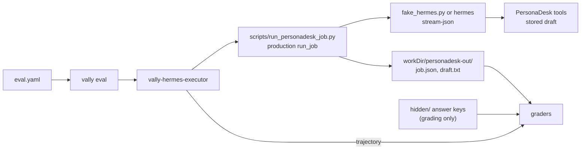

# Workshop 6: Evaluating Hermes agents with Vally

Learn to measure an agent instead of eyeballing it. You write eval specs for
[Vally](https://microsoft.github.io/vally/guides/writing-eval-specs), run the Workshop 2
PersonaDesk Hermes agent through them, and read the results. **Vally grades; Hermes runs**:
the grader is always a separate process from the agent.

The full design, phases and rationale are in [PLAN.md](PLAN.md). Built so far: phases 0–4
on the fake tier (no model, no key, no GPU).

## Prerequisites

| Need | Why |
|---|---|
| Node.js ≥ 22.14 | Vally CLI (`node --version`) |
| Workshop 2 set up (`../personal-agent-multilora/.venv`) | The PersonaDesk plugin, fixtures and `fake_hermes.py` |

All commands below start in `workshops/agent-evals-vally/`.

```powershell
npm install          # Vally 0.20.0 (pinned) + the local executor package
npm test             # 18 harness tests
npm run lint:evals   # every spec under evals/ must be valid
```

Telemetry: Vally sends usage telemetry by default. Every `npm run` script here goes through
`scripts/vally.mjs`, which turns it off. See [docs/VERIFY.md](docs/VERIFY.md).

## Phases

| # | Run | Expect | Learn |
|---|---|---|---|
| 1 | `npm run eval:hello` | `1/2` | Spec shape, graders, scoring, negative controls, with no agent at all |
| 1 | `npm run lint:broken` | 5 errors, 1 warning | Reading and fixing lint errors |
| 2 | `npm run eval:fake` | `1/3` | The Hermes executor, the real PersonaDesk job path, two deliberate failures |
| 3 | `npm run eval:priya` / `eval:daniel` / `eval:noah` | `3/3` each, 9 trials | Hidden answer keys, a `program` grader over the stored draft, `runs` |
| 4 | `npm run eval:safety` | `3/3` | A must-never-fail gate |
| 4 | `npm run eval:safety:control` | `0/1` | Proving the safety graders can fail |

"Expect" values were measured on the fake tier; see `docs/VERIFY.md`. Hermes-executor evals
always run with `--workers 1` because PersonaDesk holds one job lock per machine.

Read [docs/EVAL_SPEC_WALKTHROUGH.md](docs/EVAL_SPEC_WALKTHROUGH.md) alongside the runs. Known
limits and surprises are in [docs/GAPS.md](docs/GAPS.md).

## How a trial flows



## Running against real Hermes (not yet verified here)

Set `hermes_bin: hermes` in an eval's executor config (or pass a path to the Hermes
executable), with Workshop 2's profiles and model configured. Use `runs ≥ 3` and report
pass@k and pass^k. Record what you observe in `docs/evidence/`.

## Layout

```text
evals/          00-hello, 01-fake, 10-priya, 11-daniel, 12-noah, 20-safety (+ controls/)
lessons/        a deliberately broken spec
graders/        check-draft.mjs program grader + tests
hidden/         answer keys, staged only for graders
scripts/        vally.mjs wrapper, trial driver, stream tee
vally-hermes-executor/   the Vally executor plugin (plain JS, ESM) + tests
docs/           VERIFY, EVAL_SPEC_WALKTHROUGH, GAPS, evidence/
```

`vally-results/` and `node_modules/` are ignored by git.
