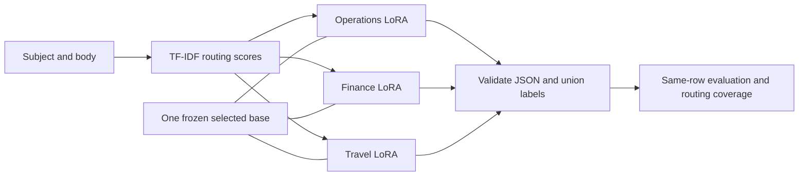

# Multi-LoRA Email Classification Workshop

Build, train, and evaluate a multi-label email classifier with one configurable, pinned
open-weight language model and separate operations, finance, and travel LoRA adapters.
The workshop defaults to a small Qwen profile for accessibility, but Qwen is not part of
the task definition or architecture.

New to the source? Read the [code companion](docs/CODE_COMPANION.md) for a guided tour of
the dataset, router, LoRA training, adapter switching, evaluation, pipeline, tests and
separate Azure hosting path.

For a separately hosted **managed Nemotron inference** path, see the
[Azure setup and deployment guide](docs/AZURE_DEPLOYMENT.md) and
[agent deployment runbook](docs/AGENT_DEPLOYMENT.md). This opt-in Container Apps API calls
an existing compatible Foundry endpoint; it does not replace local LoRA training or claim
that remote prompting uses trained adapters. Configuration lives in an ignored `.env`;
only the placeholder `.env.example` is intended for Git.

Need to provision Nemotron itself first? Use the separate
[Foundry model deployment guide](docs/FOUNDRY_MODEL_DEPLOYMENT.md), which includes Bicep for
a dedicated account/project and parameterized managed-compute model deployment.
The model's preview GPU quota and billing are separate from API hosting.

Start with [01: data and routing](notebooks/01_email_data_and_routing.ipynb), then [02: train adapters](notebooks/02_train_email_adapters.ipynb), and [03: compare and serve](notebooks/03_compare_and_serve.ipynb).

The notebooks match the CLM examples' structure: a primary question, evaluation contract, secure configuration, explicit execution gates, data checks, tables/charts, prediction artifacts, and interpretation checklists. They use a separate package and environment; nothing in CLM is modified.

## Important correction: this dataset is multi-label

[imnim/multiclass-email-classification](https://huggingface.co/datasets/imnim/multiclass-email-classification) contains a `labels` array, not one mutually exclusive class. For example, the same email can be `Business` and `Reminders`. Forcing a single label would discard supervision and make the routing task misleading.

Verified source:

| Field | Value |
|---|---|
| Revision | `e95090f0bb6dae0b05c9cd6db314dcae1d40db3f` |
| File | `email_dataset.json` |
| Schema | `subject: str`, `body: str`, `labels: list[str]` |
| Raw rows | 2,105 |
| Taxonomy | 10 labels |
| Source SHA-256 | `1093f1a3191e52b715ae728609b2e15bac71ba2573814a968856c43b009a0b30` |
| Publisher-declared license | MIT |
| Data cleanup | Quarantine two identical-text rows with conflicting labels |
| Usable emails | 2,103 |
| Seed 2026 partitions | Train 1,473; validation 312; test 318 |

No emails or dataset generator are copied into source control. Preparation downloads the pinned JSON; it never executes the dataset's generation script. Split manifests retain lineage and quarantine evidence.

## What participants build



The model choice is a run configuration. Every adapter in one run must use the same profile,
base revision, target modules, prompt contract and hyperparameters. Different models use
different artifact roots. A future cross-model comparison can then join metrics by identical
dataset/split fingerprints without mixing adapters from different bases.

| Adapter | Output vocabulary | Why it exists |
|---|---|---|
| `generalist` | All ten labels | Fair one-adapter baseline |
| `operations` | Business, Customer Support, Events & Invitations, Job Application, Newsletters, Personal, Promotions, Reminders | Non-finance/non-travel inbox work |
| `finance` | Finance & Bills | Independent financial specialization |
| `travel` | Travel & Bookings | Independent travel specialization |

Each specialist trains on **every training email**, with its label intersection as the answer. Off-domain emails produce `[]`. This prevents a constant-positive specialist and makes incorrect routing measurable.

A travel invoice can activate finance and travel simultaneously. The router receives only subject/body; ground-truth labels never select adapters at inference time.

This is **classification**, not a workflow-action or invoice-extraction dataset. The workshop does not invent labels for amounts, urgency, refunds, booking changes, or email replies.

## Learning outcomes

- Preserve a multi-label taxonomy and avoid exact-duplicate leakage.
- Understand completion-only supervised LoRA training and negative examples.
- Save independently trained adapters with exact base-model/data lineage.
- Load multiple adapters on one base without merging weights.
- Compare specialization gains against routing losses.
- Report minority-label recall, invalid outputs, and call counts honestly.
- Distinguish sequential PEFT switching from multi-adapter vLLM serving.

## Agenda

Allow roughly 3 hours of guided work, plus training/inference time. Training time is hardware-dependent and is not promised.

| Lab | Time | Participant actions | Exit artifact |
|---|---:|---|---|
| Setup | 15 min | Create environment; choose kernel; verify run root | Working kernel |
| Dataset audit | 20 min | Inspect schema, duplicate conflict, label overlap, split counts | Data manifest |
| Router | 25 min | Train lexical baseline; tune validation recall/call trade-off | Router metadata and metrics |
| LoRA mechanics | 20 min | Inspect masks, labels, rank, target modules, negatives | Tokenization check |
| Train | 15 min + compute | Run tiny smoke, then a separate full run | Four adapter manifests |
| Compare | 30 min + compute | Base/generalist/all-specialists/routed on same IDs | Predictions and comparison CSV |
| Serve (optional) | 25 min + setup | Static vLLM registration; concurrent synthetic requests | Serving smoke artifact |
| Debrief | 20 min | Inspect finance/travel errors; freeze final test protocol | Decision notes |

See [FACILITATOR.md](FACILITATOR.md) for guided questions, expected observations, and demo failure handling.

## Environment setup: Windows / VS Code

For repeatable Windows and Linux/WSL setup, GPU verification, smoke training, and full local
evaluation commands, follow [the local environment guide](docs/LOCAL_SETUP.md).
The setup scripts create/reuse only the workshop `.venv`; they never deploy Azure resources.

Use Python 3.11-3.13; Python 3.12 is the validation target.

For a workshop-only VS Code window, use **File > Open Workspace from File** and open [email-multilora.code-workspace](email-multilora.code-workspace). This scopes Python environment discovery to the workshop and defaults to its `.venv`, rather than the parent workspace's environment.

Start in the `multi-lora` repository root:

```powershell
Set-Location .\workshops\email-multilora
python -m venv .venv
.\.venv\Scripts\python.exe -m pip install -e '.[dev]'
.\.venv\Scripts\python.exe -m ipykernel install --sys-prefix --name email-multilora --display-name 'Python (email-multilora)'
```

In VS Code, choose `.venv\Scripts\python.exe` for the notebook kernel. Activation is optional because the commands use the environment's interpreter explicitly.

If VS Code reports that `ipykernel` is missing from a parent workspace's environment, it selected that environment rather than this workshop's environment. Use **Select Kernel > Select Another Kernel > Python Environments** and choose `workshops\email-multilora\.venv\Scripts\python.exe`, relative to the repository root. Do not install the workshop into an unrelated workspace environment.

If installation instead fails with "No virtual environment or system Python installation found", the selected interpreter itself may be broken. A copied Windows `.venv` can still contain `Scripts\python.exe` while its `pyvenv.cfg` points to a Python installation on another machine. Installing packages cannot repair that missing base interpreter. Open the workshop workspace above and select its working environment instead; leave unrelated environments untouched.

VS Code can remember a notebook kernel separately from the default Python interpreter. If an already-open notebook still shows the parent `.venv`, manually change its top-right kernel selection even after opening the workshop workspace.

To expose the existing workshop kernel to Jupyter outside its environment, register it once:

```powershell
.\.venv\Scripts\python.exe -m ipykernel install --user --name email-multilora --display-name 'Python (email-multilora)'
```

Then select **Python (email-multilora)**, restart the notebook kernel, and rerun from cell 3.

Run notebook 01. The default local run directory is `artifacts/run-2026`. To select another run, set `EMAIL_WORKSHOP_RUN` **before starting the kernel**, or change the `ARTIFACT_DIR` cell consistently in all three notebooks:

```powershell
$env:EMAIL_WORKSHOP_RUN = 'artifacts\full-run-01'
```

Relative `EMAIL_WORKSHOP_RUN` paths in notebooks are resolved from the workshop directory,
independently of the notebook kernel's working directory.
Existing data is verified and reused by the notebook. The CLI preparation command refuses to overwrite it. New configuration means a new run directory.

### GPU training dependencies

Install the CUDA wheel **before** the training extra:

```powershell
.\.venv\Scripts\python.exe -m pip install torch==2.10.0+cu128 --index-url https://download.pytorch.org/whl/cu128
.\.venv\Scripts\python.exe -m pip install -e '.[training,dev]'
.\.venv\Scripts\python.exe -c "import torch; print(torch.__version__); print('CUDA available:', torch.cuda.is_available())"
```

Use a driver compatible with the selected CUDA wheel. See the [PyTorch installation guide](https://pytorch.org/get-started/locally/). If this environment already has CPU PyTorch, deliberately replace that wheel inside this environment before expecting CUDA.

The small 0.5B model, batch size 1, LoRA rank 8, and 512-token context are chosen for modest GPU memory. A 12-24 GB NVIDIA GPU is a practical workshop starting point, not a measured minimum. The code uses BF16 only on supported CUDA hardware and otherwise FP32. It does not require bitsandbytes or flash-attention.

### CPU-only validation

```powershell
.\.venv\Scripts\python.exe -m pip install torch==2.10.0+cpu --index-url https://download.pytorch.org/whl/cpu
.\.venv\Scripts\python.exe -m pip install -e '.[training,dev]'
```

The automated training tests use a tiny randomly initialized local Qwen model, not a downloaded LLM. They test optimizer steps, safetensors export, reload, and adapter selection. They **do not measure email classification quality**.

The training stack pins Transformers 4.57.6, PEFT 0.18.1, Accelerate 1.12.0, PyTorch 2.10.0, and Trackio 0.7.0. Trackio is intentionally pinned because newer releases require a Hub major version incompatible with this Transformers stack.

## Notebook execution gates

| Notebook | As shipped | Explicit opt-in |
|---|---|---|
| 01 | Downloads pinned public data, prepares local splits, trains CPU router | No model training |
| 02 | Shows configuration, versions, data counts | `RUN_TOKENIZATION_CHECK`, `RUN_TRAINING` |
| 03 | Verifies splits, refits router, explains evaluation | `RUN_EVALUATION`, `RUN_VLLM_DEMO` |

Notebook 02 defaults to `SMOKE_ONLY = True`. A smoke run is real training but is not sufficient for quality claims. Use a separate run root for full training. Do not silently overwrite smoke weights.

## Single staged Python pipeline

The package provides one orchestrator for the local experiment: prepare data, fit the router,
train all four adapters, and evaluate all four strategies. It prints JSON stage events to stderr,
writes resumable status under the selected artifact root, and prints the final result to stdout.

Start from the workshop directory. First review the resolved smoke plan; without `--run` this
makes no download, training, evaluation, Azure or Foundry call:

```powershell
.\.venv\Scripts\python.exe -m email_workshop.pipeline `
  --profile smoke `
  --artifacts .\artifacts\pipeline-smoke
```

After installing the training dependencies and reviewing the plan, run the bounded CPU smoke:

```powershell
.\.venv\Scripts\python.exe -m email_workshop.pipeline `
  --profile smoke `
  --artifacts .\artifacts\pipeline-smoke `
  --run
```

The smoke profile defaults to CPU, two optimizer steps, 16 train/validation examples per adapter,
and four validation rows per evaluation strategy. It downloads the pinned public dataset and
the selected model when they are not already cached. This is real but deliberately tiny training; its
scores are pipeline diagnostics, never classification-quality evidence.

For the full GPU experiment, use a new artifact root and the explicit full profile:

```powershell
.\.venv\Scripts\python.exe -m email_workshop.pipeline `
  --profile full `
  --device cuda `
  --artifacts .\artifacts\full-run-01 `
  --run
```

The full profile rejects smoke limits. It evaluates validation by default; add `--include-test`
only after freezing the design. Existing verified data and complete adapter directories are
reused after their seed, router target, data lineage, checksums and training configuration are
checked. Evaluation checkpoints resume from their completed prefix. An incomplete adapter
directory or conflicting configuration stops the pipeline instead of overwriting artifacts.
Use a new artifact root to change the seed, source, profile, router target or model-training
configuration.

Pipeline records:

- `pipeline/status.json` — latest completed stages for operational visibility;
- `pipeline/result.json` — final stage and evaluation summaries;
- `data/`, `router/`, `adapters/`, and `evaluation/` — the same inspectable artifacts produced by
  the individual commands.

This pipeline is local. It does not provision Foundry, call the managed Nemotron deployment,
start vLLM, or deploy Container Apps; those remain separately approved operational workflows.

## Equivalent command-line workflow

From the workshop directory:

```powershell
# 1. Prepare once.
.\.venv\Scripts\python.exe -m email_workshop.cli --artifacts .\artifacts\full-run-01 prepare

# 2. Train router and select thresholds on validation only.
.\.venv\Scripts\python.exe -m email_workshop.cli --artifacts .\artifacts\full-run-01 router

# 3. Train all four independent adapters.
.\.venv\Scripts\python.exe -m email_workshop.cli --artifacts .\artifacts\full-run-01 train --device cuda

# 4. Debug on validation before touching test.
.\.venv\Scripts\python.exe -m email_workshop.cli --artifacts .\artifacts\full-run-01 evaluate --split validation --device cuda

# 5. Only after freezing the design: complete test-set comparison.
.\.venv\Scripts\python.exe -m email_workshop.cli --artifacts .\artifacts\full-run-01 evaluate --split test --device cuda
```

A short pipeline run uses another root:

```powershell
.\.venv\Scripts\python.exe -m email_workshop.cli --artifacts .\artifacts\smoke-01 prepare
.\.venv\Scripts\python.exe -m email_workshop.cli --artifacts .\artifacts\smoke-01 train --device cuda --max-steps 2 --sample-limit 16
.\.venv\Scripts\python.exe -m email_workshop.cli --artifacts .\artifacts\smoke-01 evaluate --split validation --limit 4 --allow-smoke
```

The CLI evaluation compares the four LLM strategies. Notebook 03 additionally includes the lexical baseline in its table. `--adapter finance` trains only a missing adapter; never mix configuration settings across adapters.

## Model and training contract

- Base model is selected through a model profile in
  [`model_profiles.py`](email_workshop/model_profiles.py).
- Every profile pins an immutable revision, LoRA target modules, display name, license name/link,
  and operational notes.
- Built-in profiles:
  - `qwen2.5-0.5b` — accessible default,
    [Qwen2.5-0.5B-Instruct](https://huggingface.co/Qwen/Qwen2.5-0.5B-Instruct).
  - `nemotron-nano-8b` — locally validated larger option,
    [Llama-3.1-Nemotron-Nano-8B-v1](https://huggingface.co/nvidia/Llama-3.1-Nemotron-Nano-8B-v1).
- `custom` requires an explicit model ID, immutable revision and target-module list.
- A model is compatible only if Transformers can load it without unreviewed remote code,
  it has a usable chat template and EOS token, it is a causal language model, and the named
  LoRA target modules exist. Hardware fit and license suitability remain operator decisions.
- LoRA defaults: rank 8, alpha 16, dropout 0.05 and frozen base.
- Full default: two epochs, learning rate `2e-4`, batch size 1, accumulation 8.
- Same train partition, seed, base, precision policy, and hyperparameters for all four adapters.
- Validation loss selects the best saved checkpoint; no test examples reach Trainer.
- Loss covers only the complete JSON answer and EOS.
- Long inputs are shortened by trimming body first while preserving instructions and chat formatting.
- All specialists see negative examples; never fabricate missing labels.
- Trackio stays local (`space_id=None`), with no Hub push and no automatic dashboard server.

The generalist receives one training pass budget while three specialists together consume about three times that adapter-training budget. Disclose that compute difference when discussing quality gains.

### Choose a model

Notebook 02 exposes `MODEL_CHOICE` in its first code cell. Notebook 03 exposes the same
choice and refuses to evaluate adapters whose manifest does not match it.

For the staged pipeline:

```powershell
# Accessible default
.\.venv\Scripts\python.exe -m email_workshop.pipeline `
  --profile full `
  --device cuda `
  --model-profile qwen2.5-0.5b `
  --artifacts .\artifacts\qwen-full-01

# Larger validated profile
.\.venv\Scripts\python.exe -m email_workshop.pipeline `
  --profile full `
  --device cuda `
  --model-profile nemotron-nano-8b `
  --artifacts .\artifacts\nemotron-full-01
```

These examples print plans only. Add `--run` after reviewing model license, download size,
hardware fit, artifact root and test-split policy.

For another compatible open-weight model:

```powershell
.\.venv\Scripts\python.exe -m email_workshop.pipeline `
  --profile smoke `
  --device cuda `
  --model-profile custom `
  --model-id 'publisher/model-name' `
  --model-revision 'IMMUTABLE_COMMIT_SHA' `
  --target-modules q_proj v_proj `
  --artifacts .\artifacts\custom-model-smoke
```

Do not guess target modules or use a moving branch/tag. Run the smoke and inspect the manifest
before attempting a full run.

### Cross-model comparison contract

Cross-model comparison is a separate analysis layer, not implicit adapter mixing. A valid
comparison requires:

- Identical dataset revision, split hashes and row order.
- Identical label taxonomy and prompt contract.
- Same seed, LoRA rank, epochs, learning rate, batch/accumulation and evaluation strategies,
  unless a documented ablation intentionally changes one.
- One fresh artifact root per model profile.
- Complete manifests containing profile, model ID/revision and target modules.
- Paired metrics on the same validation or frozen test IDs.
- Training time, parameter count, invalid-output rate and latency reported alongside quality.

Adapters from different base models cannot be loaded into one shared base or compared by
filename alone. Future comparison tooling should consume manifests and metrics from multiple
run roots and reject mismatched data/prompt/config fingerprints.

## Evaluation interpretation

| Strategy | Model calls per email | Question |
|---|---:|---|
| TF-IDF baseline | 0 LLM calls | Is LoRA worthwhile relative to a cheap classifier? |
| Base model | 1 | What can the untuned base do? |
| Generalist LoRA | 1 | What does one trained adapter add? |
| All specialists | 3 | Does specialization help without routing loss? |
| Routed specialists | 1-3 | What quality is lost when fewer domains run? |

Report:

- exact match of the entire label set;
- micro-F1 and macro-F1;
- per-label precision, recall, F1, support;
- Hamming loss;
- invalid-output rate and valid exact-match;
- routing domain recall and label-coverage ceiling;
- average LLM calls and sequential p50/p95 latency.

Do not report mutually exclusive multiclass log loss or a ten-way confusion matrix. Use ten binary 2x2 matrices.

Invalid model output is not repaired: a malformed call contributes no labels and records an error. Valid responses from other specialists remain visible. `valid_exact_match` cannot reward an email with any malformed call. Transport failures raise immediately and preserve prior completed emails.

Predictions resume only if backend identity, adapter manifests, runtime versions, routing metadata, prompt contract, split, and row fingerprint match. A changed sample size or model needs a new file/run.

## Optional vLLM serving lab

**This part requires Linux/WSL2 and NVIDIA CUDA. Do not install vLLM into the Windows PEFT environment.**

1. Finish training and verify the four adapter manifests.
2. Release notebook GPU memory by restarting/shutting down its kernel.
3. In a separate Linux/WSL2 environment, install a version of vLLM that explicitly supports the selected base architecture and LoRA. Record the exact installed release and container digest if applicable. Follow the [official installation guide](https://docs.vllm.ai/en/stable/getting_started/installation/gpu/).
4. Make the repository and the same adapter files visible to that environment, not a new empty directory.
5. From the workshop directory, generate and inspect the static server command:

```powershell
.\.venv\Scripts\python.exe -m email_workshop.cli --artifacts .\artifacts\full-run-01 vllm-command --linux-run-root 'artifacts/full-run-01'
```

Run the generated command from the workshop directory in Linux/WSL2. `--linux-run-root`
must be a relative POSIX path within that directory; absolute paths and parent traversal
are rejected. The same rule applies to `LINUX_RUN_ROOT` in notebook 03.

The generated command uses:

- the exact base model revision;
- `--enable-lora`, `--max-loras 4`, and `--max-lora-rank 8`;
- four named static adapter paths;
- a 512-token context matching the prompt/response budget;
- loopback binding and GPU memory utilization 0.75.

It intentionally does **not** enable `VLLM_ALLOW_RUNTIME_LORA_UPDATING`. Never expose dynamic adapter administration to untrusted callers.

6. Verify `/v1/models` advertises `email-base`, `generalist`, `operations`, `finance`, and `travel`; verify `/version`.
7. In notebook 03, enable `RUN_VLLM_DEMO` for three concurrent synthetic requests to different adapters.
8. For a separate quality run, select `BACKEND = 'vllm'`. The client sends pretokenized prompts to `/v1/completions` so truncation and label contracts match local PEFT.

The client only accepts localhost/loopback URLs. An optional `VLLM_API_KEY` is never stored in metadata. Model names and `/version` do not prove remote checkpoint identity: the operator must attest the printed server paths and inspect checksums.

Successful concurrency proves API routing, **not** that the scheduler placed different adapters into one GPU batch. The shared local PEFT implementation is deliberately sequential and must not be used concurrently across threads.

## Artifacts

```text
artifacts/<run>/
  data/
    manifest.json
    train.json
    validation.json
    test.json
  router/
    metadata.json
    validation_metrics.json
  adapters/
    generalist/
    operations/
    finance/
    travel/
      adapter_config.json
      adapter_model.safetensors
      manifest.json
      tokenizer files
      checkpoints/
  evaluation/
    <backend>-<split>-<strategy>.json
    <backend>-<split>-comparison.csv
    <backend>-<split>-metrics.json
  artifact_ledger.csv
```

The CLI emits per-strategy `.metrics.json`; the notebook emits the combined comparison CSV/JSON. Neither silently loads artifacts from another run. Model weights, data, notebook execution outputs, and local environments stay ignored by Git.

## Validation commands

```powershell
.\.venv\Scripts\python.exe -m pip check
.\.venv\Scripts\python.exe -m ruff check email_workshop tests scripts
.\.venv\Scripts\python.exe -m pytest tests -q
.\.venv\Scripts\python.exe scripts\validate_notebooks.py --execute
```

Without `[training]`, training tests are explicitly skipped. With `[training]`, the tiny model is created locally and four adapters are actually trained, saved, loaded on one base, and selected. No paid resource is involved.

The notebook validator writes executed copies under ignored artifacts; committed notebooks retain no outputs. It refuses enabled training/inference flags and uses a separate validation run.

See [VALIDATION.md](VALIDATION.md) for what was actually executed and what still needs a GPU lab.

## Boundaries and caveats

- The small dataset may contain templated/synthetic content; exact deduplication does not prevent near-template leakage.
- The routing threshold is tuned to 95% domain recall on validation, not guaranteed on test or production.
- The taxonomy is imbalanced, and operations has eight labels while finance/travel have one each.
- A correct architecture can still perform worse than a single generalist or TF-IDF baseline.
- This does not train Nemotron, certify NIM profiles, or deploy to Foundry/Azure.
- Do not assume external adapters can be imported into Foundry native managed adapter deployments; follow the [support verification guide](../../curriculum/day-05-nim-verification/README.md).
- No cloud GPU job, paid endpoint, model upload, or production email action is started automatically.

## Sources

- [Dataset card and files](https://huggingface.co/datasets/imnim/multiclass-email-classification)
- [Qwen model card](https://huggingface.co/Qwen/Qwen2.5-0.5B-Instruct)
- [LoRA paper](https://arxiv.org/abs/2106.09685)
- [PEFT LoRA guide](https://huggingface.co/docs/peft/en/developer_guides/lora)
- [PEFT checkpoint format](https://huggingface.co/docs/peft/en/developer_guides/checkpoint)
- [Iterative stratification implementation](https://github.com/trent-b/iterative-stratification)
- [vLLM LoRA serving and security warning](https://docs.vllm.ai/en/stable/features/lora/)
- [Trackio local monitoring](https://huggingface.co/docs/trackio/en/quickstart)
- [Ten-day research curriculum](../../curriculum/README.md)
