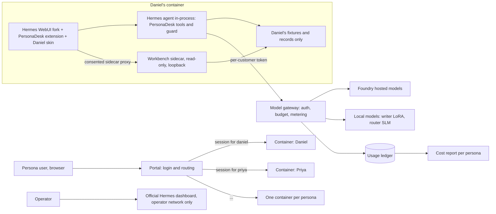

# Workshop 5 plan: PersonaDesk Portal — a managed, personalised Hermes experience per persona

Status: **phases 1 and 2 (extension + sidecar) built and tested locally; phases 0 and 3–7
not started.** What was built and what was measured is in [`README.md`](README.md) and
[`docs/VERIFY.md`](docs/VERIFY.md). Every number in this workshop must come from a run
recorded in `docs/` or `docs/evidence/`; none appear in this plan.

This workshop turns the ten fictional Example Co. personas from Workshop 2 into ten
*customers* of a small managed service. Each customer gets their own Hermes agent, their
own data, and a user interface shaped around their job. We provide and meter the models.

It builds on:

- **Workshop 2 (PersonaDesk)** — personas, Hermes profiles, the PersonaDesk plugin (tools,
  `pre_tool_call` guard, review records), the mail simulator, and the cost model
  ([`../personal-agent-multilora/`](../personal-agent-multilora/)).
- **Workshop 3 (small task models)** — the router student and its parity gate; the
  Foundry-versus-local cost comparison ([`../slm-task-models/`](../slm-task-models/)).
- **The Hermes source** pinned as a submodule at [`../../external/hermes-agent`](../../external/hermes-agent).
  Read its `AGENTS.md` and `SECURITY.md` alongside this plan.
- **Hermes WebUI**, through our fork, pinned as a submodule at
  [`../../external/hermes-webui`](../../external/hermes-webui). Read its `AGENTS.md`,
  `ARCHITECTURE.md`, `THEMES.md`, `docs/EXTENSIONS.md` and `docs/CONTRACTS.md`.

---

## 1. What you will learn

1. Why Hermes is a **single-tenant** agent and what that forces on a multi-customer design.
2. How to personalise **Hermes WebUI** with *skins* and *extensions*, developed on our own
   fork so we can learn freely and still merge upstream changes later.
3. How to keep **provider keys out of customer reach** with a metering model gateway.
4. How to run **one isolated Hermes per customer** and route each login to the right one.
5. How to prove isolation, guard behaviour, and cost with tests and measured evidence.

---

## 2. Key decision: Hermes WebUI on our fork, personalised through extensions

The customer-facing surface is **Hermes WebUI**, developed on our fork
`rashmijain02/hermes-webui` (MIT, forked from `nesquena/hermes-webui`). The official Hermes
dashboard stays as an **operator console** only.

| | Hermes WebUI (our fork) | Official dashboard (`hermes dashboard`) |
|---|---|---|
| Who it is for | End users: Claude-style chat, mobile/PWA | Operators: config, keys, analytics, logs |
| Chat | Native streaming chat (SSE), runs on Windows, Linux, macOS | Embedded terminal over a POSIX PTY |
| Frontend | Vanilla JavaScript, no build step, no framework | React + plugin SDK |
| Personalisation | **Skins** (accent palette) + **extensions** (CSS/JS, nav, message actions, turn events, loopback sidecar) | Themes, typed slots, page overrides, plugin API routes |
| Users | Single user | Single user |
| Role in this workshop | **Customer UX** | Operator console (optional) |

### Why a fork, and how we keep it mergeable

The fork lets us learn and experiment freely without waiting for upstream review, while
staying close enough to merge upstream releases later. Rules:

1. All work happens on one fork branch, **`personadesk-portal`**. `master` on the fork mirrors
   upstream only. The submodule in this repository tracks `personadesk-portal` once it is
   pushed.
2. **Extension first.** Anything expressible as an extension (skin CSS, injected JS, nav
   action, message action, turn listener, sidecar) lives under `extensions/personadesk/` in
   the fork. That directory is new, so upstream merges never conflict with it.
3. **Core changes are small and labelled.** A change to WebUI core is allowed only when an
   extension cannot do it. Each one is a separate commit whose message starts with
   `core:`, is listed in `docs/GAPS.md` here, and is written as a candidate upstream PR
   following the fork's `CONTRIBUTING.md` and `docs/CONTRACTS.md`.
4. **Sync regularly.** Merge upstream `master` into `personadesk-portal` at least once per
   phase; record the upstream commit in `docs/VERIFY.md`.

### Constraints from the WebUI extension contract (`docs/EXTENSIONS.md`)

| Constraint | Consequence for us |
|---|---|
| Extensions run with **full WebUI session authority** and are not a sandbox | Only our own reviewed extension is enabled; one customer per container keeps that authority inside one persona |
| Extensions **cannot register backend routes** | Workbench data comes from a small **read-only loopback sidecar** in each container, reached through WebUI's consented sidecar proxy path with `proxy_auth: token-v1` |
| A signed-in user can one-click install gallery extensions; no operator switch was found | First `core:` candidate: an operator flag that disables install (GAP-1, phase 0 confirms) |
| Skins change only the `--accent` family | Deeper per-persona styling lives in the extension stylesheet, scoped by a `data-persona` attribute |
| Extension settings are browser-local, not secrets | No tokens or persona data in extension settings or storage |

---

## 3. Key constraint: Hermes is single-tenant

From `external/hermes-agent/SECURITY.md` §2:

- "Hermes Agent is a single-tenant personal agent."
- "The only security boundary against an adversarial LLM is the operating system." The
  approval gate, redaction, scanners and tool allowlists are *heuristics*, not containment.

Consequences for this design:

| Tempting shortcut | Why it fails | What we do instead |
|---|---|---|
| One Hermes process, ten profiles, one customer per profile | Profiles share a process, and both WebUI and the dashboard can switch profiles. | **One container per persona**, each with one profile. |
| Give each customer the Foundry key | WebUI settings and the dashboard both expose provider setup, so a customer could read or misuse it | The container holds only a **per-customer gateway token** (§6). |
| Trust the PersonaDesk `pre_tool_call` guard as the wall | In-process heuristic | Keep the guard for *policy*; rely on the container for *containment*. |
| Expose WebUI on `0.0.0.0` without auth | WebUI auth is off by default (`api/auth.py`) | Enable WebUI auth, bind to the private network, put the portal (§7) in front. |

---

## 4. Architecture



| Component | Owns | Must not own |
|---|---|---|
| **Portal** | Login, mapping user → persona container, reverse proxy | Agent logic, model keys, persona data |
| **Persona container** | WebUI (fork), one `HERMES_HOME` with one profile: `SOUL.md`, skills, memory, sessions, PersonaDesk plugin | Other personas' data, provider keys |
| **PersonaDesk extension** (fork, `extensions/personadesk/`) | Layout, panels, persona styling | Secrets, a second chat, any write path around the guard |
| **Workbench sidecar** (this workshop, `sidecar/`) | Read-only JSON for panels, from this persona's PersonaDesk records | Writes, other personas' data |
| **PersonaDesk plugin** (existing) | Tools, guard, review records | UI |
| **Model gateway** (new, small) | Provider keys, per-customer tokens, budgets, the usage ledger | Persona data, tool execution |
| **Local model server** (existing from Workshops 1–3) | Writer adapters, router student | Authorization |

WebUI runs the Hermes agent **in-process** (`api/streaming.py` builds `AIAgent`), so tools run
in the WebUI container. Phase 0 confirms that the PersonaDesk Hermes plugin and its
`pre_tool_call` guard load on that path; if not, the container uses WebUI's gateway mode
(`HERMES_API_URL`) with a Hermes gateway beside it, as in the fork's
`docker-compose.two-container.yml`.

Every row keeps Workshop 2's rule: **one owner for each responsibility**, and Hermes remains
the only agent runtime.

---

## 5. Personalisation: what "a custom UX per persona" means

Personalisation has five layers. Only the first two change pixels.

| Layer | Hermes construct | Per-persona example |
|---|---|---|
| Look | WebUI **skin** + extension stylesheet scoped by `data-persona` | Daniel: dense, neutral finance palette. Priya: high-contrast support palette. |
| Layout and panels | WebUI **extension** (Workbench drawer beside the chat) | Daniel's Workbench shows an invoice-exception table; Noah's shows an itinerary timeline. |
| Voice | Profile **`SOUL.md`** (already exists for three personas) | Same as Workshop 2. |
| Know-how | **Skills** in the profile | Priya's "ask for environment details before escalating" procedure. |
| Authority | PersonaDesk **permissions** (`config/persona_permissions.json`) + guard | Unchanged. The UI can never widen what a persona may do. |

**One extension, ten layouts.** Write a single `personadesk` WebUI extension whose layout is
driven by a per-persona JSON file (`ux/<persona-id>.json`), instead of ten separate plugins.
The layout lists panels from a small, fixed catalogue:

| Panel | Data source (read-only sidecar route) | Used by |
|---|---|---|
| Work queue | PersonaDesk task records | All |
| Draft review | PersonaDesk review records | All |
| Evidence table | Persona fixtures listed for the current task | Daniel, Marcus, Elena |
| Timeline | Fixture events with time zones | Noah, Sofia |
| Checklist | Skill-defined checklist state | Jordan, Lucas, Priya |
| Decision brief | Latest brief artifact | Maya |
| Suggested checks | Workshop 3 router (advisory, §8) | Daniel, Noah, Priya first |
| Spend this week | Model gateway ledger for this persona | All |

Rules for the Workbench:

- It is **structured UI around the chat, not a second chat**. Chat stays WebUI's own chat.
- Sidecar routes are **read-only** in the first release. Approvals still go through the
  PersonaDesk review commands, so the UI adds no new write path that skips the guard.
- The extension never stores tokens or persona data in browser storage.

### Persona UX cards (completed in phase 1)

The cards below are encoded in [`ux/<persona-id>.json`](ux/). Phase 1 also added the three
"All" panels from the catalogue (work queue, draft review, spend) to every layout, after the
card's own panels, so each Workbench has something usable before phase 6.

| Persona | Workbench panels | Style intent |
|---|---|---|
| Maya Chen (CEO) | Decision brief, work queue | Calm, minimal |
| Daniel Okafor (CFO) — MVP | Evidence table, suggested checks, draft review | Dense, tabular |
| Priya Raman (Support) — MVP | Work queue, checklist, draft review | High contrast |
| Lucas Silva (Engineer) | Checklist, evidence table | Developer, monospace |
| Amina Yusuf (Sales) | Work queue, draft review | Warm |
| Jordan Lee (People Ops) | Checklist | Soft, accessible |
| Elena Petrova (Marketing) | Evidence table, draft review | Brand-led |
| Marcus Green (Legal) | Evidence table, checklist | Formal |
| Sofia Alvarez (Operations) | Timeline, work queue | Status colours |
| Noah Williams (Assistant) — MVP | Timeline, suggested checks | Clear time-zone emphasis |

Only Priya, Daniel and Noah have Hermes profiles and fixtures today. The other seven need
profiles (`SOUL.md`), policies and fixtures before their containers are useful (phase 6).

---

## 6. The model gateway: managed models without exposing keys

Because we provide the models, the provider keys must stay with us. A small
OpenAI-compatible gateway sits between every container and every model.

| Responsibility | How |
|---|---|
| Authenticate the caller | Each container gets one token, bound to one persona |
| Route | Model name → Foundry deployment or local server (writer LoRA, router student) |
| Enforce budgets | Per-persona daily token or cost ceiling; refuse with a clear error when exceeded |
| Meter | Append one ledger row per call: persona, model, input/output tokens, latency, status |
| Never | Store prompts or completions in the ledger by default |

Each container's Hermes `config.yaml` points its model provider at the gateway with that
persona's token as the API key. A customer who opens provider settings sees only their own
revocable token.

Cost reporting reuses Workshop 2's cost model and Workshop 3's comparison. The ledger shows
**Copilot/Foundry hosted** and **local** usage as separate columns per persona, never merged.
Hermes' own Analytics page (per-model tokens and estimated cost from session history) is a
cross-check, not the billing source. The gateway ledger is the source.

Build it as a small FastAPI service in this workshop, with tests, rather than adopting an
unreviewed third-party proxy.

---

## 7. The portal: one login, one container

- Authenticate the user at the portal: a self-hosted OIDC provider (for example Keycloak in a
  container) or, for a local-only workshop, a simple username/password table.
- Map the authenticated user to exactly one persona container.
- Reverse-proxy HTTP **and** Server-Sent Events to that container (WebUI chat streams over
  SSE; disable proxy buffering for `text/event-stream`).
- Never let a request choose its container by URL or header: the mapping comes only from the
  authenticated identity.
- Defence in depth: each WebUI also sets `HERMES_WEBUI_PASSWORD` (or passkeys), binds only to
  the private container network, and lists only the portal origin in
  `HERMES_WEBUI_ALLOWED_ORIGINS`.
- The official dashboard is reachable only from the operator network, never through the portal.

---

## 8. Reusing Workshop 3

- **Advisory "suggested checks" panel.** Serve the router student from the local model server
  and expose it as the advisory `pd_suggest_checks` tool planned in Workshop 3. The panel only
  *displays* suggestions. The guard and the controller still decide. The router has not passed
  its parity gate, so the panel must say "advisory, not verified".
- **Cost table per persona.** The gateway ledger provides measured per-persona token use, so
  the Workshop 3 question "what would this persona cost on Foundry versus a local small
  model?" can be answered from real traffic rather than estimates.

---

## 9. Phases

Each phase ends with a gate. Do not start the next phase until its gate passes.

| Phase | Goal | Deliverables | Gate |
|---|---|---|---|
| **0. Ground truth** | Pin versions and verify assumptions | `docs/VERIFY.md`: fork commit and upstream base; extension loading via `HERMES_WEBUI_EXTENSION_DIR` + manifest; skins; sidecar proxy with `token-v1`; whether the PersonaDesk plugin and guard load in WebUI's in-process agent; how to disable gallery install | Every item checked with isolated `HERMES_HOME` and `HERMES_WEBUI_STATE_DIR` (fork `AGENTS.md` rule) |
| **1. UX design** | Turn the ten cards in §5 into specs | `ux/catalog.json`, `ux/<persona-id>.json` ×10, validation tests | Each layout uses only catalogue panels; tests pass; reviewed by a person |
| **2. One persona, one container** | Priya end-to-end locally | Fork branch `personadesk-portal` with `extensions/personadesk/`; Workbench sidecar; container image | Priya completes her anchor scenario in WebUI with the Workbench; guard still blocks a forbidden tool |
| **3. Model gateway** | Managed models, no keys in containers | Gateway service, token per persona, budget, ledger, tests | Container works with only a gateway token; a budget breach is refused; the ledger matches the request count |
| **4. Portal + three MVP personas** | Priya, Daniel, Noah behind one login | Portal, Compose file, routing table | Isolation tests in §10 all pass |
| **5. Evidence** | Measure, do not estimate | `docs/evidence/PORTAL_MVP.md`: task completion per anchor scenario, guard blocks, cost per persona (hosted vs local columns), UI latency | Every number traces to a ledger row, a test run, or a Workshop 6 eval result |
| **6. Remaining seven personas** | Profiles, policies, fixtures, layouts | Seven new profiles and containers | Same gates as phases 2 and 4 |
| **7. Workshop 3 tie-in** | Advisory router panel, real cost comparison | `pd_suggest_checks` tool + panel; cost table | Panel is labelled advisory; table separates Foundry and local |

Workshop 6 (Vally evals, [`../agent-evals-vally/PLAN.md`](../agent-evals-vally/PLAN.md))
provides the per-persona release gate used in phases 2, 4 and 6.

**Progress.** Phase 1 is built: layouts, catalogue and validation tests. Its "reviewed by a
person" gate is still open. Phase 2 is partly built: the fork branch, extension, sidecar and
an end-to-end smoke test exist. Still open: Priya's anchor scenario with a real Hermes turn
in WebUI, the guard check inside WebUI, and the container image. Phase 0 items checked so
far are in [`docs/VERIFY.md`](docs/VERIFY.md).

---

## 10. Tests and evidence

Security and isolation tests (automated, run against the Compose stack):

1. A user signed in as Priya cannot reach Daniel's container by any URL, header or SSE path.
2. No container's environment, config or files contain a provider key (scan the image and the running container).
3. A revoked gateway token stops that persona's agent from calling any model.
4. A persona over budget is refused, and the refusal is shown in the UI.
5. The PersonaDesk guard still blocks each persona's `blocked_actions`. The new UI does not change this.
6. The sidecar is read-only (only `GET` routes exist), binds to loopback, and rejects requests without the `token-v1` secret.
7. Extension install from the gallery is unavailable to customers (after GAP-1).

Behaviour tests (unit, in this workshop's `tests/`):

- Layout JSON validates against the panel catalogue.
- Each sidecar route returns only the configured persona's records.
- The gateway ledger row count equals the number of model calls; token sums match provider responses.

Evidence rules from earlier workshops apply: no invented numbers, every figure links to a
run, and an agent never grades itself.

---

## 11. Repository layout (✅ built, ⏳ planned)

In this repository:

```
workshops/persona-portal/
├── PLAN.md                     # ✅ this file
├── README.md                   # ✅ learner quick start
├── docs/
│   ├── VERIFY.md               # ✅ phase 0 checklist (partly checked)
│   ├── GAPS.md                 # ✅ what extensions could not do; each core: commit on the fork
│   └── evidence/PORTAL_MVP.md  # ⏳ phase 5 measured results
├── ux/catalog.json             # ✅ panel catalogue
├── ux/<persona-id>.json        # ✅ one layout per persona (10)
├── sidecar/                    # ✅ read-only Workbench data service
├── scripts/smoke_e2e.py        # ✅ WebUI + extension + sidecar end-to-end check
├── gateway/                    # ⏳ model gateway service
├── portal/                     # ⏳ login + routing
├── containers/                 # ⏳ image build and per-persona HERMES_HOME seeding
├── compose.yaml                # ⏳ local stack
└── tests/                      # ✅ layout and sidecar tests (isolation tests ⏳)
```

On the fork (`external/hermes-webui`, branch `personadesk-portal`, ✅ built; the submodule is pinned to it):

```
extensions/personadesk/
├── manifest.json               # assets + loopback sidecar declaration (proxy_auth: token-v1)
├── personadesk.js              # Workbench drawer and panels
├── personadesk.css             # per-persona styling scoped by data-persona
└── README.md                   # how to load it with HERMES_WEBUI_EXTENSION_DIR
```

---

## 12. Hardware and hosting

| Tier | Where | Notes |
|---|---|---|
| Light | This class of machine (RTX 3080 10 GB), natively or with Docker Desktop | WebUI runs on Windows, so phases 0–2 need no containers; three MVP containers + gateway + portal from phase 4; local writer/router on the GPU |
| Full | DGX Spark | All ten containers, local models on the Spark, same Compose file |

---

## 13. Risks and open questions

| Risk or question | Mitigation or next step |
|---|---|
| Extensions have full session authority | Only our reviewed extension; one persona per container; GAP-1 removes customer install |
| The fork drifts from upstream | Extension-first rule; `core:` commits small and upstream-ready; merge upstream every phase |
| WebUI's in-process agent may not load the PersonaDesk plugin/guard | Phase 0 verifies; fallback is gateway mode with a Hermes gateway beside WebUI |
| WebUI Settings expose provider/model setup | Gateway token limits damage; phase 0 lists which settings a customer can change; hiding them is a GAPS.md item |
| Submodules track moving branches | Phase 0 pins commits for images; the submodules are for reading and developing |
| Ten containers × memory on the light tier | Measure in phase 4; start three at a time |
| Router student is not parity-verified | Advisory only, labelled as such |

---

## 14. Definition of done

- Ten personas each sign in through one portal and land in their own container with their own
  skin and Workbench layout in Hermes WebUI.
- No container holds a provider key; all model traffic goes through the metered gateway.
- The isolation and guard tests in §10 pass.
- `docs/evidence/PORTAL_MVP.md` reports measured task completion and cost per persona, with
  hosted and local usage in separate columns.
- No Hermes agent core file is modified. Every WebUI core change is a labelled `core:` commit
  on the fork, listed in `docs/GAPS.md`.
