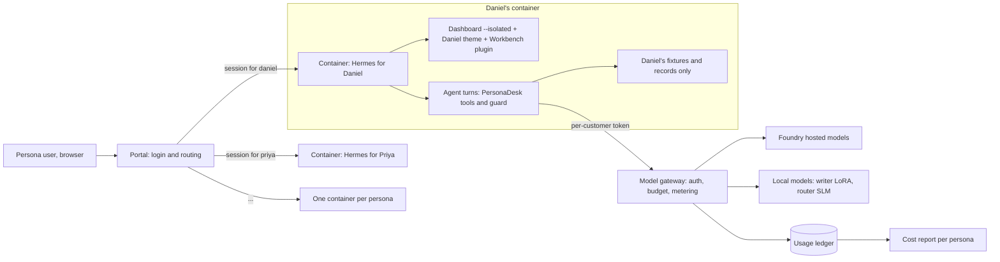

# Workshop 5 plan: PersonaDesk Portal — a managed, personalised Hermes experience per persona

Status: **plan only — nothing in this document is built or measured yet.** Every number in
this workshop must come from a run recorded in `docs/evidence/`; none appear here.

This workshop turns the ten fictional Example Co. personas from Workshop 2 into ten
*customers* of a small managed service. Each customer gets their own Hermes agent, their
own data, and a user interface shaped around their job. We provide and meter the models.

It builds on:

- **Workshop 2 (PersonaDesk)** — personas, Hermes profiles, the PersonaDesk plugin (tools,
  `pre_tool_call` guard, review records), the mail simulator, and the cost model
  ([`../personal-agent-multilora/`](../personal-agent-multilora/)).
- **Workshop 3 (small task models)** — the router student and its parity gate; the
  Foundry-versus-local cost comparison ([`../slm-task-models/`](../slm-task-models/)).
- **The Hermes source** pinned as a submodule at [`../../external/hermes-agent`](../../external/hermes-agent).
  Read its `AGENTS.md`, `SECURITY.md`, and `website/docs/user-guide/features/web-dashboard.md`
  and `extending-the-dashboard.md` alongside this plan.

---

## 1. What you will learn

1. Why Hermes is a **single-tenant** agent and what that forces on a multi-customer design.
2. How to personalise the Hermes **web dashboard** with *themes* and *dashboard plugins*
   instead of forking it, and when a fork would actually be justified.
3. How to keep **provider keys out of customer reach** with a metering model gateway.
4. How to run **one isolated Hermes per customer** and route each login to the right one.
5. How to prove isolation, guard behaviour, and cost with tests and measured evidence.

---

## 2. Key decision: extend the official dashboard, do not fork it

The original proposal suggested forking "the Hermes Web UI". Two different things share
that name:

| Option | What it is | Verdict |
|---|---|---|
| Community "Hermes Web UI" (Vue 3 / NaiveUI) | A separate third-party project | Not used. Unreviewed third-party code, and it tracks Hermes from outside. |
| Official dashboard (`hermes dashboard`, `web/` in the submodule, React) | Ships with Hermes; embeds the real `hermes --tui` for chat | **Used**, extended rather than forked. |

The official dashboard documentation states it "is built to be reskinned and extended
without forking the codebase" through three drop-in layers:

| Layer | Where it lives | What we use it for |
|---|---|---|
| **Theme** (YAML) | `<HERMES_HOME>/dashboard-themes/<name>.yaml` | Each persona's colours, fonts and layout. |
| **UI plugin** (`manifest.json` + one JS bundle) | `<HERMES_HOME>/plugins/<name>/dashboard/` | A persona *Workbench* tab, a home page override, page-scoped panels (`chat:top`, `sessions:top`, ...). |
| **Backend plugin** (`plugin_api.py`, FastAPI `router`) | Same plugin folder | Read-only routes under `/api/plugins/<name>/` that feed the Workbench from PersonaDesk records. |

Why not fork:

- Hermes changes daily. A fork has to be rebased constantly, and its root `AGENTS.md` rejects
  plugins that touch core files.
- The dashboard rule "do not re-implement the primary chat experience in React" means a
  fork would still embed the same terminal chat. A fork would not buy a different chat.
- The PersonaDesk Hermes plugin can carry the dashboard extension in the **same plugin
  folder**: one install covers tools, guard and UI.

**A fork is justified only if** a required change cannot be expressed as a theme, a tab, an
override, a slot or a plugin route, for example removing a built-in page *and* its API. Keep
a list of such gaps in `docs/GAPS.md` during the workshop. Each gap is first a candidate for
a small upstream PR to the generic plugin surface, and only then a reason to fork.

---

## 3. Key constraint: Hermes is single-tenant

From `external/hermes-agent/SECURITY.md` §2:

- "Hermes Agent is a single-tenant personal agent."
- "The only security boundary against an adversarial LLM is the operating system." The
  approval gate, redaction, scanners and tool allowlists are *heuristics*, not containment.

Consequences for this design:

| Tempting shortcut | Why it fails | What we do instead |
|---|---|---|
| One Hermes process, ten profiles, one customer per profile | Profiles share a process. The machine dashboard can switch to *every* profile, including Config and API Keys. | **One container per persona**, each with one profile. |
| Give each customer the Foundry key | The dashboard has Keys/Config pages and `PUT /api/env`, so a customer could read or misuse it | The container holds only a **per-customer gateway token** (§6). |
| Trust the PersonaDesk `pre_tool_call` guard as the wall | In-process heuristic | Keep the guard for *policy*; rely on the container for *containment*. |
| Expose the dashboard on `0.0.0.0` without auth | Hermes refuses: a non-loopback bind always requires an auth provider | Bind each container's dashboard to its private network; put the portal (§7) in front. |

---

## 4. Architecture



| Component | Owns | Must not own |
|---|---|---|
| **Portal** | Login, mapping user → persona container, reverse proxy | Agent logic, model keys, persona data |
| **Persona container** (Hermes) | One profile: `SOUL.md`, skills, memory, sessions, PersonaDesk plugin, dashboard theme + Workbench | Other personas' data, provider keys |
| **PersonaDesk plugin** (existing, extended) | Tools, guard, review records; new `dashboard/` subfolder | A second chat UI, a second session store |
| **Model gateway** (new, small) | Provider keys, per-customer tokens, budgets, the usage ledger | Persona data, tool execution |
| **Local model server** (existing from Workshops 1–3) | Writer adapters, router student | Authorization |

Every row keeps Workshop 2's rule: **one owner for each responsibility**, and Hermes remains
the only agent runtime.

---

## 5. Personalisation: what "a custom UX per persona" means

Personalisation has five layers. Only the first two change pixels.

| Layer | Hermes construct | Per-persona example |
|---|---|---|
| Look | Dashboard **theme** YAML | Daniel: dense, neutral finance palette. Priya: high-contrast support palette. |
| Layout and panels | Dashboard **UI plugin** (Workbench tab, `tab.override: "/"` home, `chat:top` slot) | Daniel's home shows an invoice-exception table; Noah's shows an itinerary timeline. |
| Voice | Profile **`SOUL.md`** (already exists for three personas) | Same as Workshop 2. |
| Know-how | **Skills** in the profile | Priya's "ask for environment details before escalating" procedure. |
| Authority | PersonaDesk **permissions** (`config/persona_permissions.json`) + guard | Unchanged. The UI can never widen what a persona may do. |

**One plugin, ten layouts.** Write a single `personadesk` dashboard extension whose layout is
driven by a per-persona JSON file (`ux/<persona-id>.json`), instead of ten separate plugins.
The layout lists panels from a small, fixed catalogue:

| Panel | Data source (read-only plugin route) | Used by |
|---|---|---|
| Work queue | PersonaDesk task records | All |
| Draft review | PersonaDesk review records | All |
| Evidence table | Persona fixtures listed for the current task | Daniel, Marcus, Elena |
| Timeline | Fixture events with time zones | Noah, Sofia |
| Checklist | Skill-defined checklist state | Jordan, Lucas, Priya |
| Decision brief | Latest brief artifact | Maya |
| Suggested checks | Workshop 3 router (advisory, §8) | Daniel, Noah, Priya first |
| Spend this week | Model gateway ledger for this persona | All |

Rules for the Workbench:

- It is **structured UI around the chat, not a second chat**. Chat stays the embedded terminal
  (`/chat`), as the dashboard's `AGENTS.md` requires.
- Plugin routes are **read-only** in the first release. Approvals still go through the
  PersonaDesk review commands, so the UI adds no new write path that skips the guard.
- Handlers are `async` or use `asyncio.to_thread`, so they never block the dashboard.

### Persona UX cards (to be completed in phase 1)

| Persona | Home panels | Theme intent |
|---|---|---|
| Maya Chen (CEO) | Decision brief, work queue | Calm, minimal |
| Daniel Okafor (CFO) — MVP | Evidence table, suggested checks, draft review | Dense, tabular |
| Priya Raman (Support) — MVP | Work queue, checklist, draft review | High contrast |
| Lucas Silva (Engineer) | Checklist, evidence table | Developer, monospace |
| Amina Yusuf (Sales) | Work queue, draft review | Warm |
| Jordan Lee (People Ops) | Checklist | Soft, accessible |
| Elena Petrova (Marketing) | Evidence table, draft review | Brand-led |
| Marcus Green (Legal) | Evidence table, checklist | Formal |
| Sofia Alvarez (Operations) | Timeline, work queue | Status colours |
| Noah Williams (Assistant) — MVP | Timeline, suggested checks | Clear time-zone emphasis |

Only Priya, Daniel and Noah have Hermes profiles and fixtures today. The other seven need
profiles (`SOUL.md`), policies and fixtures before their containers are useful (phase 6).

---

## 6. The model gateway: managed models without exposing keys

Because we provide the models, the provider keys must stay with us. A small
OpenAI-compatible gateway sits between every container and every model.

| Responsibility | How |
|---|---|
| Authenticate the caller | Each container gets one token, bound to one persona |
| Route | Model name → Foundry deployment or local server (writer LoRA, router student) |
| Enforce budgets | Per-persona daily token or cost ceiling; refuse with a clear error when exceeded |
| Meter | Append one ledger row per call: persona, model, input/output tokens, latency, status |
| Never | Store prompts or completions in the ledger by default |

Each container's Hermes `config.yaml` points its model provider at the gateway with that
persona's token as the API key. A customer who opens the Keys page sees only their own
revocable token.

Cost reporting reuses Workshop 2's cost model and Workshop 3's comparison. The ledger shows
**Copilot/Foundry hosted** and **local** usage as separate columns per persona, never merged.
Hermes' own Analytics page (per-model tokens and estimated cost from session history) is a
cross-check, not the billing source. The gateway ledger is the source.

Build it as a small FastAPI service in this workshop, with tests, rather than adopting an
unreviewed third-party proxy.

---

## 7. The portal: one login, one container

- Authenticate the user with a self-hosted OIDC provider (for example Keycloak in a
  container) or, for a local-only workshop, Hermes' username/password provider on each
  dashboard behind the portal.
- Map the authenticated user to exactly one persona container.
- Reverse-proxy HTTP **and** the `/api/pty` WebSocket to that container. The chat depends on it.
- Never let a request choose its container by URL or header: the mapping comes only from the
  authenticated identity.
- Run each dashboard with `--isolated`, so its profile switcher cannot reach other profiles.
  In our layout each container has only one profile anyway.

Open question to verify in phase 0: whether to terminate auth at the portal and run the
dashboards on a private network, or to keep Hermes' own auth gate on every dashboard as well
(defence in depth). The plan assumes **both**.

---

## 8. Reusing Workshop 3

- **Advisory "suggested checks" panel.** Serve the router student from the local model server
  and expose it as the advisory `pd_suggest_checks` tool planned in Workshop 3. The panel only
  *displays* suggestions. The guard and the controller still decide. The router has not passed
  its parity gate, so the panel must say "advisory, not verified".
- **Cost table per persona.** The gateway ledger provides measured per-persona token use, so
  the Workshop 3 question "what would this persona cost on Foundry versus a local small
  model?" can be answered from real traffic rather than estimates.

---

## 9. Phases

Each phase ends with a gate. Do not start the next phase until its gate passes.

| Phase | Goal | Deliverables | Gate |
|---|---|---|---|
| **0. Ground truth** | Pin versions and verify assumptions | Hermes stable release chosen; `docs/VERIFY.md` confirming the theme, UI plugin, `plugin_api.py`, `tab.override`, page-scoped slots, `--isolated` and auth providers on that release | Every item in VERIFY.md checked on the pinned release, inside WSL2 or Docker (the chat terminal does not run on native Windows) |
| **1. UX design** | Turn the ten cards in §5 into specs | `ux/<persona-id>.json` ×10, a wireframe per MVP persona, panel catalogue schema | Each layout uses only catalogue panels; reviewed by a person |
| **2. One persona, one container** | Priya end-to-end locally | Container image; Priya theme; `personadesk` dashboard extension (Workbench, home override, `chat:top` banner); read-only routes | Priya completes her anchor scenario from the Workbench + chat; guard still blocks a forbidden tool |
| **3. Model gateway** | Managed models, no keys in containers | Gateway service, token per persona, budget, ledger, tests | Container works with only a gateway token; a budget breach is refused; the ledger matches the request count |
| **4. Portal + three MVP personas** | Priya, Daniel, Noah behind one login | Portal, Compose file, OIDC or basic auth, routing table | Isolation tests in §10 all pass |
| **5. Evidence** | Measure, do not estimate | `docs/evidence/PORTAL_MVP.md`: task completion per anchor scenario, guard blocks, cost per persona (hosted vs local columns), dashboard latency | Every number in the report traces to a ledger row or test run |
| **6. Remaining seven personas** | Profiles, policies, fixtures, layouts | Seven new profiles and containers | Same gates as phases 2 and 4 |
| **7. Workshop 3 tie-in** | Advisory router panel, real cost comparison | `pd_suggest_checks` tool + panel; cost table | Panel is labelled advisory; table separates Foundry and local |

---

## 10. Tests and evidence

Security and isolation tests (automated, run against the Compose stack):

1. A user signed in as Priya cannot reach Daniel's container by any URL, header or WebSocket path.
2. No container's environment, config or files contain a provider key (scan the image and the running container).
3. A revoked gateway token stops that persona's agent from calling any model.
4. A persona over budget is refused, and the refusal is shown in the UI.
5. The PersonaDesk guard still blocks each persona's `blocked_actions`. The new UI does not change this.
6. Plugin routes are read-only: every non-GET route on `/api/plugins/personadesk/` is absent.
7. A dashboard bound to a non-loopback address without an auth provider refuses to start, as Hermes documents.

Behaviour tests (unit, in this workshop's `tests/`):

- Layout JSON validates against the panel catalogue schema.
- Each panel route returns only the calling persona's records.
- The gateway ledger row count equals the number of model calls; token sums match provider responses.

Evidence rules from earlier workshops apply: no invented numbers, every figure links to a
run, and an agent never grades itself.

---

## 11. Repository layout (planned)

```
workshops/persona-portal/
├── PLAN.md                     # this file
├── README.md                   # learner quick start (phase 2)
├── docs/
│   ├── VERIFY.md               # phase 0 checklist on the pinned Hermes release
│   ├── GAPS.md                 # things the dashboard extension surface could not do
│   └── evidence/PORTAL_MVP.md  # phase 5 measured results
├── ux/<persona-id>.json        # one layout per persona
├── themes/<persona-id>.yaml    # dashboard themes, copied into each container's HERMES_HOME
├── gateway/                    # model gateway service + tests
├── portal/                     # login + routing + tests
├── containers/                 # image build and per-persona HERMES_HOME seeding
├── compose.yaml                # local stack
└── tests/                      # isolation and behaviour tests
```

The dashboard extension itself goes in the existing PersonaDesk plugin, as
`workshops/personal-agent-multilora/hermes_plugin/dashboard/`, so one plugin install brings
tools, guard and UI together.

---

## 12. Hardware and hosting

| Tier | Where | Notes |
|---|---|---|
| Light | This class of machine (RTX 3080 10 GB) with WSL2 or Docker Desktop | Three MVP containers + gateway + portal; Foundry for the controller; local writer/router on the GPU |
| Full | DGX Spark | All ten containers, local models on the Spark, same Compose file |

The chat terminal uses a POSIX pseudo-terminal, so containers run Linux on every tier.

---

## 13. Risks and open questions

| Risk or question | Mitigation or next step |
|---|---|
| The dashboard is an operator console (Config, Keys, MCP, Skills pages) | Isolated container + gateway token limit the damage. Phase 0 lists which pages a customer can change; overriding them is phase 2 work, and anything left goes in GAPS.md |
| Submodule tracks Hermes `main`; this machine runs stable v0.22.5 | Phase 0 pins one stable release for the images; the submodule is for reading the source |
| Ten containers × memory on the light tier | Measure in phase 4; start three at a time |
| Customers expect a branded chat, not a terminal-styled one | Chat is the embedded TUI by design; theme it. A different chat surface is a GAPS.md item, not a fork |
| Router student is not parity-verified | Advisory only, labelled as such |

---

## 14. Definition of done

- Ten personas each sign in through one portal and land in their own container with their own
  theme and Workbench layout.
- No container holds a provider key; all model traffic goes through the metered gateway.
- The isolation and guard tests in §10 pass.
- `docs/evidence/PORTAL_MVP.md` reports measured task completion and cost per persona, with
  hosted and local usage in separate columns.
- No Hermes core file is modified. Any dashboard limitation is recorded in `docs/GAPS.md`.
