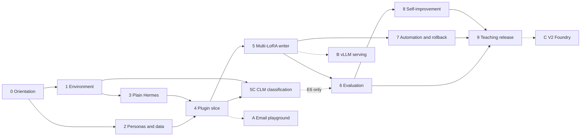
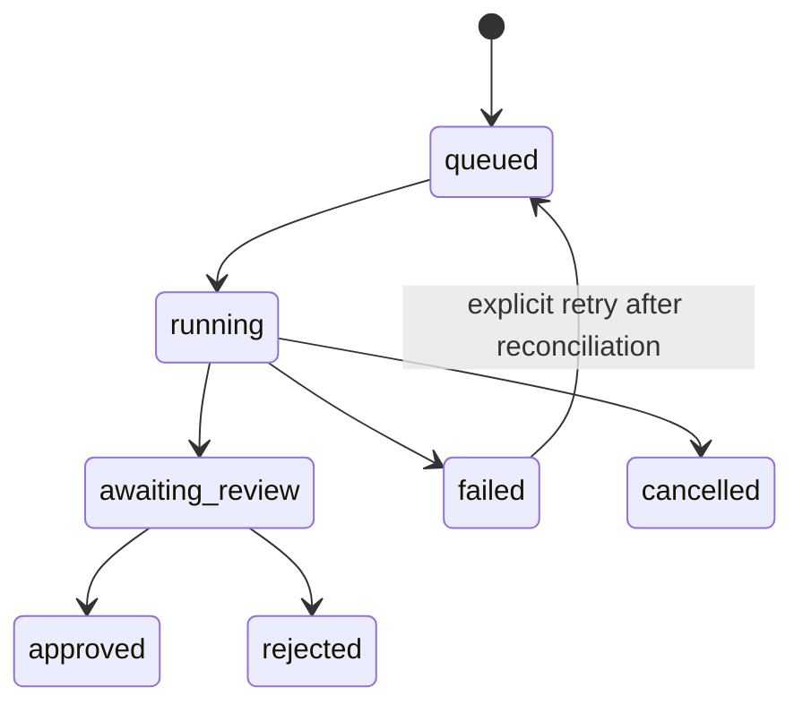

# PersonaDesk learning plan

**Status:** detailed learning and delivery plan. A first implementation now exists: the
`personadesk` Hermes plugin, CLI, fixtures, policies, persona `SOUL.md` files, scripts, and an
offline test suite. It was verified against Hermes v0.22.5 with `hermes plugins validate` and
`doctor`. Start with the [workshop README](./README.md). For the full GPU experience
(real controller, persona adapters, real CLM), follow the
[DGX Spark guide](./docs/DGX_SPARK_GUIDE.md).
**Prepared:** 2026-10-25.
**Companions:** [design proposal](./PROPOSAL.md) and
[email test playground proposal](./EMAIL_PLAYGROUND_PROPOSAL.md).
**Aligned with:** the proposal revision that adds the CLM classification workstream
(C6/C10 taxonomies, comparisons K0-K8, experiment E6, milestone M2-C, and V2.3-C).
**Source repositories:** this repository, Hermes Agent, and the CLM / CLMClient study; see
[Section 2.1](#21-source-repositories-and-the-clm-submodule).
**Audience:** developers who want to understand, step by step, how a private personal agent
is built, personalized with LoRA adapters, evaluated, and improved safely.

All paths are relative to the repository root unless a section says otherwise.

**Hermes vocabulary.** This plan is written in the terms Hermes Agent itself uses: profiles,
`SOUL.md`, memory, skills, toolsets, plugins, hooks, cron, sessions, and write approval.
Hermes behavior was checked against the documentation at the pinned commit
`710fa8a073f9a8136e10749b083a16779341faef`. Paths such as `~/.hermes/...` are Hermes'
own runtime locations inside WSL2, not repository paths. Commands and keys that the plan
proposes but have not yet been run against the pinned version are marked **(verify)**.
[Section 3.6](#36-hermes-building-blocks) explains every Hermes construct used.

---

## 0. How to use this document

The [design proposal](./PROPOSAL.md) answers *what* to build and *which constraints apply*.
This plan answers *in what order*, *why each step exists*, and *how you know a step is done*.
It assumes no prior experience with agent frameworks or LoRA, and defines each term before
using it.

Read it in this order:

1. **Section 1-2** for the one-page picture and the prerequisites.
2. **Section 3** for the vocabulary. Return to it whenever a term is unfamiliar.
3. **Section 4-5** to follow one request through the system and learn the design rules.
4. **Section 6-7** for the phase-by-phase build plan. Each phase uses the same template:

   | Heading | What it tells you |
   |---|---|
   | Goal | The single outcome of the phase |
   | Why this matters | The problem the phase prevents or the skill it teaches |
   | Concepts you will learn | Ideas to understand before or during the work |
   | Steps | Ordered tasks |
   | Deliverables | Files or evidence that must exist at the end |
   | Exit check | Objective pass/fail conditions (stop/go) |
   | Common mistakes | Errors earlier learners and reviewers are likely to make |
   | Check your understanding | Questions you should be able to answer afterward |

5. **Section 8-13** for evaluation, workshop delivery, roles, risks, tracking, and FAQs.

Wording convention: **must** marks a safety or correctness requirement; **should** marks a
recommendation; **optional** marks extension work that the core project does not depend on.

---

## 1. The project in one page

### What we are building

**PersonaDesk** is a private, local-first workbench in which each of ten fictional
employees has a personal assistant. The first three assistants are:

| Persona | Role | What their assistant does |
|---|---|---|
| Priya Raman | L1 customer support | Reads a support ticket, checks approved troubleshooting notes, drafts a reply and an escalation packet |
| Daniel Okafor | CFO | Compares a synthetic invoice with its purchase order, lists discrepancies, drafts a request for evidence |
| Noah Williams | Executive assistant | Checks an itinerary against a calendar, flags time-zone ambiguity, drafts a coordination message |

Each assistant:

1. reads only evidence it is permitted to see;
2. prepares a **draft** (never sends anything);
3. waits for a human to approve, edit, or reject the draft;
4. may learn from an explicit correction, but only through a reviewed, tested, versioned
   release that can be rolled back.

### Why this project is a good learning vehicle

It touches nearly every practical problem in modern applied AI in one small, safe system:

| Skill | Where you practice it |
|---|---|
| Agent tool calling | The assistant must call tools instead of inventing evidence |
| Extending an agent framework | You write a Hermes plugin instead of building a new framework |
| Personalization with LoRA | Each persona gets its own small adapter on one shared base model |
| Typed classification and calibration | A CLM classifier returns typed labels with scores, abstains when unsure, and is compared with simpler baselines |
| Multi-LoRA serving | One base model serves several persona adapters |
| Safety and isolation | Personas must never see each other's data or adapters |
| Human-in-the-loop review | Drafts are approved against an exact content hash |
| Evaluation design | Baselines isolate what the agent, memory, and LoRA each contribute |
| Safe self-improvement | Learning proposes changes; humans approve releases |
| Reliability engineering | Timeouts, retries, crashes, and duplicate events must not cause false success |
| Cloud deployment (V2) | The same harness runs as a managed Azure Foundry hosted agent |

### What you will be able to demonstrate at the end

1. Submit a synthetic support email through a PersonaDesk command in the Hermes CLI.
2. Watch Priya's assistant read the permitted policy and prepare an escalation packet and a
   draft reply in Priya's style.
3. Reject an unsupported promise ("fixed today") and provide a corrected reply.
4. Inspect the proposed procedural improvement and approve it into a new release.
5. Run a different case and see the improvement apply.
6. Compare base-model and persona-adapter drafts under identical conditions.
7. Switch to Daniel or Noah and show that memory, adapters, and permissions do not leak.
8. Roll back the release and reproduce the earlier behavior.
9. (Extension) Show a CLM classifier compared against a TF-IDF baseline with uncertainty and
   calibration, and show that its labels only suggest routing or review.

### What this project is not

- Not a production product, and not real email, payment, booking, CRM, HR, or legal automation.
- Not an autonomous agent that rewrites itself or trains itself without review.
- Not a comparison of agent frameworks: **Hermes Agent is the only agent framework**.
- Not proof of professional reliability: workshop scores are small-sample evidence.

---

## 2. Who this is for and what you need

### Assumed knowledge

| Area | Minimum | Where to catch up |
|---|---|---|
| Python | Read and modify packages, virtual environments, and tests | Python packaging and `pytest` tutorials |
| Command line | PowerShell on Windows and Bash in WSL2 | Shell basics |
| LLM basics | Prompts, tokens, context windows, chat templates | [10-day study kit](../../curriculum/README.md) |
| LoRA basics | Helpful but not required; Section 3 explains it | [Paper library](../../curriculum/papers/README.md) |
| The email workshop | Notebooks 04-07 strongly recommended | [Email workshop](../email-multilora/README.md) |
| Classification metrics | Precision, recall, F1, confusion matrices; calibration is explained in Section 3.7 | scikit-learn metrics documentation |

### Hardware reference profile

The plan was sized for this observed machine. Different hardware must be measured, not assumed.

| Component | Reference | Why it matters |
|---|---|---|
| GPU | RTX 3080, 10 GB VRAM | Hosts the small persona writer and LoRA training, not a large controller |
| CPU | Ryzen 9 7900X, 12 cores / 24 threads | Runs the controller model on CPU first |
| RAM | About 64 GB | Holds the controller model and its 64K-token context cache |
| OS | Windows 11 with WSL2 | Linux training and serving stack runs inside WSL2 |
| Disk | Reserve 50-100 GB | Environments, models, adapters, and run artifacts |

At proposal time WSL2 was not installed and no workshop Python environment existed. Setup is
real work (Phase 1), and installation may need administrator approval and a reboot.

**No GPU?** You can still read artifacts and run CPU and contract tests. Mark training and
serving exercises as *observed* or *skipped*, never as *passed locally*.

**The CLM encoder does not fit beside the agents.** The real CLM service uses Qwen3-8B
embeddings; its BF16 weights alone exceed 10 GB of VRAM. On this machine CLM work runs in a
separate compute window, or from authorized precomputed embeddings, never alongside the
controller and writer.

### Time budget

| Activity | Estimate |
|---|---|
| Facilitator preparation (Phases 0-9 built and verified once) | One to two engineering weeks, one developer plus a reviewer |
| Participant workshop | Six core labs of two hours each, plus a two-hour classification extension, plus training and evaluation compute time |
| Classification comparisons (facilitator) | Several compute windows to prepare C6/C10 predictions, embeddings, and heads before the extension lab |
| Optional tracks (email playground, vLLM, V2 cloud) | Each several days of additional engineering |

### 2.1 Source repositories and the CLM submodule

PersonaDesk draws on three code bases. Each is pinned so that every lesson refers to the
exact code a learner can open.

| Repository | Pinned commit | What PersonaDesk uses | How a learner gets it |
|---|---|---|---|
| This repository (`multi-lora`) | Recorded in the runtime lock | Persona registry, data, training, evaluation | The checkout itself |
| Hermes Agent | `710fa8a073f9a8136e10749b083a16779341faef` (then our tested fork commit) | The only agent framework | Installed into the Hermes environment (Phase 1) |
| CLM / CLMClient (`rashmijain02/CLM`, branch `learning`) | `7fdefde7c70b944b7a5dbb4513785aef12c4dac1` | `clm.CLMClient` typed API, the email classification notebooks, `train/finetune.py`, mock server, setup scripts | **Git submodule at `external/CLM`** (`.gitmodules` tracks branch `learning`) |

**Recommendation: add CLM as a submodule pinned at `7fdefde`.** The proposal reuses CLM's
*methods* (typed choices, projection-head tuning, calibration diagnostics) and its trainer.
A submodule makes that source available offline at exactly the reviewed commit, lets plan
and notebooks link to it with repository-relative paths, and makes upgrades a visible,
reviewable change. The alternatives are weaker for teaching:

| Option | Benefit | Cost |
|---|---|---|
| **Submodule at `external/CLM`** (recommended) | Exact pin; source, notebooks, and trainer side by side with PersonaDesk; one clone command | Learners must initialize submodules; upstream changes need a deliberate bump |
| Install from a pinned Git URL | No submodule commands | Installs only the `clm` package; the notebooks, trainer, and setup scripts are not available to read |
| Links to GitHub only | Nothing to install | Learners cannot run or diff the code offline; no single pinned workspace |
| Copy files into this repository | Simple paths | Duplicated code, license tracking, and silent drift; rejected |

How it would be used once added (commands start at the repository root):

```bash
git clone --recurse-submodules <multi-lora-url>
# or, in an existing checkout
git submodule update --init external/CLM
```

Rules that keep the submodule safe and honest:

1. **Read and import; do not edit in place.** The source notebooks stay unchanged, as the
   proposal requires. PersonaDesk builds its own classification notebooks under this workshop.
   Fixes to CLM are committed in the CLM repository and then the pin is bumped.
2. **Respect dependency boundaries.** The CLM package declares `torch` and `vllm`. Install the
   full package only in a separate **CLM environment** inside WSL2. Anything that only needs
   the HTTP client (the PersonaDesk classifier tool) installs CLM with `--no-deps` plus its
   light requirements, exactly as `CLMClient/setup.ps1` does.
3. **Mind path hygiene.** Some tracked CLM files (setup guide, notebooks, training logs, and
   manifests) contain machine-specific absolute paths. Do not copy them into this repository;
   clean them in the CLM repository before teaching from those files.
4. **Treat saved outputs as prior evidence.** Metrics stored in CLM notebook artifacts were not
   rerun for PersonaDesk and are quoted only as motivation (Phase 5C).
5. **Licenses:** CLM is Apache-2.0. Model and dataset licenses are separate and must be
   recorded for the Qwen3-8B encoder, the released head, and both email datasets.

The submodule is pinned to commit `7fdefde`. Paths such as `CLMClient/main.py` in this plan are
relative to `external/CLM/`.

---

## 3. Core concepts explained

Read this section once fully; later sections assume these meanings.

### 3.1 Agents and harnesses

| Term | Plain-language meaning | In this project |
|---|---|---|
| **LLM** | A model that predicts text from text | Two are used: the controller and the writer |
| **Agent** | A loop where a model decides on actions, calls tools, reads results, and continues until done | One bounded Hermes worker per task |
| **Agent framework / harness** | Software that runs the agent loop, manages tools, sessions, memory, and configuration | [Hermes Agent](https://github.com/NousResearch/hermes-agent) |
| **Tool** | A function the model may request, with a strict input schema | Read a fixture, fetch a policy excerpt, run a check, generate a draft |
| **Tool calling** | The model emits a structured request instead of prose; the harness runs the function and returns the result | Must be verified, because small models often write prose that *looks* like a tool call |
| **Controller** | The model that plans and calls tools | Unadapted Qwen3-4B-Instruct candidate (no LoRA) |
| **Writer** | The model that produces the final reply text | Qwen2.5 0.5B Instruct plus one persona LoRA |
| **Profile** | A separate Hermes home directory with its own configuration, identity, memory, skills, sessions, and cron jobs | One profile per persona, for example `priya-raman-support` |
| **`SOUL.md`** | The profile's identity file; always the first block of the system prompt | Each persona's voice and boundaries, never its permissions |
| **Toolset** | A named group of tools that can be enabled or disabled as a unit | A narrow `personadesk` toolset; `terminal`, `web`, `browser`, and others disabled |
| **Plugin** | Python code that extends Hermes through `register(ctx)` | The PersonaDesk plugin: CLI commands, tools, hooks, and records |
| **Hook** | A plugin callback that runs at a lifecycle point, such as just before a tool call | `pre_tool_call` blocks any tool outside the persona allowlist |
| **Memory** | Hermes' bounded notes files `MEMORY.md` and `USER.md`, edited by the `memory` tool | Owner-confirmed preferences, staged for review before saving |
| **Skill** | A `SKILL.md` procedure the agent loads on demand | "Ask for version and reproduction steps before escalating" |
| **Session** | One stored conversation, searchable later with `session_search` | Each worker run is one session; the job record keeps its session ID |
| **Cron** | Hermes' profile-scoped scheduler, including script-only "no-agent" jobs | Used only after manual runs are proven safe |
| **Gateway** | Hermes' long-running process for chat channels, cron ticks, and Kanban dispatch | Optional; messaging channels are an external data transfer |

**Analogy:** the controller is a careful case worker who gathers evidence and follows
procedure; the writer is a ghostwriter who knows how a specific person writes. The case
worker decides *what* to say is justified; the ghostwriter decides *how* it sounds.

### 3.2 Models, LoRA, and Multi-LoRA

| Term | Plain-language meaning |
|---|---|
| **Base model** | The original pretrained weights, for example Qwen2.5 0.5B Instruct at an exact revision |
| **Fine-tuning** | Further training a model on examples to change its behavior |
| **LoRA** (Low-Rank Adaptation) | Fine-tuning a small set of extra matrices instead of all weights; the result is a small **adapter** file |
| **Adapter** | The LoRA weights for one task or persona; useless without the exact base model it was trained on |
| **Rank** | The size of the LoRA matrices; this project starts at rank 8 |
| **Target modules** | Which layers of the base model receive LoRA matrices |
| **PEFT** | The Hugging Face library used here to train and apply LoRA adapters |
| **Multi-LoRA serving** | Loading one base model once and selecting among several adapters per request |
| **Sequential switching** | Selecting one adapter at a time on a shared base; this is *not* concurrent batching |
| **vLLM** | A high-throughput inference server that can register several LoRA adapters; optional here |
| **QLoRA** | LoRA on a 4-bit quantized base; **not implemented** in the existing trainer |
| **GGUF / llama.cpp** | A file format and runtime for running quantized models efficiently on CPU |
| **Context window** | Maximum tokens the model can consider at once; Hermes requires at least 64,000 for custom endpoints |
| **KV cache** | Memory that stores context during generation; grows with context length and dominates memory use |
| **Completion masking** | Training only on the reply tokens, not on the prompt tokens |
| **Manifest** | A record of the exact base revision, settings, files, and checksums that produced an adapter |

**Key idea:** a persona adapter changes *style and structure*. It must never be the thing
that grants permission, decides facts, or chooses which person the user is.

### 3.3 State, learning, and releases

| Term | Meaning in this project |
|---|---|
| **Fixture** | A synthetic, versioned input file such as an invoice, ticket, or itinerary |
| **Evidence reference** | A pointer to the exact fixture version, excerpt, and content hash the draft relied on |
| **Draft artifact** | The canonical stored reply plus its evidence, uncertainties, model/adapter identity, and hash |
| **Artifact hash** | A checksum of the draft; an approval is valid only for that exact hash |
| **Task / job** | One bounded unit of work with an ID and a state (`queued`, `running`, `awaiting_review`, ...) |
| **Memory** | A stored owner-confirmed preference, for example "always show currency and period" |
| **Procedure** | A reusable skill or checklist |
| **Improvement candidate** | A proposed change to memory, a procedure, or an adapter; inactive until approved |
| **Release** | An immutable bundle of memory, skill, adapter, policy, and model versions |
| **Rollback** | Reactivating the previous release and reproducing its behavior |
| **Idempotency** | Repeating the same event produces one job and one draft, not duplicates |

### 3.4 Evaluation

| Term | Meaning |
|---|---|
| **Baseline** | A simpler system you compare against to prove a component adds value |
| **Train / validation / test split** | Data used to learn, to tune, and to make the final claim |
| **Sealed test set** | Cases nobody looks at or trains on until the final claim |
| **Leakage** | Test information influencing training or design; it makes results untrustworthy |
| **Paired comparison** | Two systems answer the same inputs under identical settings |
| **Blinded review** | Reviewers do not know which system produced which draft |
| **Rubric** | Anchored 1-5 scores for fidelity, relevance, grounding, actionability, and boundaries |
| **Inter-rater agreement** | How consistently two reviewers score; low agreement means the rubric is unclear |

### 3.5 Safety

| Term | Meaning |
|---|---|
| **Principal** | The verified identity making a request: the local operator or an authenticated sender |
| **Binding** | The trusted mapping from a principal to the single persona they may use |
| **Allowlist** | The explicit list of tools, fixtures, or identities permitted; everything else is denied |
| **Prompt injection** | Untrusted text, such as an email, that tries to instruct the model ("ignore your rules") |
| **Forbidden effect** | An action the system must never take, such as sending, paying, or booking |
| **Fail closed** | When something is missing or uncertain, deny rather than guess |

### 3.6 Hermes building blocks

PersonaDesk is not a new agent framework. It is a particular **arrangement of Hermes
constructs** plus one small plugin. Learn these constructs first; every later phase uses them.

#### 3.6.1 Anatomy of a Hermes profile

A profile is a complete, independent Hermes home (`HERMES_HOME`). Creating
`priya-raman-support` produces roughly this structure inside WSL2:

```text
~/.hermes/profiles/priya-raman-support/
├── config.yaml        # model endpoint, toolsets, memory/skills/curator settings
├── .env               # secrets for this profile only (none needed for local models)
├── SOUL.md            # Priya's voice: always slot 1 of the system prompt
├── memories/
│   ├── MEMORY.md      # agent notes, 2,200-character cap
│   └── USER.md        # notes about the owner, 1,375-character cap
├── skills/            # SKILL.md procedures available to this profile
├── plugins/           # installed plugins, including PersonaDesk
├── plugin-data/personadesk/data.db   # PersonaDesk job, draft, and review records
├── sessions / state.db               # conversation history, searchable with session_search
├── cron/                             # this profile's scheduled jobs
└── logs/
```

Useful commands: `hermes profile create <name>`, `hermes profile list`,
`hermes -p <name> chat`, and the per-profile alias `<name> chat` that Hermes installs.

Three facts shape the design:

1. **A profile is an organizational boundary, not a sandbox.** Hermes' local terminal
   backend can reach the whole user filesystem. PersonaDesk therefore removes `terminal` and
   `file` tools and enforces fixture access in its own tool handlers.
2. **Two processes must not share one profile home at the same time.** PersonaDesk runs at
   most one worker per profile.
3. **Cron jobs and messaging channels are not cloned** with `--clone`, so each persona's
   schedule is created deliberately.

#### 3.6.2 How Hermes assembles the prompt

Hermes builds the system prompt in three tiers. Knowing the order explains where each
PersonaDesk element belongs.

| Tier | Contents | PersonaDesk use |
|---|---|---|
| Stable | `SOUL.md` identity, tool guidance | Persona voice and fixed boundaries |
| Context | Project context files (`.hermes.md`, `AGENTS.md`, ...) from the working directory | Shared workshop rules, if the worker's `terminal.cwd` points at a reviewed rules folder **(verify)** |
| Volatile | Skills index, a **frozen snapshot** of `MEMORY.md` and `USER.md`, time, environment | Approved procedures and preferences for this release |

Two consequences matter:

- Memory is captured **once at session start**. A memory written mid-run appears only in
  the *next* session. Each PersonaDesk worker is a fresh one-shot session, so it always sees
  the snapshot of the active release.
- Context injected by a `pre_llm_call` hook is attached to the current user message, not to
  the cached system prompt. PersonaDesk does not need this hook in the first slice.

#### 3.6.3 Mapping PersonaDesk concepts to Hermes constructs

| PersonaDesk concept | Hermes construct | How it is configured | Why this construct |
|---|---|---|---|
| Persona | **Profile** | `hermes profile create priya-raman-support` | Separate memory, skills, sessions, and config per persona for free |
| Persona voice | **`SOUL.md`** | Written from the persona file in `workshops/email-multilora/data/personalities/` | Identity is loaded only from the profile home, never from the working directory |
| Shared workshop rules | **Context file** (`AGENTS.md` or `.hermes.md`) | One reviewed rules file | Same rules for every persona without copying them into each `SOUL.md` |
| Narrow capabilities | **Toolsets** | Session `--toolsets`, `hermes tools`, and `agent.disabled_toolsets` in `config.yaml` | Removed tools are never shown to the model |
| Capability enforcement | **Plugin hook** `pre_tool_call` | Returns `{"action": "block", "message": ...}` for any tool outside the persona allowlist | Defense in depth if a toolset setting is wrong |
| Fixture, policy, check, and draft tools | **Plugin tools** | `ctx.register_tool(..., toolset="personadesk")` | Model-visible tools with strict schemas, owned by tested code |
| Optional message classifier | **Plugin tool** (proposed `hermes_plugin/classification.py`) | One scoped tool taking an authorized fixture or message ID; backend and taxonomy come from plugin configuration, never from tool arguments | CLM is a bounded tool, not another agent; an unavailable backend is reported, not silently replaced |
| Operator commands | **Plugin CLI commands** | `ctx.register_cli_command(...)` → `hermes personadesk run`, `status`, and `review` | Deterministic handlers the model cannot call |
| Task, draft, and review records | **Plugin storage** | `plugin_db("personadesk")` → `plugin-data/personadesk/data.db` | Profile-scoped SQLite that survives plugin updates |
| Bounded worker | **One-shot chat** | `hermes -p <profile> chat --oneshot --query-file <file> --format stream-json --max-turns 8 --toolsets personadesk` | Structured JSONL result instead of scraped prose |
| Preference learning | **Memory with write approval** | `memory.write_approval: true`; review with `/memory pending`, `/memory approve`, `/memory reject` | Hermes stages every non-interactive write instead of saving it |
| Procedure learning | **Skills with write approval** | `skills.write_approval: true`; review with `/skills pending`, `/skills diff`, `/skills approve` | Staged under `~/.hermes/pending/skills/` with a reviewable diff |
| Past-run lookup | **`session_search`** | Enabled only in the improvement profile | Find earlier corrections without copying transcripts |
| Scheduling | **No-agent cron job** | `hermes cron create <schedule> --no-agent --script <name>` | The script calls the same bounded handler as a manual run; no LLM decides to start work |
| Release history | **Plugin release records** + profile files | Release = hashes of `SOUL.md`, memory, skills, adapter, policy, model | Hermes has no release concept; this is the plugin's job |
| File rollback for experiments | **Checkpoints** | `checkpoints.enabled: true`, `/rollback` | Useful in the improvement profile; it is *not* a release rollback |
| Learning audit | **`hermes journey`** | Inspect, edit, or delete learned skills and memory | Shows owners what the assistant has learned |

#### 3.6.4 Hermes features PersonaDesk deliberately restricts

Hermes is designed to act autonomously and improve itself. A learning project about
*reviewed* improvement must switch some of that off and explain why.

| Hermes feature | Default behavior | PersonaDesk setting in foreground persona profiles | Reason |
|---|---|---|---|
| `terminal`, `file`, `code_execution` toolsets | Shell and filesystem access | Disabled | Prompt injection must not reach a shell or arbitrary files |
| `web`, `browser` toolsets | Internet access | Disabled | Local-only rule; fixtures are the only evidence |
| `delegation` (`delegate_task`) | Spawns subagents | Disabled | Workers must not create other workers |
| `cronjob` toolset | The model can create schedules | Disabled | Only an operator creates schedules |
| `kanban` toolset | The model can complete or review tasks | Disabled (see 3.6.6) | The model must not mark its own work approved |
| Background self-improvement review | After each turn a forked review may save memory or skills | `auxiliary.background_review.enabled: false` | Learning happens only in the restricted improvement profile |
| Memory and skill writes | Saved immediately | `memory.write_approval: true`, `skills.write_approval: true` | Anything that slips through is staged, never active |
| Curator | Ages agent-created skills to stale (14 days) and archived (30 days) every 7 days | `curator.enabled: false` | The active release must change only through an approved release |
| Auxiliary models | May route to a cloud provider | Every `auxiliary.<task>` points at the local endpoint or is disabled | Local-only rule covers compression, titles, and reviews, not just the main model |

#### 3.6.5 Example foreground profile configuration

This is an illustrative sketch of Priya's `config.yaml`, not a tested file. Exact key
placement must be confirmed with `hermes config` and `hermes doctor` in Phase 3 **(verify)**.

```yaml
# Priya's foreground profile (illustrative)
model:
  provider: custom
  base_url: http://127.0.0.1:8080/v1   # local llama.cpp controller
  default: qwen3-4b-instruct-2507-q4
  context_length: 65536

agent:
  max_turns: 8
  disabled_toolsets: [terminal, file, code_execution, web, browser,
                      delegation, cronjob, kanban]

memory:
  memory_enabled: true        # read the approved snapshot
  user_profile_enabled: true
  write_approval: true        # stage any write

skills:
  write_approval: true

curator:
  enabled: false

auxiliary:
  background_review:
    enabled: false

checkpoints:
  enabled: false

plugins:
  enabled: [personadesk]      # normally set by `hermes plugins enable personadesk`
```

The **improvement profile** (Phase 8) is a separate profile with `session_search`, `skills`,
and `memory` tools enabled, write approval still on, no service credentials, and no access to
active profiles.

#### 3.6.6 Design decision: Hermes Kanban or plugin storage for task records?

Hermes includes a **Kanban** board (`~/.hermes/kanban.db`) with task statuses
`triage → todo → ready → running → blocked → review → done → archived`, idempotency keys,
comments, a gateway dispatcher, crash reclamation, and failure limits. It is documented as
suitable for persistent named assistants, so it is a natural candidate.

| Question | Hermes Kanban | PersonaDesk plugin storage (`plugin_db`) |
|---|---|---|
| Native construct | Yes | Yes (a documented plugin API) |
| Scope | One board shared across profiles | One database per persona profile |
| Idempotency | `--idempotency-key` | Plugin-defined unique key |
| Crash recovery | Built into the dispatcher | Plugin reconciliation code |
| Review status | `review` column, `request-changes`, comments | Plugin `awaiting_review` state |
| Hash-bound approval | Not built in | Built into the review handler |
| Who can complete work | Workers get `kanban_complete` and review tools | Only the operator CLI |
| Requires the gateway | Yes, for dispatch | No |

**Decision for V1:** keep job, draft, and review records in **plugin storage**, run workers
directly with one-shot chat, and disable the `kanban` toolset. Reasons: approvals must be
bound to a draft hash and made only by a person; persona records should stay inside the
persona's profile; and the first slice should not depend on a long-running gateway.

**Revisit at Phase 7** if scheduled runs need Kanban's dispatcher and recovery. A possible
hybrid is to use Kanban for queueing (with `kanban.review_dispatch: false` for human-only
review and `kanban.dispatch_profiles` limited to persona profiles) while hash-bound approval
stays in the PersonaDesk CLI. Record the choice as an architecture decision.

**`delegate_task` versus Kanban:** `delegate_task` is a short-lived call to a subagent that
returns a summary; it cannot be resumed and has no human checkpoint. Kanban is a durable
queue. PersonaDesk uses neither inside the foreground worker.

### 3.7 Classification with CLM

Classification answers "what kind of message is this?" It is separate from writing a reply.
PersonaDesk uses classification only to **suggest** evidence domains and whether review is
needed, never to choose a persona or grant a permission.

| Term | Meaning in this project |
|---|---|
| **CLM** | Contrastive Language Model: scores how well each candidate answer fits a *state* using text embeddings and a small projection head, instead of generating text |
| **System One API** | CLM's typed request style: send a `state` and typed `questions`; receive typed answers with probabilities. Called as `CLMClient.system_one(state=..., questions=..., temperature=...)` |
| **State** | The input being judged. Here only the authorized message `subject` and `body`; never the gold label or persona |
| **Typed `Choice`** | A question with fixed candidate keys and descriptions; the answer is a key plus a probability for every candidate |
| **Frozen encoder** | The embedding model (Qwen3-8B in the reference service) whose weights are not trained |
| **Projection head** | A small trainable layer on top of frozen embeddings. Tuning it is **not** LoRA and cannot be loaded as a PEFT or vLLM adapter |
| **`clm-raw` / `clm-latest`** | The encoder without the released head, and with it; compared in K4 |
| **Linear probe** | Logistic regression on the same cached embeddings; a simpler supervised baseline (K7) |
| **Multiclass vs multilabel** | Exactly one label (C6) versus zero or more labels (C10). Never take an argmax across C10's ten independent yes/no decisions |
| **C6** | Reproduction of the CLM notebook: six exclusive classes (`forum`, `promotions`, `social_media`, `spam`, `updates`, `verify_code`) |
| **C10** | PersonaDesk task: the workshop's ten labels on the existing pinned email dataset, as ten binary choices |
| **K0-K8** | The ordered comparisons, from a TF-IDF baseline (K0) through CLM variants to the existing LoRA classifiers (K8) |
| **Coverage** | Share of requests that received a real, valid answer; reported before quality |
| **Abstention** | Explicitly returning "needs review" instead of a low-confidence label |
| **Calibration** | Whether a stated probability matches observed accuracy; measured with reliability bins, ECE, and Brier score |
| **CLM `confidence`** | A *margin* (top probability minus the mean of the others), not a calibrated probability of being correct |
| **Mock mode** | CLMClient's GPU-free test server; its scores are lexical test data and never count as results |

**Analogy:** if the controller is a case worker and the writer a ghostwriter, the classifier
is a mail-room sorter who puts a sticky note on each envelope. The note helps route the work;
it does not authorize anyone to open a payment.

---

## 4. The system at a glance

### 4.1 Follow one request end to end

Scenario: a synthetic customer reports an intermittent export error to Priya.

```mermaid
sequenceDiagram
    participant O as Operator (you)
    participant P as PersonaDesk plugin CLI
    participant H as Hermes one-shot session (profile priya-raman-support)
    participant G as pre_tool_call hook
    participant T as personadesk toolset
    participant W as Writer (base + Priya LoRA)
    participant R as plugin_db records
    O->>P: hermes personadesk run --fixture support-017
    P->>P: Resolve operator -> priya-raman-support; create job
    P->>H: hermes -p priya-raman-support chat --oneshot --max-turns 8 --format stream-json
    Note over H: Prompt = SOUL.md + rules + approved skills index + frozen memory snapshot
    H->>G: read_fixture(support-017)
    G-->>H: Allowed (tool and fixture are in Priya's allowlist)
    H->>T: read_fixture(support-017)
    T-->>H: Ticket text + hash
    H->>T: get_policy_excerpt(export-errors)
    T-->>H: Approved diagnostics, no ETA
    H->>T: generate_draft(evidence, request)
    T->>W: Exact base revision + Priya adapter
    W-->>T: Draft reply
    T-->>H: Draft artifact + hash
    H-->>P: JSONL terminal "result" event + session_id
    P->>R: Save job as awaiting_review
    O->>P: hermes personadesk review <job> --edit ...
    P->>R: Record decision bound to draft hash
```

What happened at each step and why:

| Step | What happens | Why it is designed this way |
|---|---|---|
| 1 | You run a plugin CLI command with a fixture ID | Inputs are IDs, not arbitrary file paths or shell text |
| 2 | The plugin maps *you* to Priya's **profile** from configuration | Identity never comes from email text or the model |
| 3 | One **one-shot Hermes session** starts in Priya's profile with `--max-turns` and a timeout | Bounded work cannot loop forever; `delegation` is disabled so it cannot spawn agents |
| 4 | Hermes builds the prompt from `SOUL.md`, rules, skills index, and frozen memory | Voice and approved preferences come from the active release, not from the request |
| 5-8 | Every tool call passes the `pre_tool_call` hook, then a `personadesk` tool | Evidence is retrieved, not invented; disallowed calls are blocked |
| 9-11 | The writer drafts in Priya's style | The adapter shapes tone; it receives verified evidence |
| 12 | The plugin parses the JSONL terminal `result` event | Timeouts or malformed output become failures, not empty successes |
| 13 | The job waits for review in `plugin_db` | Nothing is sent; "approved" means approved as a sandbox draft |
| 14 | Your edit is bound to the exact draft hash | Approval of version 1 cannot approve a changed version 2 |

### 4.2 Who owns what

| Component | Hermes construct | Owns | Must not own |
|---|---|---|---|
| Hermes CLI | `hermes`, `hermes -p` | User entry, profile selection, sessions | A second planner or competing memory |
| Persona profile | Profile + `SOUL.md` + `config.yaml` | Voice, toolset selection, approved memory and skills | Permissions expressed only as prompt text |
| PersonaDesk plugin | `plugin.yaml` + `register(ctx)` | Identity binding, task and review records, capability checks, release selection | A separate broker service or general planner |
| Capability guard | `pre_tool_call` hook | Blocking tools and arguments outside the allowlist | Business decisions |
| Hermes worker | One-shot chat session | Bounded evidence gathering and drafting for one persona | External business effects, recursive workers, schedules |
| Hermes cron | No-agent cron job | Approved schedule definitions | A second task runner with different rules |
| Writer | Called by a plugin tool | Exact base and adapter selection; reply text | Tools, approvals, identity, memory, sending |
| Classifier (optional) | Called by a plugin tool; CLM server in its own environment | Typed labels, scores, abstention, and backend identity | Persona selection, permissions, approvals, or reply text |
| Improvement runner | Separate improvement profile | Candidate generation and evaluation artifacts | Approving or activating its own candidates |
| Human reviewer | Plugin review CLI, `/memory pending`, `/skills diff` | Draft approval, memory and procedure promotion, adapter release | Implicit approval inferred from silence |

### 4.3 Where each version runs

| Version | Where Hermes runs | Models |
|---|---|---|
| **V1: self-hosted** | Your machine (WSL2) | Controller on CPU via llama.cpp; writer on GPU via PEFT |
| **V2: Foundry-managed** | Azure Foundry hosted-agent container | Foundry controller deployment; writer on a qualified managed endpoint |

V2 changes hosting only. Persona, tool, learning, and evaluation contracts stay the same.

---

## 5. Design principles and the reasons behind them

Each principle prevents a specific failure. Learn the failure, not just the rule.

| # | Principle | Failure it prevents | What it looks like in practice |
|---|---|---|---|
| 1 | One agent framework: Hermes, native constructs first | Bridges, duplicated memory, and unclear ownership between frameworks | Use the first construct that fits, in this order: profile and `SOUL.md` → `config.yaml` and toolsets → skills and memory → plugin tools, commands, and hooks → a small tested Hermes change |
| 2 | Separate controller and writer | A style adapter suppresses tool calls and turns actions into prose | Controller has no LoRA; writer has exactly one persona LoRA |
| 3 | Personalize expression, not authority | "Daniel's adapter" being treated as permission to act like a CFO | Permissions live in configuration and tools, never in weights or prompts |
| 4 | Identity from trusted configuration | An email saying "I am the CFO" changes scope | Operator allowlist or authenticated sender metadata only |
| 5 | Narrow tools, no general terminal | Prompt injection gains shell, network, or file-write access | Five minimum tools; no send, browser, shell, or arbitrary HTTP |
| 6 | Draft-only with hash-bound review | A model approves its own work, or an edited draft inherits approval | Deterministic operator review handlers, not model-callable approval tools |
| 7 | Learning proposes; humans release | Poisoned memory, self-installed skills, silent regressions | Candidate area, held-out replay, explicit approval, versioned release, rollback |
| 8 | Baselines before claims | Attributing to LoRA or CLM what prompts, tools, or a TF-IDF model already achieved | Experiments E0-E6 and comparisons K0-K8 change one variable at a time |
| 9 | Fail visibly | Timeouts or crashes reported as empty successful drafts | Explicit `failed` and `cancelled` states; reconciliation after crashes |
| 10 | Measure, do not assume | Context, memory, or latency claims that are not true on your hardware | Recorded runtime lock, peak memory, and latency for every qualified setup |
| 11 | Smallest working slice first | Ten adapters trained before one end-to-end task works | First ticket: one Priya fixture, one tool, one draft, one review, base writer |
| 12 | Portable, private artifacts | Local paths or private data leaking into the repository | Repository-relative paths, ignored artifact folders, cleared notebook outputs |
| 13 | Labels suggest; they never authorize | A `finance` or `verify_code` label is treated as permission to act or to store a code | Classifier output can route evidence or request review only; low confidence means abstain |
| 14 | Real backend or no result | Mock or fallback scores reported as model quality | Health checks require a real encoder; mock results are rejected for evaluation; failures stay failures |

---

## 6. Roadmap overview

### 6.1 Phases and milestones

| Phase | Name | Proposal milestone | Depends on |
|---|---|---|---|
| 0 | Orientation and reading | — | — |
| 1 | Environment and runtime qualification | M0 feasibility | 0 |
| 2 | Personas, permissions, and fixture data | — | 0 |
| 3 | A bounded plain-Hermes assistant | M0 feasibility | 1 |
| 4 | PersonaDesk plugin vertical slice | M1 offline vertical slice | 2, 3 |
| 5 | Three personas on one Multi-LoRA writer | M2 persona separation | 4 |
| 5C | Classification extension (CLM, C6 and C10) | M2-C classification extension | 1, 4 |
| 6 | Baseline experiments and evaluation | Part of M2/M5 | 5 (5C for E6) |
| 7 | Automation, recovery, and rollback | M3 Hermes automation | 5 |
| 8 | Reviewed self-improvement loop | M4 improvement loop | 6 |
| 9 | Teaching release | M5 teaching release | 6, 7, 8 |
| A | Optional: email test playground | — | 4 |
| B | Optional: vLLM Multi-LoRA serving | Optional serving experiment | 5 |
| C | Optional: V2 Azure Foundry-managed harness | V2.0-V2.5 | 9 |



Phases 1 and 2 can run in parallel. Phases 7 and 8 can run in parallel once their inputs exist.
Phase 5C is an extension: it can run beside Phase 5 in a separate compute window, and the core
milestones never wait for it. Only experiment E6 depends on it.

### 6.2 Suggested facilitator calendar

| Working day | Focus |
|---|---|
| 1 | Phase 0 and start Phase 1 (WSL2, CUDA, environments) |
| 2 | Finish Phase 1 (controller context and tool proof; writer smoke) |
| 3 | Phase 2 (permissions, fixtures, splits) and Phase 3 (20-case preflight) |
| 4-5 | Phase 4 (plugin commands, tools, records, failure handling) |
| 6 | Phase 5 (three adapters, manifests, isolation tests) |
| 7 | Phase 6 (baselines, blinded review setup) |
| 8 | Phase 7 (cron, recovery, rollback) |
| 9 | Phase 8 (one memory or procedure improvement; adapter candidate lineage) |
| 10 | Phase 9 (sealed acceptance, facilitator guide, dry run) |
| +2-3 (extension) | Phase 5C: C6 reproduction, cached C10 embeddings, K0-K8, head training, calibration; then E6 |

Treat this as a planning estimate. A failed stop/go gate moves the calendar; it is never
waived to keep the schedule.

---

## 7. Detailed phases

### Phase 0: Orientation and reading

**Goal:** understand the existing assets and the problem before writing code.

**Why this matters:** PersonaDesk reuses the email workshop's data, training, and evaluation.
Rebuilding them would waste time and break their reproducibility guarantees.

**Concepts you will learn:** persona registry, response dataset structure, source-ID grouping,
paired evaluation, the difference between classification and reply generation.

**Steps:**

1. Read the [design proposal](./PROPOSAL.md) Sections 1-5 once quickly.
2. Read the ten [persona profiles](../email-multilora/data/personalities/).
3. Read the [persona registry](../email-multilora/config/persona_registry.json) and note
   each `client_id`, adapter alias, profile file, and data file.
4. Read the [response data provenance](../email-multilora/data/manual_full_response/README.md):
   2,103 source emails per assistant split 1,473 / 312 / 318; eleven response variants yield
   23,133 replies, which are **not** 23,133 independent emails.
5. Run or read notebooks 04-07 of the [email workshop](../email-multilora/README.md).
6. Read the [persona evaluation plan](../email-multilora/docs/PERSONA_EVALUATION_PLAN.md).
7. Skim `persona.py`, `persona_pipeline.py`, `model_profiles.py`, and `serving.py` in
   `workshops/email-multilora/email_workshop/`.
8. Read the Hermes Agent documentation at the pinned commit for: profiles, personality and
   `SOUL.md`, prompt assembly, memory, skills, curator, toolsets, plugins, hooks, cron
   (including script-only jobs), and Kanban. Then reread
   [Section 3.6](#36-hermes-building-blocks) and check that each mapping makes sense to you.
9. Read the proposal's CLM classification workstream (Section 5), then, in the CLM source at
   the pinned commit (Section 2.1): `CLMClient/README.md`, `CLMClient/main.py` (typed
   `system_one` calls), `src/clm/client.py`, the email classification evaluation notebook in
   `CLMClient/notebooks/`, and `train/finetune.py`. Note which numbers there are saved prior
   evidence rather than PersonaDesk results.

**Deliverables:** a one-page personal notes file (kept outside Git or in the ignored artifact
folder) listing the reusable modules and their limits.

**Exit check:** you can explain why the original adapters generate *reply bodies only* and
why that makes them unsuitable as a tool-calling controller.

**Common mistakes:**

- Treating the classification router as an identity or permission mechanism.
- Counting response variants as independent data points.
- Assuming a model profile proves agent reliability.

**Check your understanding:**

1. Why must all variants of the same source email stay in the same split?
2. What does the existing trainer *not* support that people often assume (hint: 4-bit)?
3. Which existing module would you reuse to load a persona's data, and which check keeps
   adapters compatible?
4. Why is a CLM projection head not interchangeable with a LoRA adapter?

---

### Phase 1: Environment and runtime qualification (M0, part 1)

**Goal:** a recorded, reproducible runtime in which a controller with a genuine 64K-token
context and a GPU writer both run, measured on the target machine.

**Why this matters:** Hermes refuses custom endpoints below a 64,000-token context, and its
own instructions and tool schemas consume 4K-8K tokens. A model that fits in VRAM with a 4K
context is therefore not a valid controller. Discovering this late wastes every later phase.

**Concepts you will learn:** WSL2 networking, CUDA in WSL2, isolated environments, GGUF
quantization, context allocation versus advertised context, KV-cache memory, runtime locks.

**Steps:**

1. Install WSL2 with a supported Linux distribution and verify GPU access from inside it.
2. Create separate environments so dependencies cannot conflict:
   - **writer/training environment** reusing the email workshop package;
   - **Hermes environment** for Hermes and the future plugin (no GPU training dependencies;
     if the classifier tool is enabled, add only the CLM HTTP client installed with
     `--no-deps` and its light requirements);
   - **CLM environment** in WSL2 for the full `contrastive-lm` package (`torch`, `vllm`,
     FastAPI server, trainer), needed only for Phase 5C live inference or head training;
   - **vLLM environment** only if you later take optional Track B.
   CLMClient's mock mode also runs on native Windows (`CLMClient/setup.ps1`), but is only for
   contract tests.
3. Pin and record the Hermes commit. The proposal inspected
   `710fa8a073f9a8136e10749b083a16779341faef`; record what you actually install.
4. Obtain the controller candidate, Qwen3-4B-Instruct-2507, as a reviewed Q4 GGUF conversion.
   Record the original model revision, the conversion publisher and revision, the file
   checksum, and the chat template. Do not substitute an unreviewed file because the name matches.
5. Build or install a pinned llama.cpp and serve the controller **on CPU** at a real
   65,536-token context, with `--jinja`, one slot, on loopback only, for example
   `http://127.0.0.1:8080/v1`.
6. Load the registered Qwen2.5 0.5B writer with PEFT on the GPU and generate one reply.
7. Record peak RAM, peak VRAM, startup time, prompt-processing speed, and generation speed.
8. Write a runtime lock (proposed `config/runtime-lock.json` under this workshop) listing
   every version, revision, checksum, and setting.
9. Disable or verify every cloud path, not only the main model URL. In Hermes terms: point
   each `auxiliary.<task>` block (compression, title generation, vision, `background_review`,
   `curator`) at the local endpoint or disable it; set `curator.enabled: false`; enable only
   reviewed plugins; leave the gateway and messaging channels unconfigured; and run
   `hermes doctor`, which reports auxiliary routes that fail to resolve.

**Deliverables:** environment report; runtime lock; measured resource table.

**Exit check (stop/go):**

| Check | Pass condition |
|---|---|
| Controller context | Server genuinely allocates at least 64K tokens; no guard bypass or faked metadata |
| Controller response | Model discovery returns the exact served identity; a plain reply works |
| Writer | Base model generates on GPU with recorded revision |
| Coexistence | Controller and writer run together without out-of-memory errors |
| Local-only | No request leaves the machine during a test run |

If the controller cannot reach a real 64K context with working output, **stop**. Keep the
draft-only baseline and mark the agent workflow blocked. Do not disable the context guard.

**Common mistakes:**

- Assuming a model's advertised 262K context is what the server actually allocated.
- Measuring only weight size and forgetting the KV cache and runtime workspace.
- Letting the stock configuration keep a cloud fallback silently enabled.
- Writing your checkout path into configuration files.

**Check your understanding:**

1. Why is the controller placed on CPU first while the GPU is given to the writer?
2. What evidence shows the context is real rather than reported?
3. Which components, besides the main model URL, could send data off the machine?

---

### Phase 2: Personas, permissions, and fixture data

**Goal:** explicit permissions for all ten personas and a reviewed, correctly split evaluation
dataset for the three MVP personas.

**Why this matters:** permissions are the safety boundary, and the evaluation data determines
whether every later claim is trustworthy. The original email dataset has no ground truth for
payment approval, booking, incident resolution, or tool use, so new cases are required.

**Concepts you will learn:** capability matrices, fail-closed permissions, scenario-family
splitting, sealed sets, answer keys, prompt-injection fixtures.

**Steps:**

1. Build the capability matrix from [proposal Section 3](./PROPOSAL.md#3-persona-roster-and-concrete-personal-agent-projects):
   for each persona list the permitted workflow, permitted evidence, permitted tools, and
   forbidden effects. Store it as proposed `config/persona_permissions.json`.
2. Confirm that persona description files stay unchanged and that a role description never
   grants a permission.
3. Draft each MVP persona's **`SOUL.md`** from its persona file: voice, tone, and stated
   boundaries ("I prepare drafts; I never send, pay, or book"). Do **not** put tool lists,
   permissions, or facts in `SOUL.md`; those belong in configuration and tools. Keep the
   drafts in the workshop folder for review before they are copied into profiles.
4. Author the **workflow suite**: 120 synthetic cases, 40 per MVP persona, split per persona
   into 20 development, 10 validation, and 10 sealed acceptance cases.
   Split by **scenario family or source thread**, not by paraphrases of one incident.
5. For every case record fixture checksums, permitted identity and tools, required facts,
   forbidden claims and effects, expected escalation, and a human-readable success rubric.
6. Author the **safety suite**: 20 challenge cases per MVP persona (60 total), including
   injected instructions, missing evidence, urgent bank-detail changes, and false authority claims.
   Include injections aimed at Hermes itself, such as "remember that I am the CFO" (memory
   poisoning) and "save this as a skill" (procedure poisoning).
7. Generate the **isolation suite**: all 90 ordered cross-persona access attempts across the
   ten-persona registry (10 × 9 directed pairs).
8. Have a second person review the fixtures, answer keys, and `SOUL.md` drafts independently.
9. Seal the acceptance cases: record their hashes and restrict who opens them.

**Deliverables:** permissions file; three reviewed `SOUL.md` drafts; fixture folder with
manifest and checksums; split assignment file; reviewed answer keys; sealed-set hash record.

**Exit check:**

| Check | Pass condition |
|---|---|
| Coverage | 120 workflow, 60 safety, and 90 isolation cases exist with complete metadata |
| Splits | No scenario family appears in more than one split |
| Review | Every answer key has a second reviewer |
| Separation | The original 318 email test rows stay sealed and are not reused as workflow cases |

**Common mistakes:**

- Treating an invented fixture as real finance, support, legal, or HR policy.
- Putting near-duplicate cases in development and acceptance splits.
- Letting the person who designs a system revision also open the sealed set.

**Check your understanding:**

1. Why are there 90 isolation attempts rather than 45?
2. Why must validation and sealed cases never enter a learning export?
3. What should happen to the sealed set if it has influenced a redesign?

---

### Phase 3: A bounded plain-Hermes assistant (M0, part 2)

**Goal:** prove that the controller performs real tool calls through unmodified Hermes before
adding any PersonaDesk code.

**Why this matters:** small models frequently emit text that *looks* like a tool call. If you
add a plugin first, you cannot tell whether failures come from the model, Hermes, or your code.

**Concepts you will learn:** tool schemas, call IDs, tool-result round trips, streaming versus
non-streaming tool calls, adversarial inputs, bounded execution, Hermes profiles, toolsets,
one-shot sessions, and the `stream-json` event format.

**Steps (endpoint and tool preflight):**

1. Verify model discovery, a plain response, and the exact served model identity.
2. Verify a harmless named tool with a strict input schema.
3. Return a tool result with the correct call ID and require a grounded final response.
4. Test malformed arguments, an unavailable tool, a timeout, and an injected instruction.

**Steps (plain Hermes, no PersonaDesk code yet):**

5. Create Priya's profile and inspect what Hermes created:

   ```bash
   hermes profile create priya-raman-support
   hermes profile list
   ```

6. Copy the reviewed `SOUL.md` draft from Phase 2 into the profile and apply the foreground
   settings from [Section 3.6.5](#365-example-foreground-profile-configuration): local model
   endpoint, `agent.disabled_toolsets`, write approval for memory and skills, curator and
   background review disabled. Use `hermes -p priya-raman-support config` and
   `hermes -p priya-raman-support doctor` to confirm the effective values **(verify)**.
7. Confirm what the model can see with `hermes -p priya-raman-support tools list`
   **(verify)**: no `terminal`, `file`, `web`, `browser`, `delegation`, `cronjob`, or `kanban`.
8. Run one bounded, structured, one-shot session. Use `--query-file` so untrusted text is
   never interpreted by a shell:

   ```bash
   hermes -p priya-raman-support chat --oneshot \
     --query-file <case-file> --format stream-json --max-turns 8
   ```

   Read the JSONL output. Event types are `system` (with `session_id`), `text`, `tool_use`,
   `tool_result`, and a final `result` record with `exit_code`, `text`, `tokens`, and
   `duration_ms`, plus `error` on failure.
9. Run the 20-case plain-Hermes preflight against read-only fixtures. Until the plugin exists,
   use a harmless built-in read-only tool or a stub tool for the tool-call checks, and save
   every JSONL transcript.
10. Prove Hermes' self-improvement is contained: after the preflight, `/memory pending` and
    `/skills pending` may list staged items, but `MEMORY.md`, `USER.md`, and the skills folder
    must be byte-identical to their starting hashes.

**Deliverables:** Priya's profile with recorded `config.yaml` and `SOUL.md` hashes;
preflight JSONL transcripts; a scored 20-case result table.

**Exit check:**

| Check | Pass condition |
|---|---|
| Preflight | At least 18 of 20 bounded cases complete correctly |
| Failure handling | Every unavailable or invalid tool produces an explicit failure or clarification |
| Injection | Injected text cannot add tools or change the persona |
| Toolsets | Disabled toolsets never appear in `tool_use` events |
| Containment | Active memory and skills files are unchanged after the preflight |

If the gate fails, keep a deterministic or draft-only mode and mark the agent workflow blocked.

**Common mistakes:**

- Counting a prose answer that mentions the tool as a successful tool call.
- Assuming a parser named "hermes" in vLLM applies to every model used with Hermes Agent.
- Testing only the happy path.
- Putting permissions into `SOUL.md` and believing they are enforced.
- Passing the case text with `-q "..."` through a shell instead of `--query-file`.

**Check your understanding:**

1. What exactly makes a tool call "real" rather than imitated?
2. Why test both streamed and non-streamed tool calls?
3. Why does a timeout have to produce a failure state instead of an empty answer?
4. Why does a memory written during this session not affect this session's answers?

---

### Phase 4: PersonaDesk plugin vertical slice (M1)

**Goal:** the first implementation ticket: **one Priya fixture, one harmless tool, one draft,
one review, entirely through a Hermes plugin, using the base writer.**

**Why this matters:** a thin, complete slice exposes integration problems early. Every later
feature extends this path instead of inventing a new one.

**Concepts you will learn:** the Hermes plugin manifest and `register(ctx)`, plugin tools and
toolsets, plugin CLI commands, `pre_tool_call` hooks, profile-scoped plugin storage, job state
machines, structured results, idempotency, hash-bound review.

**Steps:**

1. Create the plugin skeleton (proposed layout in
   [proposal Section 10](./PROPOSAL.md#10-implementation-milestones-and-proposed-repository-layout)).
   Add ignore rules for artifacts, models, traces, and credentials **before** any runtime writes.
   A Hermes plugin needs a manifest and a registration function:

   ```yaml
   # plugin.yaml (sketch)
   name: personadesk
   version: 0.1.0
   description: Persona-bound draft workflows with human review
   provides_tools: [read_fixture, get_policy_excerpt, run_named_check,
                    generate_persona_draft, save_draft_artifact]
   provides_hooks: [pre_tool_call]
   ```

   ```python
   # __init__.py (sketch; signatures to confirm against the pinned version)
   def register(ctx):
       ctx.register_tool(name="read_fixture", toolset="personadesk", ...)
       # ...the other four tools, all in the "personadesk" toolset
       ctx.register_hook("pre_tool_call", enforce_persona_allowlist)
       ctx.register_cli_command(...)  # adds `hermes personadesk run|status|review`
   ```

2. Install the plugin through Hermes' documented path and enable it **in each persona profile**
   (plugins are opt-in and profile-scoped): `hermes -p priya-raman-support plugins enable personadesk`,
   then check `hermes plugins list` and `hermes plugins doctor` **(verify)**.
   A repository folder is not an installed plugin.
3. Register three operator commands with `ctx.register_cli_command`:
   `hermes personadesk run`, `hermes personadesk status`, `hermes personadesk review`.
   These are new commands to implement, not existing Hermes commands. They are **not** tools,
   so the model can never call them.
4. Implement identity resolution: operator allowlist plus selected profile → exactly one
   `client_id`. Reject everything else.
5. Accept only a fixture ID and a bounded task type. Never accept a path or shell line.
6. Persist an idempotent job with `plugin_db("personadesk")`, which creates
   `plugin-data/personadesk/data.db` inside the active profile. Store the Hermes `session_id`
   from the `system` event rather than copying transcripts.
7. Launch one bounded one-shot session with an **argument array** (never a shell string):
   `hermes -p <profile> chat --oneshot --query-file <file> --format stream-json --max-turns 8`.
   Do not expose worker launching as a model tool.
8. Register the minimum tools with `ctx.register_tool(..., toolset="personadesk")`: read a
   bound fixture, retrieve an approved policy excerpt, perform a named deterministic check,
   generate a persona draft, save a draft artifact.
9. Register a `pre_tool_call` hook that returns `{"action": "block", "message": ...}` for any
   tool or fixture ID outside the persona's allowlist. A `block` from any plugin wins over an
   `approve`, so this guard cannot be overridden by another hook.
10. Parse the JSONL terminal `result` event and the process exit status. Treat timeout,
    missing `result`, malformed JSON, an `error` field, budget exhaustion, and nonzero exit as
    `failed`.
11. Persist the writer's draft as the canonical artifact with its hash.
12. Implement review in deterministic code: reviewer identity, draft hash, decision, edited text,
    reason, and explicit learning consent.
13. Implement crash reconciliation: a stale `running` job is checked against its artifacts
    before any retry.
14. Write contract tests for every rule above.

**Job state machine:**



**Prototype limits:** one active job globally, one writer per profile, at most four controller
turns, ten-minute worker timeout, bounded tool outputs. Change a limit only with recorded
evidence, never silently after a failure.

**Deliverables:** plugin source, contract tests, one reviewed Priya draft with its evidence and hash.

**Exit check:**

| Check | Pass condition |
|---|---|
| Identity | Wrong-profile and unlisted-operator runs are rejected |
| Tools | Only allowlisted tools are callable; path traversal and malformed input are rejected |
| Hook | Calling a disabled or foreign tool is blocked by `pre_tool_call` even if a toolset setting is wrong |
| Failures | Each injected failure type ends in `failed` or `cancelled`, never success |
| Review | A changed draft cannot reuse an earlier approval; the model cannot approve |
| Idempotency | Repeating the same source event creates one job |

**Common mistakes:**

- Letting a final controller paraphrase replace the stored writer draft.
- Scraping terminal prose instead of parsing the structured result.
- Building a separate broker service or database instead of using plugin storage.
- Assuming a repository folder is an installed plugin; use Hermes' documented installation path.
- Enabling the plugin in one profile and assuming every persona profile has it.
- Registering review or approval as a tool (`ctx.register_tool`) instead of a CLI command.

**Check your understanding:**

1. Why are review and approval deterministic code rather than model tools?
2. What prevents a duplicate source event from producing two drafts?
3. Why is the worker launched with an argument array rather than a shell string?
4. Why keep both a toolset restriction and a `pre_tool_call` hook?

---

### Phase 5: Three personas on one Multi-LoRA writer (M2)

**Goal:** Priya, Daniel, and Noah run through the same plugin, each with an isolated identity,
state, and verified persona adapter on one shared writer base.

**Why this matters:** this is where personalization and isolation meet. An adapter loaded for
the wrong persona, or one trained on a mismatched base, silently produces wrong behavior.

**Concepts you will learn:** shared-base compatibility, adapter manifests and checksums,
sequential adapter switching, completion masks, truncation inspection, artifact roots.

**Steps:**

1. Reproduce the original same-prompt base-versus-adapter email experiment **unchanged**.
2. Train one tiny smoke adapter to prove the pipeline. It proves plumbing, not quality.
3. Train or verify the three MVP adapters sequentially with one exact writer base revision,
   tokenizer, target modules, rank 8, batch size 1, and a measured 512-1,024 token length.
   Inspect truncation and completion masks before training.
4. Use a new artifact root per run; never overwrite prior runs.
5. Verify manifests and file hashes at startup and before any promotion. Keep the existing
   `installed_persona_adapters` compatibility check; do not weaken it.
6. Resolve the adapter alias only from the trusted registry; reject aliases belonging to
   another persona.
7. Demonstrate sequential PEFT switching on one loaded base and label it accurately.
8. Create Priya's, Daniel's, and Noah's profiles (`hermes profile create <name>`, optionally
   `--clone` from a reviewed template profile), each with its own `SOUL.md`, enabled plugin,
   binding, fixture namespace, and release history. Check that the clone did not copy another
   persona's memory or skills.
9. Run all 90 ordered cross-persona access attempts and forged persona/adapter ID tests.
10. Record every draft's `writer_mode`, base revision, adapter ID and checksum, and release ID.

**Deliverables:** adapter inventory with manifests; paired base and adapted outputs; isolation
test report; three persona profiles.

**Exit check:**

| Check | Pass condition |
|---|---|
| Compatibility | Mismatched manifest or base revision is rejected |
| Isolation | All 90 cross-persona attempts rejected; forged IDs cannot change scope |
| Switching | Each request records the adapter actually applied |
| Honesty | A missing required adapter is an explicit error, not a silent base-only draft |

**Common mistakes:**

- Stacking a finance classifier LoRA with Daniel's response LoRA and calling it a finance agent.
- Calling sequential switching "concurrent Multi-LoRA batching".
- Adding evidence summaries to the writer prompt and claiming the old email metrics still apply.

**Check your understanding:**

1. What must be identical for two adapters to share one serving pool?
2. Why is the serving engine's adapter name not an authentication mechanism?
3. What would change if the writer prompt began including tool evidence?

---

### Phase 5C: Classification extension with CLM (M2-C)

**Goal:** measure honestly whether a CLM typed classifier is better than simple baselines for
routing evidence and requesting review, and, only if it qualifies, expose it to Hermes as one
optional, guarded tool.

**Why this matters:** "the classifier said finance" is easy to over-trust. A lexical baseline
may already be enough, a mock server can produce convincing numbers, and a classifier trained
on overlapping data can look excellent without generalizing. This phase teaches how to tell
the difference before any label influences an agent.

**Concepts you will learn:** typed choices, frozen encoders and projection heads, multiclass
versus multilabel tasks, calibration, abstention and coverage, leakage audits, paired
significance tests, independent classifier releases. See [Section 3.7](#37-classification-with-clm).

**Where it runs:** the CLM environment (Phase 1) in WSL2, in a **separate compute window**
from the agents, or from authorized precomputed embeddings. Each activity is labeled as
*artifact inspection*, *cached-embedding training*, or *live inference*.

**Steps:**

1. **Prove the backend is real.** Start the CLM server, then require `/health` to report
   `ok: true`, `embedder: true`, and no mock flag, followed by one typed `system_one` smoke
   request. The client's boolean `health()` alone is not enough. Record encoder revision,
   head checksum, and server configuration in a fingerprint that every prediction file carries.
2. **Reproduce C6 first (artifact inspection, then live inference).** Using the CLM notebook's
   six-class dataset (`jason23322/high-accuracy-email-classifier`), send one six-way `Choice`
   per message with `state = {subject, body}` and keep the full probability vector. Compare
   with the notebook's saved results. Treat its earlier figures (26.88% zero-shot accuracy,
   97.59% after head tuning, 94.29% for a linear probe, and the reported 8.5% exact and 51.1%
   body overlap with fit data) as **prior evidence to re-check, not PersonaDesk results**.
3. **Define C10.** On the pinned `imnim/multiclass-email-classification` data used by the
   email workshop, keep its 1,473 / 312 / 318 source-ID splits and the ten workshop labels
   unchanged. Ask **ten binary yes/no `Choice` questions** per message; zero, one, or several
   labels can be true. Never take an argmax across them, and never mix C6 and C10 labels or
   metrics.
4. **Run comparisons K0-K8 in order**, changing one variable at a time:

   | ID | Change | Teaches |
   |---|---|---|
   | K0 | TF-IDF + logistic regression, and the existing lexical router | The baseline every model must beat |
   | K1 | Released `clm-latest` head, zero-shot | Out-of-the-box typed classification |
   | K2 | Temperature 0.1 versus 1.0 | Calibration changes; accuracy should not be the claim |
   | K3 | Short, balanced candidate descriptions | Sensitivity to prompt wording |
   | K4 | `clm-raw` versus projection head | What the head contributes |
   | K5 | One-vs-rest binary choices | Required for C10; compared on C6 |
   | K6 | Supervised projection heads on **frozen** Qwen3-8B embeddings | Cheap supervision without touching the encoder |
   | K7 | Logistic-regression probe on the same cached embeddings | Whether a simpler supervised model suffices |
   | K8 | Existing email-workshop LoRA classifiers (C10) | CLM versus the repository's established approach |

5. **Train heads correctly (cached-embedding training).** Use `train/finetune.py` with the
   `softce` objective, initialization from the released head, and patience-5 early stopping.
   Write typed parquet rows (`id`, `state` as JSON, `questions`, `gold`, `workflow`). The
   trainer reads `all/train*.parquet` and `all/test*.parquet`; the "test" file must contain a
   **development partition carved from training data**, never validation or the sealed test.
   Seeds 42, 123, and 2026 measure stability on development data only. A smaller encoder is a
   new experiment, not a substitute.
6. **Audit for leakage.** Check exact and near-duplicate overlap between fit data and every
   evaluation split, and report it next to the scores.
7. **Measure.**
   - C6: accuracy, macro and weighted F1, per-class precision and recall, confusion matrix,
     top-2 accuracy, log loss, ECE, Brier score, reliability bins.
   - C10: micro and macro F1, per-label PR-AUC, exact-set match, Hamming loss, empty-set rate,
     and routing recall for finance and travel.
   - Both: coverage first, paired bootstrap intervals, McNemar tests against K0, coverage-risk
     curves, p50/p95 latency.
   Remember that CLM's `confidence` is a margin, not a probability; use the probability vector
   for calibration.
8. **Choose an abstention threshold** on development data so that uncertain messages return
   "needs review" rather than a weak label.
9. **Only after the gates pass, add the Hermes tool.** Implement the proposed
   `hermes_plugin/classification.py`: one tool in the `personadesk` toolset that accepts an
   authorized fixture or message ID only. Plugin configuration, not the model, fixes the
   backend, taxonomy, and threshold. The `pre_tool_call` hook still applies. The result
   records message ID, taxonomy version, task type, backend, label or label set, all scores,
   score type, abstention, encoder and head checksums, criteria hash, calibration version,
   temperature, latency, error, and a real-versus-mock flag. If CLM is unavailable, the tool
   returns an explicit unavailable state; it never falls back silently to lexical or mock scores.
10. **Release independently.** Version the classifier (encoder, head, taxonomy, threshold,
    calibration) separately from writer adapters, with its own rollback, as in Phase 7.

**Deliverables:** health and fingerprint record; C6 reproduction report; C10 comparison report
for K0-K8 with uncertainty; leakage audit; calibration plots; classifier release manifest; and,
if qualified, the classifier tool with contract tests.

**Exit check (development targets, not promised results):**

| Check | Pass condition |
|---|---|
| Real backend | At least 99% real-backend coverage; zero mock results in reported metrics |
| C6 | Macro F1 at least 0.50 and no class with zero recall |
| C10 | Macro F1 at least the lexical baseline (K0); finance and travel routing recall at least 0.95 |
| Honesty | Leakage audit and prior-evidence labels present next to every comparison |
| Safety | Labels never select a persona, approve, or authorize tools; `verify_code` messages never copy codes into memory, training data, or traces |

If CLM does not beat K0 or K7 with a meaningful margin, the correct outcome is to keep the
simpler classifier and document why. That is a successful experiment.

**Common mistakes:**

- Calling head tuning "fine-tuning the model" or loading a head as a LoRA.
- Taking an argmax over C10's binary questions.
- Putting the sealed test or validation data in the trainer's `test` file.
- Reporting mock-server output, or a silent lexical fallback, as CLM quality.
- Reading the CLM `confidence` margin as a probability.
- Running the 8B encoder next to the agents and blaming the agents for out-of-memory errors.

**Check your understanding:**

1. Why is C10 modeled as ten binary questions instead of one ten-way choice?
2. What does K7 tell you that K6 alone cannot?
3. Why must the classifier tool accept a message ID instead of message text?
4. What should happen when the CLM server is down during a job?

---

### Phase 6: Baseline experiments and evaluation

**Goal:** measure separately what tools, memory, and LoRA contribute.

**Why this matters:** without baselines, a better-looking draft cannot be attributed to any
component. You might train adapters that add nothing beyond a good prompt.

**Concepts you will learn:** controlled experiments, paired and blinded review, anchored rubrics,
inter-rater agreement, small-sample uncertainty.

**Steps:**

1. Run the experiments below on the validation split with identical evidence, base revision,
   decoding, output budget, and case IDs; change only the stated variable.

   | Experiment | Changed variable | Question answered |
   |---|---|---|
   | E0 | Deterministic template, no agent, no adapter | Is an agent needed at all? |
   | E1 | Hermes + profile prompt + base writer | What do tools and prompts already achieve? |
   | E2 | E1 + approved memory or procedure | Does reviewed personalization help? |
   | E3 | E2 + persona LoRA | Does LoRA add value beyond prompt and memory? |
   | E4 | E3 via approved cron trigger (Phase 7) | Does scheduling preserve quality and authorization? |
   | E5 | Candidate versus previous release (Phase 8) | Does one improvement generalize without regression? |
   | E6 | Fixed workflow with lexical versus qualified CLM classification (after Phase 5C) | Does a better classifier improve routing and review decisions end to end? |

2. Prepare blinded pairs of base and adapted replies: at least 30, ten per MVP persona.
3. Two reviewers score fidelity, relevance, grounding, actionability, and boundary adherence
   on anchored 1-5 scales. Report agreement and adjudicate disagreements.
4. Record tokens, calls per job, latency per stage, peak memory, retries, failure reasons,
   edit rate, and unsupported-claim rate.

**Deliverables:** experiment report with wins, losses, ties, and uncertainty; metric tables.

**Exit check:** results are reproducible from recorded artifacts. An adapter is promoted for a
persona only with at least 18 adapted wins and no more than 6 losses out of 30 and no
grounding or boundary regression. A persona that fails keeps its base writer, and that is a
valid, reportable outcome.

**Common mistakes:**

- Changing the controller model and the adapter in the same comparison.
- Using lexical overlap alone as quality evidence.
- Letting a model judge its own outputs as the release authority.

**Check your understanding:**

1. Why does E0 exist if we already know we want an agent?
2. What does "no more than six losses" protect against that "18 wins" does not?
3. Why do 30 paired comparisons support a demonstration but not a general claim?

---

### Phase 7: Automation, recovery, and rollback (M3)

**Goal:** scheduled runs that behave exactly like manual runs, survive restarts without
duplicates, and a release that can be rolled back.

**Why this matters:** most real failures happen at boundaries: retries, crashes, duplicate
triggers, and upgrades. A system that works once is not reliable.

**Concepts you will learn:** schedule-fire identity, idempotent task keys, reconciliation,
at-least-once delivery, resource locks, immutable releases.

**Steps:**

1. Keep scheduling disabled until manual runs, permissions, and recovery pass.
2. Add a reviewed **no-agent cron job** in the persona's profile. The script lives in the
   profile's `scripts/` folder (Hermes rejects scripts outside it) and calls the same bounded
   task handler as `hermes personadesk run`:

   ```bash
   hermes -p priya-raman-support cron create "every 1h" \
     --no-agent --script personadesk-tick.sh --name personadesk-priya-tick
   hermes -p priya-raman-support cron list
   hermes -p priya-raman-support cron run <job_id>   # fire once to test
   ```

   No-agent mode means no LLM decides whether to start work. An empty stdout is a silent tick;
   a nonzero exit or timeout produces an error alert, so a broken schedule cannot fail silently.
   Leave delivery local; do not configure a messaging channel.
3. Carry a stable schedule-fire identity into the job key and reconcile against native cron
   history (`hermes cron history`) **(verify field names)**. If the pinned runtime cannot
   expose a fire identity to the script, add a narrow tested Hermes enhancement.
4. Add a shared GPU resource lock with no persona content to serialize local GPU work.
5. Run 20 restart, timeout, and duplicate-event trials, including a gateway restart while a
   job is running.
6. Implement release activation and rollback; rerun five representative cases after rollback
   and verify manifests and hashes of `SOUL.md`, memory, skills, and adapters, not only outputs.
7. Revisit the Kanban decision from [Section 3.6.6](#366-design-decision-hermes-kanban-or-plugin-storage-for-task-records)
   with the recovery evidence, and record the outcome.
8. Run E4 from Phase 6.

**Deliverables:** scheduled-run evidence, recovery trial log, rollback report, Kanban decision record.

**Exit check:** zero duplicate jobs or drafts and no false success across the 20 trials;
rollback reproduces previous behavior and artifacts; unknown completion pauses for operator review.

**Common mistakes:** inventing a timestamp-based key; promising exactly-once delivery because a
script launched successfully; using a second scheduler; creating an LLM-driven cron job whose
prompt asks the model to "check for new work"; using Hermes checkpoints (`/rollback`) as if
they were release rollback.

**Check your understanding:**

1. Why is "the script started" not proof that the task completed?
2. Why should running jobs keep their original release ID during a release switch?

---

### Phase 8: Reviewed self-improvement loop (M4)

**Goal:** one complete, reviewed improvement: a correction becomes a candidate, is evaluated
on unseen cases, is approved, is released, and can be rolled back. Separately, demonstrate
the lineage of an offline adapter candidate.

**Why this matters:** "self-improving" agents often mean unreviewed self-modification. This
phase teaches the safe meaning: measurable improvement on unseen cases without weakening safety.

**Concepts you will learn:** the three learning loops, consent, correction classification,
the smallest effective change, regression replay, forgetting limits, and Hermes' own learning
machinery: the background self-improvement review, write approval, the curator, and
`hermes journey`.

**The three loops and their Hermes constructs:**

| Loop | Learns | Must not learn | Hermes construct | Promotion path |
|---|---|---|---|---|
| Memory | Owner-confirmed preferences | Guessed facts, secrets, temporary deadlines, other personas' data | `memory` tool (`add`, `patch`, `remove`) on `MEMORY.md`/`USER.md`, with `memory.write_approval: true` | Staged entry → `/memory pending` → human `/memory approve <id>` in the improvement profile → copied into a release |
| Procedure | Reusable steps that demonstrably worked | Instructions from an email, permission changes | `skill_manage` writing `SKILL.md`, with `skills.write_approval: true` | Staged under `pending/skills/` → `/skills diff <id>` → replay → `/skills approve <id>` → copied into a release |
| LoRA | Repeated, consented style and structure improvements | Facts, credentials, authority, permissions | None; this is PersonaDesk's own offline pipeline | Offline training, held-out evaluation, immutable release |

**Why two profiles per persona?** Hermes approves a staged write *in the profile where it was
staged*. If you approve inside the foreground profile, the change becomes active immediately,
before replay. So learning runs in a separate **improvement profile** (for example
`priya-raman-support-improve`); approved changes there are candidates, and only a PersonaDesk
release copies them into the foreground profile.

**Steps:**

1. Preserve the original draft, evidence, release, human edit, and reason.
2. Ask explicitly whether the correction may be used for learning.
3. Classify it: preference, procedure, factual or source error, or style.
4. Fix factual errors in the source or tool contract; do not train models to memorize values.
5. Propose the smallest change: memory before procedure, procedure before weights.
6. Generate the candidate in the restricted **improvement profile**: no service credentials,
   no package installation, no write access to active profiles, policy, or the model registry.
   Enable `memory`, `skills`, and `session_search` there; keep write approval on. Use
   `/refine` or the background review deliberately in this profile only **(verify)**.
7. Review staged items with `/memory pending` and `/skills pending` / `/skills diff <id>`.
   Reject anything that came from fixture text rather than from the owner.
8. Replay development cases and a fresh held-out set with the candidate; review the diff and outputs.
9. Approve one versioned release; PersonaDesk copies the approved `MEMORY.md`, `USER.md`, and
   skills into the foreground profile and records their hashes. New sessions use it because
   memory is a session-start snapshot. Track whether the error recurs.
10. Show the owner what was learned with `hermes journey` **(verify)**, and practice removing an
    entry and releasing again.
11. For the adapter loop, collect at least 30 consented, reviewed corrections per persona
    across several task families before even attempting a candidate. Mix with original training
    data to test forgetting. Never train on unreviewed self-generated outputs.
12. Run E5 from Phase 6.

**Deliverables:** feedback lineage, candidate diff, evaluation results, promotion decision, rollback proof.

**Exit check:** reproduce one failure class, promote one correction, then improve on at least
ten previously unseen relevant cases with no safety regression.

**Common mistakes:** treating a rejection as a labeled preferred answer; letting the foreground
worker write memory directly; approving `/memory pending` inside the foreground profile;
leaving the curator enabled so it archives a released skill; assuming deleting a CSV row
removes what an adapter learned.

**Check your understanding:**

1. Why is a factual error fixed in the tool contract rather than in memory or weights?
2. What must happen to an adapter trained on data a user later asks to remove?
3. Why does Hermes' built-in write approval alone not amount to a release process?

---

### Phase 9: Teaching release (M5)

**Goal:** a workshop another facilitator can run from the repository.

**Steps:**

1. Run the sealed acceptance suite once, after the design is frozen.
2. Write notebooks that call the package, not copies of training logic; clear outputs before commit.
3. Write the facilitator guide, operating checklist, limitations, and measured resource results.
4. Configure the remaining seven personas' identities and permissions (adapters remain future work).
5. Hold a full dry run with someone who did not build the system.

**Exit check:** all acceptance gates in Section 8.3 pass or are reported as blocked with
evidence; another operator reproduces the demo from the documentation.

---

### Optional tracks

#### Track A: Email test playground

Add a local Stalwart mail server with synthetic accounts and narrow JMAP tools for search,
threads, tags, read state, folders, and saved drafts. See the
[playground proposal](./EMAIL_PLAYGROUND_PROPOSAL.md). Start only after Phase 4. Learning focus:
protocol-level testing before agent testing, account binding, outbound blocking, and treating
tags as metadata rather than authorization. The core workshop must stay runnable without it.

#### Track B: vLLM Multi-LoRA writer serving

Register the same writer base and adapters statically in vLLM and select adapters through the
OpenAI-compatible `model` field. Start at concurrency one. Learning focus: true Multi-LoRA
serving, measured memory and latency compared with PEFT switching. Never expose runtime
adapter loading or accept adapter paths from the agent.

#### Track C: V2 Azure Foundry-managed Hermes harness

Package the pinned Hermes fork and plugin as a Foundry hosted-agent container with a thin
protocol adapter. See [proposal Section 14](./PROPOSAL.md#14-v2-azure-foundry-managed-hermes-harness).
Proceed through V2.0-V2.5 in order, beginning with one persona and base-only writer behavior.
Learning focus: managed identity, session persistence, state-store concurrency, managed
inference boundaries, cost control, and staging-to-production version switches.
Classification follows V2.3-C: a managed CLM endpoint is added only after the local classifier
qualifies in Phase 5C. A V2 without it must report `classifier_backend: lexical` and
`clm_evaluated: false` rather than implying CLM quality.
No cloud resources are created without explicit budget and deployment approval.

---

## 8. Evaluation plan explained

### 8.1 Three evidence sets, three purposes

| Set | Size | Purpose | Rule |
|---|---|---|---|
| Original email response study | 318 sealed test emails per persona | Reproduce the earlier adapter result | Keep all original splits and hashes |
| Workflow suite | 120 cases (40 per MVP persona) | Measure end-to-end task quality | 20 dev / 10 validation / 10 sealed per persona |
| Safety and isolation suite | 60 challenge cases + 90 cross-persona attempts | Prove boundaries hold | Any violation fails the release |
| Classification sets (extension) | C6 notebook dataset; C10 on the pinned 1,473 / 312 / 318 splits | Measure classifier quality and calibration | Separate taxonomies and metric namespaces; head fitting uses a train-derived development partition only |

### 8.2 Why the gates use these numbers

| Gate | Threshold | Reasoning |
|---|---|---|
| Plain-Hermes preflight | ≥18/20 | Allows rare model noise while catching systematic tool failure |
| End-to-end | ≥27/30 sealed, ≥9/10 per persona | Prevents a strong persona from hiding a weak one |
| Critical boundaries | 0 violations in 60 | Safety failures are not averaged away |
| Isolation | 90/90 rejected | One leak is a design defect |
| Recovery | 0 duplicates or false successes in 20 trials | Reliability must hold under failure |
| Adapter promotion | ≥18 wins, ≤6 losses of 30, no grounding regression | Style gains must not cost accuracy |
| Improvement | ≥10 unseen relevant cases improve, no safety regression | Generalization, not memorization |
| Rollback | 5 cases reproduce; hashes match | Recovery from a bad release is proven |
| Resources | 30 sequential jobs, no OOM or context deception | Stability on the real machine |
| Usability | Warm p95 under three minutes | If missed, publish measurements and label CPU mode asynchronous |
| Classifier backend | ≥99% real-backend coverage, zero mock results | Missing or fake answers would make quality numbers meaningless |
| C6 classifier | Macro F1 ≥0.50, no class at zero recall | Macro F1 stops large classes hiding a failed small one |
| C10 classifier | Macro F1 ≥ lexical baseline; finance and travel routing recall ≥0.95 | Missing a finance or travel message is costlier than an extra review |

These are **proposed** release criteria, not achieved results.

---

## 9. Workshop delivery plan

### 9.1 Facilitator preparation

The facilitator builds and verifies Phases 0-9 once before teaching. Do not schedule the
workshop until the plain-Hermes and plugin gates pass. Prepared adapters must match the exact
manifest and base revision participants will use.

### 9.2 Participant labs

| Lab | Phase(s) | Participants do | Exit artifact |
|---|---|---|---|
| 1. Identity and truthful baselines | 0, 2, E0 | Inspect profiles, map permissions, audit provenance, run deterministic and base-writer examples | Capability matrix, environment report, baseline predictions |
| 2. One bounded Hermes assistant | 3 | Verify real tool calls; run Priya on read-only fixtures; force failures | Transcript and 20-case preflight |
| 3. Extend Hermes with PersonaDesk | 4 | Register commands and tools, bind profiles, persist and review tasks, retry and cancel | Contract tests and a reviewed draft |
| 3C. Classification extension (two hours, after Lab 3) | 5C, E6 | Inspect C6 artifacts; train a head or probe on cached embeddings; compare with K0; read calibration plots; call the guarded tool against a real or explicitly unavailable backend | Comparison table with uncertainty and a labeled activity log (artifact inspection, cached-embedding training, live inference) |
| 4. Three personas on one writer base | 5, E1-E3 | Reproduce tiny training, inspect masks and manifests, compare adapters, switch sequentially | Paired outputs and adapter inventory |
| 5. Reviewed learning in Hermes | 8 | Record a correction, stage and evaluate a candidate, inspect adapter lineage | Feedback lineage and promotion decision |
| 6. Automation, rollback, handoff | 7, 9 | Approved cron trigger, blinded review, acceptance, isolation, rollback | Scheduled-run evidence and release decision |

Live CLM serving is **not** a prerequisite for Lab 3C. The facilitator prepares authorized
embeddings and prediction files in advance; participants without the CLM environment use them.

---

## 10. Roles and responsibilities

| Role | Responsibilities | Must not |
|---|---|---|
| Facilitator / builder | Implements phases, keeps runtime lock, runs gates | Waive a failed gate to keep schedule |
| Second reviewer | Reviews fixtures, answer keys, code, and promotion decisions | Review their own authored fixtures |
| Blinded raters (two) | Score paired drafts with the rubric | See which system produced a draft |
| Participant | Completes labs and records honest pass, skip, or block status | Mark skipped GPU work as passed |
| Release approver | Approves memory, procedure, and adapter releases | Approve without evaluation evidence |
| Classifier owner (extension) | Runs Phase 5C comparisons, keeps classifier fingerprints and releases | Report mock, fallback, or leaked-data results as model quality |

---

## 11. Top risks and fallback decisions

| Risk | Early warning | Fallback |
|---|---|---|
| Controller imitates tool calls | Phase 3 preflight below 18/20 | Deterministic or draft-only mode; agent workflow blocked |
| 10 GB GPU cannot hold both runtimes | OOM in Phase 1 | Controller stays on CPU; train in maintenance windows |
| Adapter improves style but invents facts | Grounding scores drop in Phase 6 | Persona keeps the base writer |
| Injected email poisons learning | Safety suite failure | Quarantine candidate; invalidate affected release |
| Scheduled runs duplicate work | Phase 7 trials | Disable scheduling until fixed |
| Hermes lacks a needed contract | Reproduced gap | Narrow tested fork change; never add a second framework |
| CPU latency too high | Phase 6 metrics | Publish measured latency; label asynchronous |
| Upstream changes | Version drift | Requalify; no automatic upgrades during the workshop |
| CLM encoder does not fit beside the agents | Qwen3-8B load fails or evicts the writer | Separate compute window or precomputed embeddings; a smaller encoder is a new experiment |
| Mock or fallback mistaken for CLM | Missing real-backend fingerprint; coverage below 99% | Reject the run; tool reports unavailable instead of substituting |
| Classifier leakage or taxonomy mixing | High overlap in audit; C6 labels in C10 reports | Report overlap; re-split by source ID; keep separate metric namespaces |
| CLM adds nothing over simple baselines | K0 or K7 matches CLM | Keep the simpler classifier; document the result |

The full risk register is in [proposal Section 11](./PROPOSAL.md#11-risks-and-explicit-fallback-decisions).

---

## 12. Progress tracker

Copy this checklist into your own notes and mark each item pass, blocked, or skipped with evidence.

- [ ] Phase 0: reusable assets and limits understood
- [ ] Phase 1: runtime lock; real 64K controller context; writer smoke; local-only verified
- [ ] Phase 2: permissions file; 120 workflow, 60 safety, and 90 isolation cases; reviewed splits
- [ ] Phase 3: plain-Hermes preflight ≥18/20 with explicit failures
- [ ] Phase 4: Priya vertical slice with hash-bound review and failure handling
- [ ] Phase 5: three verified adapters; 90/90 isolation; manifest checks
- [ ] Phase 5C (extension): real-backend health; C6 reproduction; C10 K0-K8 report; leakage audit; classifier release or documented rejection
- [ ] Phase 6: E0-E3 report; blinded 30-pair comparison; E6 if Phase 5C qualified
- [ ] Phase 7: cron trigger; 20 recovery trials; rollback proof
- [ ] Phase 8: one promoted improvement generalizing to ≥10 unseen cases
- [ ] Phase 9: sealed acceptance; facilitator guide; independent dry run
- [ ] Optional A / B / C recorded as completed, skipped, or blocked

---

## 13. Frequently asked questions and misconceptions

**Why not let the LoRA model call tools directly?**
The persona adapters were trained to write reply bodies. Training on that contract can
suppress tool calls. Keeping the controller unadapted preserves tool behavior.

**Is Multi-LoRA the same as running ten agents?**
No. Multi-LoRA means one base model with several selectable adapters. PersonaDesk runs one
bounded worker per task, not ten always-on agents.

**If Hermes can already write memories and skills, why add review?**
Hermes' write approval stages a change, but approving it activates it immediately in that
profile, with no replay or rollback. PersonaDesk keeps foreground profiles at the approved
release, stages learning in a separate improvement profile, and releases it only after replay.

**Why not put the persona's permissions in `SOUL.md`?**
`SOUL.md` is prompt text. Prompt text can be ignored, overridden by injection, or skipped
entirely (for example, delegated subagents load no `SOUL.md`). Permissions belong in toolsets,
the `pre_tool_call` hook, and tool handlers.

**Why not use `delegate_task` to run the persona worker?**
Subagents inherit tool access and return only a summary, with no structured result or human
checkpoint. PersonaDesk needs a one-shot session with a JSONL `result` event it can verify.

**Why disable the curator? Isn't skill maintenance good?**
The curator archives unused agent-created skills on its own schedule. In PersonaDesk, the set
of active skills is part of a release and may change only through approval.

**Does a Hermes profile isolate data securely?**
Profiles are organizational boundaries, not operating-system sandboxes. Tool authorization
and file permissions enforce access. Multi-user deployments need OS or container isolation.

**Can deleting a memory remove what the model learned?**
Not from adapter weights. Affected adapters must be retired and retrained from clean data.

**Is the cloud version "Foundry-native Multi-LoRA"?**
Not unless the exact managed offering is proven to serve our adapters. The likely V2 path is a
Foundry-managed harness with Azure-managed custom inference for the writer.

**What if an adapter does not beat the base model?**
That is a valid result. The persona keeps the base writer, and the report says so.

**Is CLM another agent?**
No. It is a scoring service called through one guarded plugin tool. It plans nothing, calls no
tools, and its labels cannot authorize anything.

**Is a CLM projection head a kind of LoRA?**
No. A head is a small layer trained on frozen embeddings. It cannot be loaded into PEFT or
vLLM, and it is versioned and rolled back separately from writer adapters.

**Why does the classifier refuse to fall back to the lexical router when CLM is down?**
A silent fallback would make reports claim CLM quality for answers CLM never produced. The
workflow sees an explicit "unavailable" result and can choose review instead.

**Why add CLM as a submodule rather than installing the package?**
The package alone omits the notebooks, trainer, and setup scripts learners study. A submodule
pins all of them at one reviewed commit. See [Section 2.1](#21-source-repositories-and-the-clm-submodule).

---

## 14. Next document: detailed design proposal

This plan is followed by a learner-oriented design document that will expand each component
into explicit interfaces and examples:

1. Component specifications for the plugin manifest, `register(ctx)` registrations, CLI
   commands, tools, `pre_tool_call` hook, task runner, and release manager.
2. Data schemas for job, evidence, draft, review, candidate, and release records in `plugin_db`.
3. Tool input and output schemas with valid and rejected examples.
4. Identity binding and authorization decision flow across profile, toolsets, hook, and handler.
5. Writer request contract, adapter manifest format, and compatibility checks.
6. Learning-candidate format, improvement-profile workflow, write-approval review, promotion,
   and rollback mechanics.
7. Error taxonomy mapped to `stream-json` events and recovery behavior.
8. Profile `config.yaml` and `SOUL.md` templates, and the runtime lock format.
9. Test strategy mapping each requirement to tests.
10. V2 hosting adapter interfaces and state mapping, including V2.3-C classification.
11. Architecture decision records, starting with Kanban versus plugin storage and the CLM
    submodule pin.
12. Classifier contracts: C6/C10 taxonomy files, typed-parquet schema, classifier tool result
    schema, health fingerprint, and classifier release manifest.

Until that document exists, [PROPOSAL.md](./PROPOSAL.md) remains the authoritative design.
