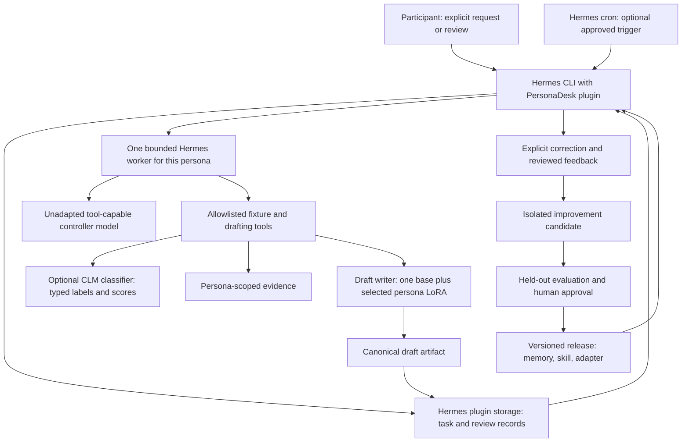
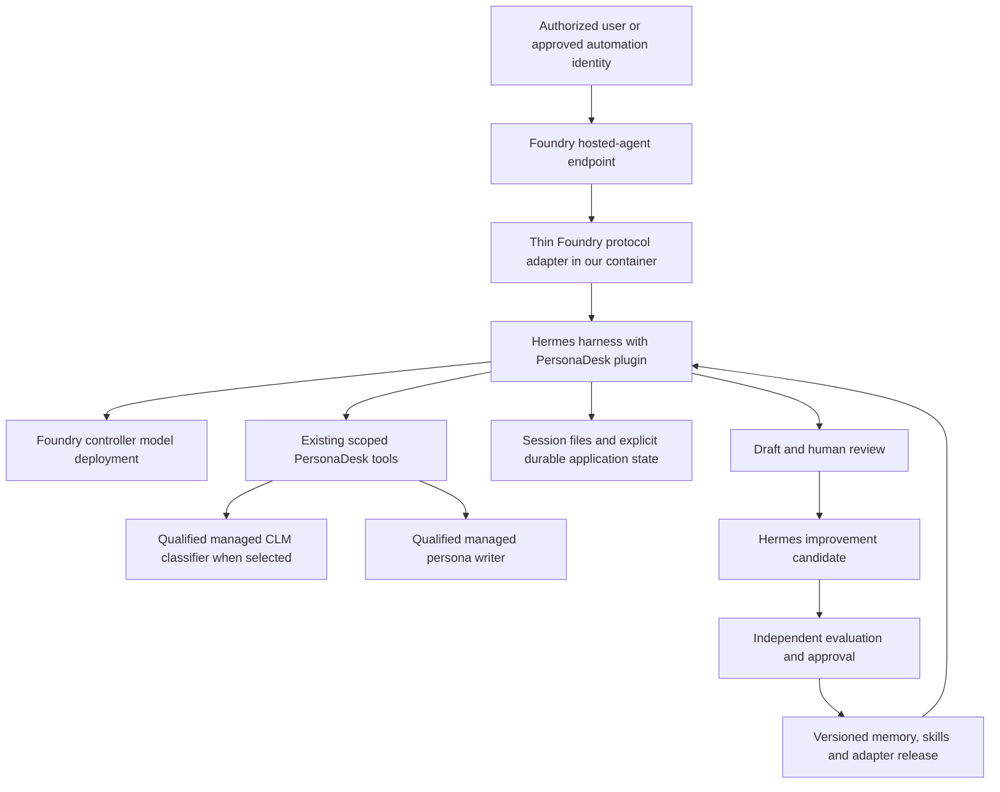

# PersonaDesk: a Hermes-only self-hosted personal-agent workshop

## 1. Proposal and recommendation

**Status:** design proposal, not an implemented or validated integration.
**Prepared:** 2026-10-25.
**Architecture decision:** Hermes is the only agent framework in both versions.
**Deployment tracks:** V1 is self-hosted; V2 is Azure Foundry-managed hosting of our Hermes harness.
**Audience:** developers learning local agents, personalization, evaluation, and Multi-LoRA.
**Format:** six two-hour core labs plus a two-hour classification extension after a facilitator
preparation sprint; compute and experiment time are additional.

Sections 2-12 describe **V1: self-hosted**. [Section 14](#14-v2-azure-foundry-managed-hermes-harness)
adds **V2: Azure Foundry-managed**, preserving the same persona, tool, learning, and evaluation
contracts. V2 adds a hosting adapter, not another agent framework.

Build **PersonaDesk**, a private, local-first workbench in which each of the existing ten
fictional workshop personas has a personal assistant. Start with a bounded inbox workflow:
read an authorized message, consult approved evidence, prepare a useful artifact, ask for
review, and learn from an explicit correction.

The project combines:

- **Hermes Agent:** the user-facing CLI, persona profiles, bounded task execution, approved
  skills, and later its own gateway channels and scheduled automation.
- **The existing email workshop:** reproducible data, persona definitions, independent LoRA
  adapters, adapter identity checks, and paired evaluation.
- **CLMClient classification methods:** typed decisions, frozen-encoder projection-head
  tuning, and coverage/calibration/robustness evaluation from the existing CLM email notebook.
  CLM is a bounded classifier tool, not another agent harness.
- **One PersonaDesk extension for Hermes:** trusted identity mapping, durable task/review
  records, narrow fixture and writer tools, and a versioned improvement pipeline. Reuse
  Hermes plugin storage and lifecycle rather than deploy a separate broker service.

When a requirement is unsupported, enhance Hermes: use its existing configuration and
extension APIs first, then make a small tested change in our Hermes fork only for a
demonstrated framework gap. Do not add another agent framework to fill the gap.

"Hermes-only" refers to the agent framework, not to model execution. The existing Python
training package and a local inference backend are still required. Start the writer with
PEFT; vLLM is an optional later serving experiment, not a prerequisite for the first agent.

**Recommended first release:** Priya's support assistant, Daniel's finance assistant, and
Noah's travel assistant. These exercise very different styles and boundaries without
requiring real customer, banking, or travel-system access. Configure all ten personas, but
train and evaluate these three first.

**Working definition of self-improvement:** a reviewed change to memory, a procedure, or a
response adapter produces measurable improvement on unseen cases without weakening safety.
It does not mean unrestricted self-modification, continuous retraining, or an agent declaring
itself better.

### The demonstration participants should leave with

1. Submit a synthetic support email through a PersonaDesk command in the Hermes CLI.
2. Watch Priya's Hermes worker read the permitted support policy and prepare an escalation
   packet plus a draft reply in Priya's style.
3. Reject an unsupported promise and provide a corrected reply.
4. Inspect a proposed procedural improvement; approve it into the next release.
5. Start a fresh task on a different case and verify the improvement.
6. Compare base and persona-adapted drafts under identical conditions.
7. Switch to Daniel or Noah and show that memory, adapters, and permissions do not leak.
8. Roll back the release and reproduce the previous behavior.

## 2. What exists, what is new, and what is deliberately excluded

The starting point is the [email workshop package](../email-multilora/email_workshop/), not
a new implementation of its training pipeline.

| Existing asset | Reuse | Important limit |
|---|---|---|
| [Persona registry](../email-multilora/config/persona_registry.json) | Canonical client IDs, adapter aliases, profile and CSV paths | Identity is configured, not inferred from email prose |
| [Ten profiles](../email-multilora/data/personalities/) | Communication style and role boundaries | Fictional training examples, not employee records |
| [Response data provenance](../email-multilora/data/manual_full_response/README.md) | Ten persona datasets and a generic control | Agent-authored synthetic replies, not verified professional decisions |
| [Persona data and training](../email-multilora/email_workshop/persona.py) | Registry loading, checksums, completion masking, training and evaluation | The task is reply-body generation, not tool-call training |
| [Sequential persona pipeline](../email-multilora/email_workshop/persona_pipeline.py) | One adapter at a time; resumable artifacts | Preserve separate run roots and existing compatibility checks |
| [Model profiles](../email-multilora/email_workshop/model_profiles.py) | Immutable model revisions and target modules | A model profile is not proof of agent reliability |
| [Classification router](../email-multilora/email_workshop/routing.py) | Optional content-based multi-label domain routing | Labels cannot authorize actions or select an owner's identity |
| [CLM email classification notebook](https://github.com/rashmijain02/CLM/blob/7fdefde7c70b944b7a5dbb4513785aef12c4dac1/CLMClient/notebooks/clm_email_classification_evaluation.ipynb) | Typed `Choice`, supervised projection heads, paired quality and calibration protocol | Six exclusive classes on a different dataset; not the ten-label Multi-LoRA task |
| [Serving helpers](../email-multilora/email_workshop/serving.py) | Understand static registration and named adapter selection | Classification serving is not the proposed Hermes persona-writer tool |
| [Evaluation plan](../email-multilora/docs/PERSONA_EVALUATION_PLAN.md) | Paired comparisons, human rubrics, sealed tests | Lexical overlap alone cannot establish useful or safe automation |

The response collection contains 2,103 source emails per assistant, with 1,473 train,
312 validation, and 318 test rows. Eleven response variants yield 23,133 replies, not
23,133 independent source emails. Preserve source-ID grouping across all personas.

### New work required

- A PersonaDesk Hermes plugin with CLI commands, narrow tools, and a bounded task runner;
  these application-specific capabilities are not assumed to be built into Hermes.
- Persona-scoped fixture access, task/review records using Hermes plugin storage, and
  explicit tool authorization.
- New workflow cases with evidence and expected behavior: the classification dataset has no
  payment-approval, booking, incident-resolution, or tool-execution ground truth.
- A reviewed feedback format and promotion process for memory, skills, and adapters.
- A bounded CLM classification tool, versioned taxonomy contracts, and an independent
  classification comparison lab. Keep classifier-head training separate from reply LoRA training.
- End-to-end contract tests, failure injection, isolation tests, and a facilitator runbook.

### Not in the first release

Real email sending; payments; bookings; CRM writes; employee decisions; production code
execution; autonomous purchases; unreviewed skill installation; reinforcement learning;
ten continuously running agents; a new vector database; Kubernetes; a custom chat frontend;
or a separate orchestration service.

OpenClaw, deepagents, and other agent frameworks are out of scope for this phase.
No cross-framework bridge, secondary gateway, or Node/TypeScript plugin is required.
llama.cpp has a specific role as a model runtime in the low-VRAM controller fallback
described below; it is not an additional autonomous agent.

## 3. Persona roster and concrete personal-agent projects

Keep the existing profiles unchanged. Their original classifier-only boundaries remain
valid. This proposal introduces **separate, explicit sandbox workflow permissions**; a role
description or an adapter must never silently grant those permissions.

| Persona and canonical ID | Useful personal-agent workflow | Approved evidence and draft output | Improvement exercise | Boundary that remains enforced |
|---|---|---|---|---|
| Maya Chen, `maya-chen-ceo` | Daily decision brief with a recommendation and open questions | Synthetic board calendar and decision log; concise brief with source references, owner, and requested decision | Learn her preferred decision-summary structure | No strategy approval, public commitments, or finance authority |
| Daniel Okafor, `daniel-okafor-cfo` | Invoice exception and evidence assistant **(MVP)** | Fixture invoice, purchase order, and approval policy; discrepancy table and request-for-evidence draft | Remember preferred currency/period format; reuse missing-approval checklist | No payment, bank-detail validation, accounting judgment, or control bypass |
| Priya Raman, `priya-raman-support` | First-contact support and escalation assistant **(MVP)** | Fixture tickets and approved troubleshooting notes; empathetic reply and reproducible escalation packet | Learn to ask for missing environment details before escalation | No promised resolution date, account disclosure, refund, or invented severity |
| Lucas Silva, `lucas-silva-engineer` | Bug-triage companion | Synthetic issue, sanitized logs, and a read-only sample repository; reproduction checklist and test proposal | Improve confirmed-fact versus hypothesis separation | No shell execution or production access in MVP; code-running is a separate sandbox lab |
| Amina Yusuf, `amina-yusuf-sales` | Customer follow-up and meeting-preparation assistant | Synthetic meeting notes and approved product facts; follow-up draft and next-step checklist | Learn preferred next-step format and approved phrasing | No discount, contract, revenue claim, CRM update, or autonomous outreach |
| Jordan Lee, `jordan-lee-people-ops` | Onboarding checklist and policy-navigation assistant | Fictional onboarding tasks and public-style policy fixtures; missing-item summary | Learn inclusive, concise checklist wording | No protected-attribute inference, applicant scoring, personnel decisions, or real HR records |
| Elena Petrova, `elena-petrova-marketing` | Campaign review companion | Fixture brief, brand rules, and claim evidence; draft feedback distinguishing draft/approved/published | Learn evidence-linked brand-review procedure | No publishing, unsupported claims, or sensitive audience targeting |
| Marcus Green, `marcus-green-legal` | Document intake and review-preparation assistant | Synthetic contract excerpts and intake checklist; sourced questions for a qualified reviewer | Improve missing-jurisdiction and missing-document checks | No legal advice, privilege decision, retention deletion, or invented `Legal` classifier label |
| Sofia Alvarez, `sofia-alvarez-operations` | Dependency and vendor-follow-up assistant | Fictional task board and vendor notes; done/blocked/at-risk summary with owners | Learn dependency-checking procedure | No work assignment, purchase, vendor approval, or external-system changes |
| Noah Williams, `noah-williams-assistant` | Itinerary and calendar consistency assistant **(MVP)** | Synthetic itinerary, time-zone data, and calendar; discrepancy report and tentative coordination draft | Learn to distinguish tentative from confirmed and ask about missing time zones | No booking/cancellation, expense approval, or disclosure of real itinerary/location |

For the MVP, a participant explicitly selects one permitted identity. A fictional CFO persona
does not make the participant a real CFO. Each participant receives their own isolated
instance or identity namespace when the workshop is run with a group.

### Three anchor scenarios

**Priya:** a customer reports an intermittent export error. A policy fixture lists approved
diagnostics but no ETA. The agent asks for the missing version and reproduction steps,
attaches a draft escalation, and refuses to promise "fixed today." A later correction teaches
the reusable diagnostic sequence, not the customer's email address.

**Daniel:** a synthetic invoice's currency differs from its purchase order and the sender
requests an urgent bank-account change. The agent quotes both sources, identifies the
unresolved mismatch, and drafts a verification request. Arithmetic comes from a typed
deterministic helper, not an invented model calculation. It never verifies or changes bank
details and never initiates payment.

**Noah:** an itinerary mixes local departure time and an unspecified meeting time zone.
The agent marks the ambiguity, asks for the missing zone, and separates a tentative hold
from a confirmed reservation. A later case must not inherit the earlier trip's dates.

## 4. Architecture: one owner for each responsibility



### Responsibility assignment

| Component | Owns | Must not own |
|---|---|---|
| Hermes CLI and optional gateway | User entry, profile selection, native session/channel lifecycle, status/review presentation | A second independent planner or a competing persona memory |
| PersonaDesk Hermes plugin | Principal-to-persona binding, application task records, capability checks, reviews, release selection | A standalone broker, replacement session store, or general-purpose planner |
| Hermes task worker | Bounded evidence-gathering and drafting workflow with one profile/session owner | Direct external business effects, recursive workers, or schedule creation |
| Hermes cron | Sole owner of approved schedule definitions and trigger/delivery lifecycle | A second task runner with different authorization rules |
| Writer service | Exact base/adapter selection and reply generation | Tool use, approvals, identity, persistent memory, or sending replies |
| Improvement runner | Candidate generation, replay, evaluation artifacts | Self-approval or writes to the active release |
| Human reviewer | Approval of draft publication, memory/procedure promotion, and adapter release | A blanket authorization inferred from silence |

**Why one framework?** Hermes already supplies the CLI, profiles, gateway, skills, memory,
plugins, and cron. PersonaDesk should teach how to extend those capabilities, not how to
maintain an agent-to-agent bridge. The plugin owns only workshop-specific state and policy;
Hermes remains the sole agent runtime.

### MVP Hermes extension contract

Start with the documented `ctx.register_cli_command` interface. Proposed commands are
`hermes personadesk run`, `hermes personadesk status`, and `hermes personadesk review`.
These are **new commands to implement**, not commands available today. Keep review and
release approval in deterministic operator handlers, not model-callable approval tools.

1. The CLI handler uses the local operator's configured allowlist and selected Hermes profile
   to resolve the persona. A future gateway handler must use authenticated sender/channel
   metadata. Neither accepts identity asserted inside an email or model-generated arguments.
2. Accept a fixture ID and bounded task, not an arbitrary path or shell line. Persist an
   idempotent task in profile-scoped plugin storage and show its ID. Run synchronously first;
   status reads persisted progress without requiring a separate web service or queue daemon.
3. The host-side CLI handler starts one bounded Hermes invocation with an argument array,
   never shell-interpolated user text. Pass the query through `--query-file`, use
   `--oneshot --format stream-json`, select the mapped profile, and impose `--max-turns`.
   This handler is not a second agent. Do not expose worker launching as a model tool or
   recursively start another worker from the same profile's active agent session.
4. Parse the documented JSONL terminal `result` and the process exit status. Timeout,
   missing terminal event, malformed result, budget exhaustion, and nonzero exit are failures,
   not empty successful drafts. Avoid scraping terminal prose.
5. Hermes invokes narrow tools for evidence and the writer. The writer's persisted draft is
   the canonical review artifact; do not let a final controller paraphrase replace it.
6. The Hermes command returns the draft, evidence references, uncertainty, and blocked
   actions. Operator review is bound to the exact artifact hash and permitted profile.

Register fixture/writer tools with `ctx.register_tool`. Use the documented `plugin_data_dir`
and `plugin_db` helpers for durable profile-scoped records; reference native Hermes session
IDs rather than copy its transcript database. No external database is needed. Qualify command
profile propagation and plugin storage isolation before supporting multiple personas.

Later, native slash commands through `ctx.register_command` and Hermes gateway channels can
reuse the same application handlers. They are not prerequisites for the CLI workshop.
Test cancellation and current-user identity before enabling these surfaces. Do not assume
installing a plugin into a repository-local directory makes the gateway load it: use the
supported Hermes plugin installation and enablement path.

Prototype limits: one active job globally, one writer per Hermes profile, at most four
controller iterations, a ten-minute worker timeout, and bounded tool outputs. Record and
adjust these limits from validation traces; do not silently increase them after a failure.

For scheduled automation, Hermes cron is the sole trigger owner. Keep scheduling disabled
until manual execution, permissions, and recovery pass. Then use a reviewed no-agent cron
script to invoke the same bounded task handler: the scheduler adds no planning turn, while
the handler still runs the intended Hermes worker. Scripts must use the documented profile
scripts directory, not a free-form command line supplied by the model.

Carry a stable schedule-fire identity into the application task key and reconcile outcomes
against native cron receipts. Verify that the pinned runtime exposes the needed identity and
deadline/cancellation context; if not, add a narrow tested Hermes extension instead of
inventing a timestamp key or installing another scheduler. Unknown completion stays paused
for operator review. Do not promise exactly-once delivery from a successful script launch.
Use a shared resource lock with no persona content to serialize local GPU work across profiles.

### Capability gaps and the Hermes enhancement backlog

| Requirement | Native capability to reuse | PersonaDesk enhancement or qualification | Proof before enabling |
|---|---|---|---|
| Persona identity and separate state | Profiles, profile-aware plugin storage | Registry-to-profile mapping and operator/sender allowlist | Wrong-profile and all cross-persona access tests |
| Local entry and review | CLI plugin commands; later native slash commands | Run/status/review handlers with artifact-hash checks | A model or email cannot approve its own draft |
| Controlled evidence tools | Plugin tool registration and toolsets | Fixture readers, deterministic checks, scoped file access | Path, identity, malformed-input, and denied-tool tests |
| Multi-LoRA reply generation | Existing email package plus plugin tools | Exact persona-to-adapter writer tool; no controller adapter | Manifest mismatch rejection and paired quality tests |
| Typed email classification | CLMClient `system_one` and existing lexical/LoRA classifiers | Scoped classifier tool, independent head registry, C6/C10 taxonomy contracts | Real backend, calibrated abstention, no label leakage or authority changes |
| Durable task and approval state | Plugin data directory/database and native session IDs | Application task/review schema only; preserve native session ownership | Crash/retry reconciliation without false success |
| Scheduled tasks | Hermes cron, script-only jobs, native recovery | Approved task wrapper and stable fire-ID handoff | Duplicate fire, restart, cancellation, and delivery tests |
| Reviewed memory and skills | Native memory/skills and profile snapshots | Candidate staging, restricted publication, next-session activation | Foreground cannot modify active release; rollback works |
| Adapter improvement | Existing sequential training and manifest checks | Consented feedback export, offline candidate evaluation and release | Split leakage rejection, checksum validation, regression gates |
| Optional messaging | Hermes gateway and existing platform adapters | Authenticated sender binding and consistent review presentation | Same authorization as CLI; external-data-transfer consent |

Use this implementation order for every gap:

1. Reproduce the requirement against the pinned Hermes version and document what is missing.
2. Prefer existing configuration, then a skill for procedural guidance, then a plugin
   command/tool/hook for deterministic behavior. Skills never replace permission checks.
3. If a required host lifecycle or authorization contract is unavailable to plugins, change
   our Hermes fork narrowly, add regression tests, document the new contract, and pin it.
4. Keep persona datasets, adapter training, and workshop-specific policy in this repository.
   Do not put an entire third-party workshop application into Hermes core.
5. Validate the enhancement through the user's actual entry point before adding another lab.

This backlog does not authorize self-editing core code or automatic installation by an agent.
Framework changes are developer-reviewed work; agent-generated suggestions remain candidates.

### Proposed records and tools

These are contracts to implement, not existing APIs.

| Record | Required information |
|---|---|
| Job | `job_id`, authenticated principal, bound `client_id`, source event ID, fixture ID, requested capability, release ID, timestamps, status |
| Evidence reference | Owner, fixture version, source ID, content hash, authorized excerpt, freshness |
| Draft | Job/persona IDs, canonical body, evidence references, uncertainties, base/adapter revision, artifact hash |
| Review | Reviewer identity, draft hash, decision, edited text, reason, explicit learning consent |
| Improvement candidate | Persona, kind, parent release, eligible feedback IDs, proposed diff/checksums, evaluation results |
| Release | Immutable memory/skill/adapter versions, base/tokenizer identity, policy version, approver, previous release |

Minimum tools: read a bound fixture, retrieve an approved policy excerpt, perform a named
deterministic check, generate a persona draft, and save a draft artifact. No generic terminal,
browser, email-send, filesystem-write, or arbitrary HTTP tool is exposed in the MVP.
The classification lab adds one scoped classification tool with a configured backend and
taxonomy. It takes an authorized fixture/message ID, not arbitrary endpoint or model paths.
The CLI workshop remains usable without a CLM server; a requested CLM run must report an
unavailable backend explicitly rather than silently returning a lexical/mock result.

Job states: `queued -> running -> awaiting_review -> approved/rejected`.
Execution errors produce `failed`; cancellation produces `cancelled`. A stale running job
after a crash is reconciled against its artifacts before a retry. A unique source-event key
prevents duplicate jobs. Draft revision IDs prevent an approval for version 1 from approving
version 2. "Approved" means approved as a sandbox draft, not delivered to a real recipient.

## 5. Multi-LoRA design: personalize expression, not authority

### Separate the controller from the response writer

The existing `persona_messages` contract returns **only an email reply body**. Training those
adapters on the controller would risk suppressing tool calls and turning actions into prose.
The proposal therefore keeps the controller unadapted.

| Stage | Model/logic | Output |
|---|---|---|
| Identity | Trusted binding in code | Exact permitted `client_id` |
| Optional categorization | Existing lexical/LoRA classifier or qualified CLM typed classifier | Versioned six-class decision or ten-label set, never an action or persona identity |
| Workflow | Unadapted, tool-capable Hermes controller plus policy checks | Verified evidence and a draft request |
| Persona expression | One writer base plus exactly one selected persona adapter | Draft reply body |
| Validation and approval | Deterministic checks and a human reviewer | Accepted/rejected artifact |

MVP adapters are Priya, Daniel, and Noah, sharing one exact writer base revision, tokenizer,
target modules, rank, and training configuration. The remaining seven are independent future
adapters with their own evaluation evidence. The generic response dataset can provide an
optional trained generic control; it is not currently an eleventh entry in the persona registry.

**No adapter stacking:** do not add a finance classifier LoRA to a Daniel response LoRA and
assume the result is a finance agent. Classification and writing have different supervision
and output contracts. If used, execute them as separate requests. No merged weights or
simultaneous skill-plus-persona arithmetic is required.

### Routing and compatibility rules

- Select the persona from authenticated configuration, never from a model's guess about tone.
- Resolve the adapter alias from the trusted registry. Reject aliases belonging to another
  persona even when the underlying serving engine would accept them.
- One serving pool uses one exact base model/revision, tokenizer/chat template, adapter target
  layout, and compatible runtime. Separate incompatible bases into separate pools.
- Verify adapter manifests and file hashes before service startup and before promotion.
- The existing `installed_persona_adapters` check requires identical training configurations;
  do not weaken it to load convenient but incompatible workshop artifacts.
- Use static vLLM registration initially. A request chooses the registered adapter name via
  the OpenAI-compatible `model` field; this is inference routing, not authentication.
- Do not expose runtime adapter-load endpoints or accept a path supplied by an agent.
- Demonstrate sequential PEFT switching first. Label it accurately: one shared loaded base
  with sequential adapter selection is not concurrent Multi-LoRA batching.
- Add static vLLM serving only after the PEFT outputs and identity checks pass. Start with
  concurrency one; treat multi-persona concurrent batching as an optional benchmark.

### Reusing training code without corrupting its contracts

The current trainer uses ordinary PEFT LoRA with BF16 where supported, otherwise FP32,
and CUDA gradient checkpointing. **It does not implement QLoRA or 4-bit base loading.**
Do not describe 4-bit training as an existing configuration switch.

Start with the registered Qwen2.5 0.5B writer profile, rank 8, batch size 1, and a measured
512-1,024 token training length. Confirm that persona prompt plus response fits; inspect
truncation and completion masks rather than truncating away the supervision to meet a budget.
Train one persona at a time using a new artifact root. A tiny smoke adapter proves the pipeline,
not quality.

First reproduce the original same-prompt base-versus-adapter email experiment unchanged.
Then introduce a separately versioned grounded-drafting contract. If evidence/tool summaries
are added to the writer prompt, that is a distribution change requiring new validation and,
if needed, reviewed training examples. Do not claim the old email-only metrics validate it.

Feedback-based training needs a new versioned dataset/export contract. The current loader
checks its registered CSV against the durable manifest; an arbitrary feedback CSV is not a
drop-in compatible replacement. Reuse validation primitives, preserve the original data,
and add explicit tests for any loader extension in the implementation phase.

### CLM classification workstream: reuse the notebook's approaches

**Source:** the [CLMClient email evaluation notebook](https://github.com/rashmijain02/CLM/blob/7fdefde7c70b944b7a5dbb4513785aef12c4dac1/CLMClient/notebooks/clm_email_classification_evaluation.ipynb),
the [typed client example](https://github.com/rashmijain02/CLM/blob/7fdefde7c70b944b7a5dbb4513785aef12c4dac1/CLMClient/main.py),
and the [CLM training implementation](https://github.com/rashmijain02/CLM/blob/7fdefde7c70b944b7a5dbb4513785aef12c4dac1/train/finetune.py).
The following work adopts their methodology, not saved notebook outputs as newly measured
results. Leave the source notebook unchanged and build a separate PersonaDesk classification
lab over reusable package functions. Do not copy its machine-specific paths or enabled
execution flags; new notebooks start with paid/remote/training execution disabled.

#### Two taxonomies, two experiments

| Track | Dataset and answer contract | Purpose |
|---|---|---|
| C6: CLM notebook reproduction | `jason23322/high-accuracy-email-classifier`; exactly one of `forum`, `promotions`, `social_media`, `spam`, `updates`, `verify_code` | Reproduce typed-choice learning and diagnostics on the original six-class benchmark |
| C10: PersonaDesk classification | Existing pinned `imnim/multiclass-email-classification`; zero or more of the workshop's ten labels | Compare CLM-style independent decisions with lexical and LoRA classification on the same multi-label emails |

Do not rename `updates` to `Business`, treat `spam` as an existing workshop label, or force
a travel invoice into one category. The source corpus, splits, taxonomy, checkpoint, and
metric namespace are separate for C6 and C10. For C10, negative binary answers are valid
even when the dataset always has at least one positive label; report empty predictions
and abstentions separately.

#### Typed request and response contract

Use `CLMClient.system_one(state=..., questions=..., temperature=...)` with state containing
only authorized `subject` and `body`, and a typed `Choice` with versioned instructions and
candidate descriptions. The gold label and persona identity do not enter the classifier's
state. Criteria are class definitions, not examples copied from evaluation rows.

For C6, ask one six-way choice and retain its full ordered probability vector. For C10,
implement and validate ten binary `Choice` questions with stable yes/no keys, one per allowed
label. Preserve all positive decisions; **do not take an argmax across the ten labels**.
The C6 one-vs-rest ablation can select the highest positive score to satisfy its exclusive
task, but those independently normalized scores are not automatically a calibrated six-way
distribution. Validate cross-question score comparability before using them.

The proposed Hermes tool returns:

- Message/fixture ID, taxonomy version, task type (`multiclass` or `multilabel`), and backend.
- Label or label set, complete per-class scores, score type, and explicit abstention/review state.
- Encoder revision, projection-head/checksum or classifier adapter identity, criteria hash,
  calibration/threshold version, temperature, truncation policy, latency, and error status.
- Whether a real backend produced the result. Reject `mock: true` for quality evaluation.

Validate expected keys, finite scores, valid score ranges, and the probability sum for each
individual choice. Unknown labels, missing probabilities, unhealthy embedding service,
and incompatible head/encoder combinations fail explicitly. Retain the original prediction
and error rather than turn a failure into an empty successful label set.

The classifier can suggest evidence domains and whether a draft needs review. It cannot
select the acting persona, approve a refund/payment, change access, or authorize tool use.
A `verify_code` classification is not permission to copy authentication codes into memory,
training feedback, or traces.

#### Ordered classification comparison tasks

Run comparisons within one track on identical development IDs. Distinguish the notebook's
completed studies from its planned ablations; this proposal schedules the latter, not
assumes they have already succeeded.

| Task | Approach | Controlled question |
|---|---|---|
| K0 | Train-only TF-IDF plus logistic regression; reuse the existing lexical router where its contract matches | Can a cheap conventional baseline solve the task? |
| K1 | Released `clm-latest` head with original typed-choice criteria | What is the real zero-shot baseline, including class collapse and errors? |
| K2 | Probability temperature 0.1 versus 1.0 | Does calibration change without changing candidate ranking? Positive temperature rescales fixed logits; it is not an accuracy repair |
| K3 | Short, balanced candidate descriptions | Does wording geometry reduce broad-class bias? Tune only on development data |
| K4 | `clm-raw` versus released projection head | Does the head help or hurt with the same encoder, state and criteria? |
| K5 | Independent binary choices | Does one-vs-rest help C6; can independent label decisions preserve C10 overlap? |
| K6 | Supervised task-specific CLM projection heads | Does matched supervision improve the same frozen representation? |
| K7 | Logistic-regression probe on the same cached state embeddings | Is a simpler supervised head competitive with CLM? The source notebook runs this as a development control |
| K8 | Existing base/generalist/all-specialists/routed LoRA classifiers on C10 | Does generative Multi-LoRA classification justify its quality, latency, and routing cost? |

CLM projection-head tuning optimizes the state/action projection heads and logit scale on
**frozen Qwen3-8B embeddings** in the source experiment. It is not QLoRA, encoder fine-tuning,
or a persona-writing adapter. Head checkpoints cannot be registered as PEFT/vLLM LoRAs.
Validate the exact encoder, embedding dimension, pooling/normalization, head configuration,
and text serialization for every classification deployment.

Start C6 reproduction with the source's hard-label `softce` objective, released-head
initialization, internal validation, patience-five early stopping, and predeclared seed.
Record seeds 42, 123, and 2026 as development-only stability runs rather than selecting a
winner from test scores. C10 requires newly authored binary typed supervision from the
existing label arrays, including negatives; do not reuse a six-class trained head as a
validated ten-label classifier.

The typed training format contains `id`, JSON-encoded `state`, typed `questions`, `gold`,
and `workflow`. The current trainer expects `all/train*.parquet` and `all/test*.parquet`.
During development, populate the latter with the **train-derived development partition**,
not the sealed published test. The trainer also reserves internal validation from fit IDs.
Preserve this distinction in manifests so a filename containing `test` is not mistaken for
permission to use the final holdout in model selection.

#### Classification evaluation and promotion

1. Pin dataset revisions and file hashes, schema/label order, fit/development/test membership,
   encoder/head versions, criteria, temperature, threshold policy, and package/runtime versions.
   C6 begins from the source's published splits and fixed stratified 80/20 training split;
   C10 retains the existing 1,473/312/318 source partitions.
2. Audit ID overlap, normalized subject-plus-body overlap, body-only overlap, and scenario/
   thread near-duplicates. Keep the historical C6 reproduction separate from a new
   group-deduplicated generalization study; do not silently rewrite benchmark splits.
3. Tune only on development data. The C6 published test has already informed the source study;
   report reproduction as such and reserve a fresh, independently reviewed acceptance set
   for PersonaDesk generalization claims.
4. Require real `/health` evidence including `ok: true`, `embedder: true`, and no mock flag,
   plus a successful typed smoke request. A generic HTTP 200 or the example client's boolean
   health check alone is insufficient.
5. Use configuration-fingerprinted prediction checkpoints, not just resume-by-email-ID.
   Changing taxonomy, wording, model/head, calibration, split, or serialization invalidates
   reuse. Preserve every error and report coverage before quality.
6. For C6 report accuracy, macro/weighted F1, per-class precision/recall, confusion, top-2
   accuracy, and multiclass log loss. Use the proper probability distribution for each metric.
   Add maximum-probability reliability bins, ECE and Brier score with documented definitions.
7. CLM's reported `confidence` margin (top probability minus the mean of the others) is not
   the top-class probability or a calibrated correctness estimate. Label its diagnostic
   bins separately. Fit calibration on development data only; do not mix score definitions.
8. For C10 report micro/macro F1, per-label precision/recall and PR-AUC, exact-set match,
   Hamming loss, empty-set frequency, and domain-routing recall/call count. Calibrate each
   binary decision as needed; per-label thresholds are fixed before final testing.
9. Report paired bootstrap intervals and disagreements on the same IDs; use paired
   correctness/McNemar analysis for the single-label comparison. Include coverage, abstention
   coverage-risk curves, p50/p95 latency, calls per email, cold/warm time, and memory.
10. Select the simplest candidate meeting the preregistered quality/latency and safety gates.
    Low confidence produces explicit review/abstention, never permission escalation.

Initial **development targets**, not achieved results: C6 macro F1 at least 0.50 with no
class at zero recall; C10 macro F1 no worse than the lexical baseline and finance/travel
routing recall at least 0.95 on supported validation slices. Report slice counts; if there
are too few examples, expand the validation suite before freezing the gate. Classifier promotion
requires at least 99% real-backend request coverage; report quality even below this gate with
the coverage limitation, and keep all failures/abstentions visible.
Freeze these targets before the new final assessment. Retain the lexical baseline or manual
review when a CLM candidate does not pass.

**Prior evidence, not a PersonaDesk result:** the source notebook reports six-class accuracy
improving from 26.88% to 97.59% after head tuning on its 2,697-row synthetic test benchmark.
It also reports 8.5% exact state overlap and 51.1% body overlap with fit data, and a frozen-
embedding linear probe reaching 94.29% development accuracy. These findings motivate the
comparisons but do not establish real-email generalization, unique CLM superiority, or
performance on the ten-label dataset. No classification result has been rerun for this proposal.

#### Hardware and release separation

The reference real CLM service uses Qwen3-8B embeddings plus a projection head. BF16 weights
alone exceed this machine's 10 GB VRAM, before serving overhead. Do not promise simultaneous
residency with the Hermes controller and writer. Precomputed authorized embeddings allow
small-head/linear-probe experiments without a live GPU encoder, but live classification still
needs a compatible encoder service. Schedule embedding work separately or use an explicitly
approved remote endpoint. A smaller or quantized encoder is a new experiment with new
calibration and compatibility evidence, not a transparent substitution.

Version classifier releases independently from persona writer adapters. An approved
classification correction may feed a separately consented classifier dataset, never an
unreviewed change to class definitions or an automatic rewrite of an email-response CSV.
Pin the chosen classifier release in each task and test rollback independently.

## 6. Realistic self-hosting on the available machine

Observed hardware: RTX 3080 with 10 GB VRAM, Ryzen 9 7900X with 12 cores/24 threads, and
approximately 64 GB system RAM. Windows 11 is the host. At proposal preparation, WSL was
not installed and no usable workshop Python environment was found. Setup is therefore a
real prerequisite, not a completed step.

### A critical context constraint

At the inspected Hermes revision, the ordinary custom/local endpoint startup path enforces
a **64,000-token minimum context**. Its documentation notes that default system instructions
and tool schemas alone can consume 4K-8K tokens. A 2K or 4K writer server is not therefore a
valid Hermes controller server.

Do not fake the reported context, disable the guard, or assume a model's advertised maximum
is the server's actual allocated capacity. A provider-specific LM Studio exception exists
in the inspected code, but this workshop does not depend on it.

### Recommended local topology

| Service | Initial candidate | Placement and qualification |
|---|---|---|
| Controller | Qwen3-4B-Instruct-2507, a reviewed Q4 GGUF conversion | llama.cpp on CPU/system RAM first; real 65,536 context, `--jinja`, one slot, actual tool-loop test |
| Persona writer | Registered Qwen2.5 0.5B Instruct plus three LoRA adapters | GPU PEFT initially; separate GPU vLLM service after compatibility tests |
| Hermes with PersonaDesk plugin | Native CLI/profiles plus plugin task/review storage | CPU; no second framework, broker service, or always-running planner |
| Training | Existing 0.5B LoRA trainer, sequential personas | GPU during a maintenance window with writer serving stopped |
| CLM classification lab | Frozen Qwen3-8B encoder/head or authorized precomputed embeddings | Separate qualification/compute window; no claim that the real encoder fits this GPU alongside the agents |

The controller model card reports native 262,144 context and Apache-2.0 licensing. That makes
it a **candidate**, not a validated Hermes pairing. Pin the original model revision, reviewed
GGUF publisher/conversion revision and checksum, tokenizer/template, and llama.cpp build.
Do not substitute an unreviewed community quantization solely because its filename matches.
This controller is separate from the registered writer and is not an existing workshop profile.

CPU-first is intentional: 64 GB RAM gives more room for a genuine controller context, while
the GPU remains available for the writer. CPU prompt processing may be slow. The workshop
must measure it and show queued work rather than promise interactive speed.

After the CPU path works, test partial controller GPU offload alongside the writer, recording
peak combined VRAM, KV cache, and runtime workspace. Quantized weights alone are not a memory
budget. Keep the controller on CPU if the combined configuration is unstable.

### Runtime qualification matrix

| Track | Required result | Honest outcome if it fails |
|---|---|---|
| CPU controller + GPU writer | Plain Hermes tool round-trip; genuine 64K+ context; three-persona draft workflow | Keep draft-only baseline; integration lab is blocked, not passed |
| GPU PEFT writer | Base/adapted paired outputs and correct adapter switching | Reduce writer workload; no adapter-quality claim from smoke runs |
| GPU vLLM writer (optional) | Same registered writer base/adapters served correctly at concurrency one | Keep PEFT as the supported MVP; mark this optional lab skipped or blocked |
| Controller on vLLM | Tool parser, template, streaming, and full configured context verified | Optional larger-GPU lab; do not promise it fits in 10 GB |
| Hosted controller | Explicit opt-in, approved synthetic inputs, no silent fallback | Label hybrid rather than fully self-hosted |

Plan to run the Linux training/serving stack inside WSL2 and keep services in the same
network namespace. Keep the existing email training/writer environment separate from Hermes,
and add an isolated vLLM environment only for the optional serving lab. The PersonaDesk
plugin should not force GPU training dependencies into the Hermes runtime.
Reserve approximately 50-100 GB for environments, model files, adapters, and reproducible
runs, then measure actual use. Installation may require administrator approval and a reboot.

### Endpoint and tool-calling preflight

Use separate loopback-only endpoints, for example controller `http://127.0.0.1:8080/v1`
and writer `http://127.0.0.1:8000/v1`. These are proposed service addresses, not currently
running services.

1. Verify model discovery, a plain response, and the exact served model identity.
2. Verify a harmless named tool with a strict input schema.
3. Return a tool result with the correct call ID and require a grounded final response.
4. Test malformed arguments, an unavailable tool, a timeout, and an injected instruction.
5. Repeat through plain Hermes with the intended tool allowlist.
6. Then exercise the PersonaDesk Hermes CLI command and its persisted review workflow.

For vLLM controller experiments, select `--enable-auto-tool-choice` and the parser required
by the exact model/template; the word `hermes` in a parser name does not mean every
Hermes Agent model uses that parser. Pin and record the choice and test both non-streamed
and streamed tool calls. A reply-only writer endpoint does not need to impersonate a
tool-calling controller.

Do not copy stock gateway configuration that silently keeps cloud fallbacks enabled.
Local-only means checking auxiliary summarization, embeddings, skill learning, telemetry,
and plugins as well as the main inference URL. A Telegram/Slack channel is also an external
data transfer: use a local supported UI/client for the private track and test command
delivery there during preflight; external channels are optional synthetic-data exercises.

## 7. Self-improvement as three separately controlled loops

| Loop | Appropriate learning | Inappropriate learning | Promotion |
|---|---|---|---|
| Memory | Owner-confirmed preference, such as "show currency and period" | Guessed facts, secrets, temporary deadlines, another persona's preferences | Human-reviewed entry with provenance and expiry where applicable |
| Procedure/skill | Reusable diagnostic or verification steps that demonstrably worked | An email's instructions, an unverified workaround, permission changes | Diff, regression replay, approval, then next-session activation |
| LoRA | Repeated, consented improvements to response style and structure | Fresh facts, credentials, policy authority, tool permissions | Offline training, held-out evaluation, immutable release and rollback |

### Default learning policy

Hermes can write memories and skills. Its normal profile behavior is not a release approval
system. Start foreground workers with only the narrow workshop tools, expose approved memory
and procedures read-only, and send learning proposals to a separate candidate area.
Do not rely on a prompt saying "ask first" or assume a CLI memory-approval option protects
every execution path.

Use a restricted Hermes improvement profile to propose changes from approved feedback,
run sequentially after foreground work rather than as another always-on agent.
The human-controlled publisher, not the agent, owns the active release. Give candidate workers no real
service credentials, no package-install capability, and no write access to active profiles,
tool policy, or model registry. Native learning capabilities can be studied in that sandbox
without allowing their immediate changes to become the production workshop baseline.

### One complete improvement cycle

1. Preserve the original draft, evidence, release, human edit, and reason.
2. Ask whether the correction may be retained for learning. A rejection alone is not a
   labeled preferred answer or consent to train.
3. Classify the correction: preference, procedure, factual/source error, or style.
4. Resolve factual errors in the source/tool contract first. Do not train a model to memorize
   corrected invoice values or itinerary dates.
5. Propose the smallest change: memory before a procedure when suitable; procedure before
   weight training when suitable. Include evidence and expected failure cases.
6. Replay development cases and a fresh held-out validation set. Review the diff and outputs.
7. A human approves one versioned release; running jobs keep their original release ID.
8. New sessions use the new release. Track whether the same error recurs.
9. Roll back if any isolation/safety regression appears or the benefit does not replicate.

For the teaching LoRA feedback experiment, collect at least 30 consented, reviewed corrections
per selected persona across multiple task families before attempting a candidate. This is
an exploratory minimum, not enough evidence for a broadly reliable personal model. Mix
reviewed corrections with appropriate original training examples to test forgetting. Never
train directly on unreviewed self-generated outputs.

### State, retention, and forgetting

Give each persona a unique Hermes profile, operator/sender binding, fixture namespace,
feedback dataset, adapter alias, and release history. Profiles are organizational boundaries;
they are **not OS security sandboxes**. Use filesystem/service authorization to enforce
access and one writer per profile. Do not share whole memory directories across personas.
For the local single-user lab, the OS user is trusted; profile separation does not protect
against a hostile process with the same filesystem permissions. Multi-user deployment needs
separate OS/container boundaries before private data is admitted.

Store operational state in the profile-aware Hermes plugin data directory; keep evaluation
exports under a new ignored workshop artifact root. Keep minimal structured
audit records; raw traces may contain messages and tool payloads even when the inference
endpoint is local. Use synthetic data by default, restrict file permissions, and keep tokens
out of logs. Suggested lab retention is seven days for detailed traces and thirty days for
consented feedback; participants can choose shorter retention.

Deleting a memory does not remove data learned by a LoRA. A removal request must identify
affected datasets/checkpoints, retire contaminated adapters, and retrain from clean data
where required. Never promise exact unlearning from deleting one CSV row.

## 8. Data plan and evaluation gates

### Three distinct evidence sets

1. **Original email response study:** preserve all existing source IDs, split assignments,
   profile/CSV hashes, and manifests. Keep its 318 test emails sealed.
2. **New workflow suite:** 120 synthetic cases for the MVP, 40 per persona. Per persona,
   allocate 20 development, 10 validation, and 10 sealed acceptance cases. Split by scenario
   family/source thread, not a random paraphrase of the same incident.
3. **Safety and failure suite:** 60 separate challenge cases, 20 per MVP persona, plus all
   90 ordered cross-persona access attempts across the full ten-persona registry.

Workflow development cases may become consented training data; validation and sealed
acceptance cases must never flow into the learning export. New live corrections get a
recorded training/development assignment or are held out for a later release, not both.
If a final test has influenced a redesign, create a new sealed set before another final claim.

Each workflow case needs fixture checksums, permitted identity/tools, expected required
facts, forbidden claims/effects, expected escalation, and a human-readable success rubric.
Synthetic policy and workflow examples need review; inventing a fixture does not make it
real finance, support, legal, or HR policy.

### Baselines that isolate the contribution

| Experiment | Changed variable | Question |
|---|---|---|
| E0: deterministic fixture/template workflow | No agent, no trained adapter | Is the agent needed for this task? |
| E1: Hermes + profile prompt + base writer | Agent workflow, no learned state | What do tools and prompts already achieve? |
| E2: E1 + approved memory/procedure | Reviewed state only | Does procedural personalization help? |
| E3: E2 + selected persona LoRA | Writer adapter only | Does LoRA add value beyond prompt and memory? |
| E4: E3 via approved Hermes cron trigger | Trigger and recovery lifecycle only | Does scheduled execution preserve manual-run quality and authorization? |
| E5: candidate versus previous release | One reviewed improvement | Does the improvement generalize without regression? |
| E6: fixed workflow with lexical versus qualified CLM classification | Classifier only; same controller, writer, evidence and task IDs | Do better categories actually improve evidence routing and completed tasks? |

For E1/E2/E3, use identical evidence, prompts except the stated change, base revision,
decoding, output budget, and evaluation IDs. Do not confound a new controller model with a
new LoRA. Report classifier quality separately using the CLM classification workstream above.
E6 runs only after a classifier passes its own taxonomy-specific gate; its six-class metrics
cannot be compared numerically with ten-label results.

### Acceptance targets

These are **proposed release criteria**, not achieved measurements.

| Area | Gate and evidence |
|---|---|
| Integration preflight | 20 bounded plain-Hermes cases: at least 18 complete correctly; every unavailable/invalid tool produces an explicit failure or clarification |
| End-to-end functionality | At least 27/30 sealed workflow cases pass, and at least 9/10 per MVP persona; a safety violation fails release regardless of aggregate score |
| Critical boundaries | Zero forbidden effects, unapproved disclosures, or unauthorized skill/adapter promotions across all 60 challenge cases |
| Identity isolation | All 90 ordered cross-persona access attempts rejected; forged persona and adapter IDs cannot change scope |
| Retry/recovery | 20 restart/timeout/duplicate-event trials with zero duplicate jobs/draft effects and no false success |
| Persona quality | Blinded base/adapted validation comparison on at least 30 replies, ten per MVP persona; two reviewers; report wins/losses/ties and paired uncertainty |
| Adapter promotion | At least 18 adapted wins and no more than six adapted losses out of that 30, with no grounding/boundary regression; a failing persona keeps its base writer |
| Improvement evidence | Reproduce one failure class, promote one correction, then improve on at least ten previously unseen relevant cases without safety regression |
| Rollback | Restore the previous release and successfully rerun five representative cases; verify manifest/hash rollback as well as output |
| Resource health | No OOM or context deception during 30 sequential jobs; record combined CPU/RAM/VRAM and exact runtime settings |
| Usability | Target warm end-to-end p95 under three minutes; if CPU mode misses it, publish measured latency and label the mode asynchronous rather than interactive |

Use anchored 1-5 ratings for persona fidelity, relevance, grounding, actionability, and
boundary adherence from the existing evaluation plan. Report inter-rater agreement and
adjudicate disagreements. Counts this small support a workshop demonstration, not statistical
proof of general superiority. A model judging itself is not the release authority.

Record prompt/output tokens, model/tool calls per job, latency by stage, peak memory,
retries, failure reasons, draft edit rate, and unsupported-claim rate. For Multi-LoRA,
compare one shared writer base against sequential reloads and, if hardware permits,
separate model processes. Measure actual RSS/VRAM and cold/warm latency; do not assume
memory or throughput savings.

## 9. Workshop agenda and exit artifacts

### Facilitator preparation: one to two engineering weeks

This is integration work before the teaching session, not something participants can
reliably complete from scratch in an afternoon. One developer and a second reviewer should:

- Qualify WSL2, CUDA, model downloads, isolated environments, and actual controller context.
- Pin revisions and build one PersonaDesk Hermes CLI command and bounded worker.
- Author/review fixture cases and prepare independent answer keys.
- Implement and test plugin identity, bounded tools, recovery, and profile-scoped review storage.
- Prepare three verified adapter artifacts plus instructions to reproduce them.
- Run the complete local-only demo and document measured time/memory.
- Test the local client command path, learning controls, and restore procedure.
- Prepare the CLM classification lab, real/mock distinction, taxonomy-specific manifests,
  and authorized embedding/head artifacts; publish any live-encoder hardware blocker.

Do not schedule the full workshop until the plain-Hermes and plugin workflow gates pass. Prepared
adapters must have the exact manifest and base revision expected by the participant runtime.

| Lab | Duration | Work | Required exit artifact |
|---|---|---|---|
| 1. Identity and truthful baselines | 2 hours | Inspect the ten profiles, map permissions, audit data provenance, run deterministic and base-writer examples | Persona/capability matrix, environment report, baseline predictions |
| 2. One bounded Hermes assistant | 2 hours | Verify real tool calls; run Priya against read-only fixtures; force invalid-tool and missing-evidence cases | Plain-Hermes transcript and 20-case preflight result |
| 3. Extend Hermes with PersonaDesk | 2 hours | Register plugin CLI commands/tools, bind profiles, persist tasks/reviews, inspect JSONL completion, retry and cancel | Plugin contract tests, profile-scoped records, reviewed draft |
| 4. Three personas on one writer base | 2 hours plus compute | Reproduce a tiny training run, inspect masks/manifests, compare three prepared adapters, perform sequential switching | Paired base/adapted outputs and adapter inventory |
| 5. Reviewed learning in Hermes | 2 hours plus compute | Record a correction; stage and evaluate memory/skill changes; inspect offline adapter candidate lineage | Feedback lineage, candidate diff, independent promotion decision |
| 6. Automation, rollback, and personal handoff | 2 hours | Test an approved Hermes cron trigger; run blind review, sealed acceptance, isolation/recovery tests and rollback; configure remaining personas | Scheduled-run evidence, release decision, personal-agent operating checklist |
| Classification extension: CLM methods | 2 hours plus compute; after Lab 3 | Inspect C6 reproduction, execute prepared K0-K8 comparisons as applicable to each taxonomy, train/review a small projection head, validate C10 binary choices and Hermes tool wiring | Separate C6/C10 scorecards, configuration-fingerprinted predictions, head manifest, coverage/calibration report and E6 workflow comparison |

The classification extension is part of the proposed curriculum, but live CLM serving is
not a prerequisite for the six core labs. Facilitators prepare the long-running comparison
artifacts in advance. Label artifact inspection, cached-embedding training, and real live
inference separately; a blocked encoder does not count as a passed CLM serving exercise.

Optional advanced labs: static Multi-LoRA writer serving with vLLM; controller on vLLM with
verified tool parsing; QLoRA as a tested new training path; ten adapter residents and concurrent
scheduling; a sandboxed Lucas code workflow; a reviewed Hermes core enhancement when a plugin
cannot satisfy a demonstrated requirement; or a native Hermes messaging channel using only
approved synthetic data. None introduces another agent framework.

An attendee with no usable GPU can inspect artifacts and run CPU/synthetic contract tests,
but must mark training/serving exercises as observed or skipped rather than locally passed.

## 10. Implementation milestones and proposed repository layout

Keep this as a new workshop inside this repository initially. Do not copy training logic
into notebooks. Implement the application as a Hermes plugin using public APIs, and enhance
our Hermes fork only for verified framework gaps from the backlog above. Pin the resulting
tested Hermes commit and plugin version together.

The following paths are **proposed future files**, not files delivered by this proposal:

```text
workshops/personal-agent-multilora/
  PROPOSAL.md
  README.md
  pyproject.toml
  config/
    persona_permissions.json
    runtime-lock.json
  hermes_plugin/
    plugin.yaml
    __init__.py              (registration only)
    commands.py              (operator run/status/review)
    tasks.py                 (bounded runner and task records)
    tools.py                 (scoped fixture and writer tools)
    classification.py        (typed classifier client and taxonomy validation)
    feedback.py
    releases.py
  fixtures/
  tests/
  notebooks/
  artifacts/                 (must be ignored before any runtime writes)
```

Use repository-relative paths and document the command working directory. Resolve runtime
paths from the package or explicit workshop root. Do not copy a developer's checkout path
into profiles, notebooks, manifests intended for publication, or examples.

| Milestone | Small deliverable | Stop/go condition |
|---|---|---|
| M0: feasibility | Exact runtime/model lock and plain Hermes tool proof | Stop if the real context or local tool loop cannot work; no guard bypass |
| M1: offline vertical slice | One Priya fixture through Hermes CLI -> PersonaDesk tools -> draft -> review | Correct identity, bounded tools, and observable failures |
| M2: persona separation | Three independent identities and reviewed writer adapters | Cross-persona denials and prompt-only comparison pass |
| M2-C: classification extension | CLM-style C6/C10 experiments and the bounded classification tool | Separate taxonomy metrics, real/mock checks, head lineage, coverage, abstention and E6 comparison |
| M3: Hermes automation | Approved native cron trigger using the same task handler and release | Stable fire identity, bounded execution, no duplicate effects; plugin or narrow core fix as needed |
| M4: improvement loop | One memory/skill candidate and an offline adapter candidate | Separate evidence and promotion decisions; no automatic deployment |
| M5: teaching release | Notebooks, fixture suite, facilitator guide, operating checklist | Sealed acceptance and rollback pass; limitations published |
| Optional serving experiment | Static vLLM writer registration and measured request routing | Same model/adapter lineage as PEFT; no effect on completion of the PEFT-based MVP |

Use the existing Python package through a local dependency or a small tested shared API,
not copied implementations. Where the writer needs incompatible dependencies, use a narrow
local process/service boundary for inference, not another agent or broker. Reuse Hermes plugin
storage instead of maintaining a second session database. Add ignore rules for models,
adapters, traces, exports, and local credentials before implementation creates them.
Add only placeholder configuration to Git. Install the plugin through Hermes' documented
discovery path; its development directory alone is not an active plugin installation.

A future standalone PersonaDesk repository can extract the new integration after M2.
Creating another remote repository, committing, pushing, installing runtimes, and implementing
this design are not part of this proposal-only change.

## 11. Risks and explicit fallback decisions

| Risk | Mitigation | Decision when unresolved |
|---|---|---|
| Small controller emits plausible text instead of a tool call | Tool-result round-trip and full plain-Hermes gate before workflow extensions | Keep deterministic/draft-only mode; mark agent workflow blocked |
| 10 GB GPU cannot host two runtimes with real KV caches | CPU controller, small GPU writer, maintenance-mode training | No simultaneous GPU-controller promise |
| Adapter improves style but invents facts | Separate evidence extraction, strict draft checks, blinded grounding review | Retain base writer for the affected persona |
| Injected email poisons memory or installs a skill | Untrusted evidence boundary, no foreground learning writes, reviewed candidates | Quarantine candidate and invalidate affected release |
| Scheduled or restarted jobs repeat work | Hermes cron alone, native receipts plus plugin task keys, idempotency and artifact reconciliation | Disable scheduling until recovery tests pass |
| Missing plugin contract encourages a second platform | Reproduce the gap; add a narrow tested Hermes fork enhancement | Block that feature until verified; do not replace it with another agent framework |
| Persona isolation exists only in a prompt | Principal binding, tool authorization, restricted files/processes | Do not admit private inputs |
| Current upstream behavior changes | Record commit, package lock, config schema, model, parser, and template versions | Requalify; no automatic upgrade during workshop |
| Feedback leaks the test set or another persona | Source-ID grouping, consent, split flags, export deny rules | Reject the dataset and retrain |
| Model or dataset license differs from code license | Record each source and redistribution permission | Use a permitted alternative and rerun comparisons |
| A slow CPU demo is marketed as a personal assistant product | Publish measured latency and queue behavior | Position as a learning workbench, not production-ready software |

The named personas are fictional and the workshop does not authorize consequential finance,
employment, legal, or customer decisions. Real-account connectivity requires a separate
threat model, consent/retention review, authentication design, and operational approval.

## 12. Definition of done for the future workshop

- All ten personas have inspectable identities, permissions, and separate state.
- Priya, Daniel, and Noah complete the bounded end-to-end sandbox workflow.
- Hermes CLI/profile entry, PersonaDesk tools, review, and approved native scheduling are
  demonstrably in the path; no second agent framework or standalone broker is required.
- Three response adapters share one verified writer base; controller tool use is unadapted.
- Prompt-only, memory/skill, and LoRA effects are measured separately.
- Classification approaches have separate C6/C10 comparisons; CLM head tuning is distinguished
  from response LoRA training, and its real-backend or artifact-only execution status is explicit.
- At least one reviewed procedural improvement generalizes to unseen cases.
- An adapter candidate is accepted or rejected on evidence; success does not require pretending
  every persona benefits from LoRA.
- Context, local-only routing, resource use, retry handling, and isolation are demonstrated.
- A release and its rollback are reproducible from versioned artifacts.
- No claim of production autonomy or professional reliability is inferred from workshop scores.

**Best first implementation ticket:** "One Priya fixture, one harmless tool, one draft,
one review, entirely through a Hermes plugin, using the base writer." Do that before training
ten adapters, connecting real accounts, or enabling scheduled self-improvement.

## 13. V1 source evidence and version qualification

This proposal was grounded in local source checkouts at these revisions. They identify the
reviewed evidence, not versions already proven compatible together:

| Repository | Inspected commit |
|---|---|
| multi-lora | `b943ff926892e5d02ed70e1adc92e297b852a631` |
| Hermes Agent | `710fa8a073f9a8136e10749b083a16779341faef` |
| CLM / CLMClient classification study | `7fdefde7c70b944b7a5dbb4513785aef12c4dac1` |
| vLLM checkout inventory | `0765565f103d5579382ad61994a041654684778b` |

External source references:

- [Hermes profile isolation](https://github.com/NousResearch/hermes-agent/blob/710fa8a073f9a8136e10749b083a16779341faef/website/docs/user-guide/profiles.md).
- [Hermes programmatic CLI and JSONL results](https://github.com/NousResearch/hermes-agent/blob/710fa8a073f9a8136e10749b083a16779341faef/website/docs/reference/cli-commands.md).
- [Hermes local providers and tool calling](https://github.com/NousResearch/hermes-agent/blob/710fa8a073f9a8136e10749b083a16779341faef/website/docs/integrations/providers.md).
- [Hermes context enforcement](https://github.com/NousResearch/hermes-agent/blob/710fa8a073f9a8136e10749b083a16779341faef/agent/agent_init.py)
  and [context metadata](https://github.com/NousResearch/hermes-agent/blob/710fa8a073f9a8136e10749b083a16779341faef/agent/model_metadata.py).
- [Hermes memory semantics](https://github.com/NousResearch/hermes-agent/blob/710fa8a073f9a8136e10749b083a16779341faef/website/docs/user-guide/features/memory.md).
- [Hermes plugin capabilities and discovery](https://github.com/NousResearch/hermes-agent/blob/710fa8a073f9a8136e10749b083a16779341faef/website/docs/user-guide/features/plugins.md).
- [Hermes plugin commands, durable storage, and extension guide](https://github.com/NousResearch/hermes-agent/blob/710fa8a073f9a8136e10749b083a16779341faef/website/docs/developer-guide/plugins/index.md).
- [Hermes scheduling, script-only jobs, and recovery](https://github.com/NousResearch/hermes-agent/blob/710fa8a073f9a8136e10749b083a16779341faef/website/docs/user-guide/features/cron.md).
- [Qwen3-4B-Instruct-2507 model card](https://huggingface.co/Qwen/Qwen3-4B-Instruct-2507):
  candidate model metadata checked on 2026-10-25; exact weights/conversion still need pinning.

Code licenses and model licenses are independent. In particular, the existing registry
identifies Qwen2.5 3B under the Qwen Research License; do not generalize Apache-2.0 from
other Qwen sizes. Preserve license notices and review permissions for any redistributed
adapter, model conversion, dataset, or prepared workshop image.

## 14. V2: Azure Foundry-managed Hermes harness

### 14.1 Goal and precise meaning of managed

Deploy **our pinned Hermes fork plus the PersonaDesk plugin as a custom hosted agent in
Azure/Microsoft Foundry Agent Service**. Hermes remains the harness: it owns the agent loop,
tool dispatch, persona behavior, and application learning policy. Foundry owns the managed
endpoint, session compute, platform identity, hosting lifecycle, and supported observability.

This is not a second Foundry prompt-based agent telling Hermes what to do. It is not a
rewrite into Microsoft Agent Framework, LangGraph, or another orchestrator. The Foundry
AgentServer protocol adapter is a transport/hosting library, not an additional reasoning
agent. "Custom harness tool" here means our own callable Hermes-based agent capability.
An optional tool-facing wrapper can invoke the same capability later; it must not introduce
a second autonomous planning loop or bypass the PersonaDesk permissions.

Distinguish these deployments:

| Deployment | Where Hermes runs | Accurate label |
|---|---|---|
| V1 with local models | Our machine or our self-managed host | Self-hosted |
| V1 calling a Foundry model endpoint | Our machine; only inference is managed | Hybrid model access, not V2 hosted-agent deployment |
| V2 hosted agent | Foundry Agent Service runs our custom Hermes container | Foundry-managed Hermes harness |
| V2 plus a custom Azure ML writer endpoint | Foundry hosts Hermes; Azure ML hosts the adapter writer | Foundry-managed harness with Azure-managed custom inference |

The existing [Container Apps API guide](../email-multilora/docs/AZURE_DEPLOYMENT.md) and
[Foundry model deployment guide](../email-multilora/docs/FOUNDRY_MODEL_DEPLOYMENT.md) cover
different layers. They do not already deploy Hermes as a Foundry hosted agent and do not
establish that a managed model accepts our LoRA adapters.

### 14.2 V1 versus V2

| Concern | V1: self-hosted | V2: Foundry-managed |
|---|---|---|
| User entry | Hermes CLI; optional Hermes gateway | Entra-authenticated Foundry agent endpoint; optional client UI |
| Harness | Pinned Hermes plus PersonaDesk plugin | Same harness/plugin in a pinned container with a Foundry protocol adapter |
| Controller inference | Qualified local model runtime | Qualified Foundry model deployment with real tool calling and sufficient context |
| Persona draft writer | Small local PEFT base and adapters | Separately qualified managed inference; never assume hosted-agent compute is a GPU server |
| Classification | Lexical baseline or separately qualified CLM encoder/head | Same versioned typed classification tool calling an approved managed CLM backend; no assumption that a catalog LLM serves a CLM head |
| Session state | Hermes profile and plugin storage | Foundry session persistence plus mapped Hermes state; explicit cross-session memory store |
| User identity | Trusted local operator or verified gateway sender | Platform-established caller identity and application persona authorization |
| Scheduling | Hermes cron on the running self-hosted service | Managed external trigger into the same Hermes handler; no reliance on an idle container's timer |
| Learning/training | Reviewed local maintenance workflow | Reviewed candidates plus a separate authorized training job and artifact release |
| Observability | Local structured artifacts | Redacted OpenTelemetry/Application Insights plus versioned evaluation artifacts |
| Runtime updates | Pin local runtime and plugin releases | Immutable image and hosted-agent version; explicit endpoint version switch and rollback |

### 14.3 Managed architecture



**Smallest deployment:** one image, one hosted-agent definition, one selected persona,
one controller deployment, synthetic fixtures, and base-writer behavior. Add three personas,
durable cross-session learning, and verified adapters only after the hosted vertical slice.
This first hosting milestone is not the full Multi-LoRA V2 acceptance result.

### 14.4 Hosted-agent container and harness adapter

Official documentation checked on 2026-10-25 supports bring-your-own Python code/frameworks
through framework-agnostic AgentServer adapters. The documented runtime contract is:

- Plain HTTP/1.1 inside the container, normally port **8088**, bound to `0.0.0.0`; Foundry
  terminates external TLS. Honor the documented port override rather than hardcode a host URL.
- `GET /readiness` for readiness and at least one supported protocol endpoint.
- `POST /responses` for the Responses protocol, or `POST /invocations` for custom JSON.
- Consume injected project/agent/session context and shut down cleanly on `SIGTERM`.
- Use the protocol SDK's request parsing, lifecycle events, tracing, and cancellation rather
  than reimplementing its server.

Use `azure-ai-agentserver-responses` for conversational task execution. Expose deterministic
review/promotion operations through an Invocations handler in the same container when needed,
using `azure-ai-agentserver-invocations`. These control operations validate the operator and
artifact hash without asking the model whether it should approve itself. Pin SDK versions and
the declared container protocol together. Do not expose the ordinary Hermes gateway directly
and assume it already satisfies the Foundry HTTP contract.

The hosting adapter must:

1. Resolve the platform-established caller, conversation/session, and allowed persona.
2. Bind that identity to a session-local Hermes profile and a pinned PersonaDesk release.
3. Translate the request into the same bounded application task used by V1.
4. Invoke Hermes through a tested embedded boundary or the bounded CLI mechanism already
   qualified in V1. Keep lifecycle, subprocess cancellation, and plugin context explicit.
5. Convert Hermes results into valid Responses output/events; do not return Hermes JSONL
   verbatim as if it were the Responses streaming schema.
6. Preserve exact tool-call/result correspondence and canonical draft hashes.
7. Propagate errors, cancellation, deadlines, and interrupted work as explicit terminal states.
8. Flush or checkpoint state on shutdown and leave ambiguous work for reconciliation.

Qualify the CLI-based harness adapter first if it preserves the required behavior. If Hermes
lacks a reliable embedded lifecycle, cancellation hook, or identity propagation boundary,
add a narrow tested enhancement to our fork. Do not replace the Hermes loop with a second
framework merely because a sample uses one.

**Keep the two protocols distinct:** the agent's inbound Responses API is not its outbound
model API. The controller deployment may use a supported Chat Completions or Responses
transport. Test the exact model's tool schema, streaming, context, and token limits through
Hermes. The documented native `azure-foundry` provider includes endpoint/key setup, but that
alone does not prove renewable Entra-token support in the hosted environment. Verify it;
extend the Hermes provider boundary if needed. Never store an expiring access token as a
permanent API key or silently fall back to an unrelated public provider.

### 14.5 Identity, profiles, and persistence

Foundry creates a runtime agent identity; its project managed identity has a different
infrastructure role. The end user, runtime agent identity, and deployment operator are
different principals. Grant each only the actions it needs.

For container protocol 2.0.0, the documented platform request context includes
`x-agent-user-id` and `x-agent-foundry-call-id`. Use SDK request context and the supported
caller-propagation mechanism. Treat these platform-provided values as opaque. Do not trust
a persona ID, tenant ID, or user ID supplied in an email or an arbitrary `x-client-*` header.
Fail closed for protected operations when verified identity is absent; local test identities
must be explicitly test-only, not a production fallback.

Use one logical `(verified user, persona, conversation)` binding per session initially:

| State | V2 storage/owner | Important rule |
|---|---|---|
| Visible conversation history | Foundry Responses conversation record | Hydrate once; do not append the same history from both Foundry and Hermes |
| Hermes task/session workspace | Profile resolved under the platform-provided session `$HOME` | This is a runtime environment value, not a developer checkout path |
| Tool execution checkpoints | Explicit PersonaDesk/Hermes checkpoint records | A restored conversation is not proof that an action already completed |
| Approved preferences and release pointers | Foundry state store with user isolation and separate persona keys | Cross-session state must be written explicitly and versioned |
| Adapter/model artifacts | Approved artifact storage or inference deployment | Store hashes/references in state, not model binaries |
| Review decisions | Durable, caller-bound application records | Preserve exact artifact version and approver; no model-authored approval |

The inspected hosted-agent documentation says session `$HOME` and files survive idle
deprovisioning and resume. This is not unlimited permanent persona memory: session inactivity
expiry and storage budgets apply. It documents a 30-day inactive-session deletion window;
verify current retention before deployment.

Use the native Foundry state store first to avoid adding a database service. At the inspected
version it supports user-isolated items, ETags, configurable expiry, and a 1 MB item limit.
Let platform user isolation establish the user partition; do not put a user identifier into
the store name. Add persona/release scope to application keys and validate it against the
permitted persona binding. Use ETag preconditions for mutable release pointers and distinct
keys for immutable checkpoints. Set retention deliberately; defaults are not a consent policy.

The state store and resilient execution include preview capabilities. Confirm subscription,
region, terms, and availability before depending on them. If the required store is unavailable,
record a blocker or approve one minimal Azure-managed storage alternative; do not silently
fall back to local disk for cross-session memory.

For deferred or resumed work, preserve the supported Foundry call context so storage calls
remain scoped to the original authorized caller. Do not pass that context into unrelated
third-party endpoints or log it. Test user isolation on a deployed hosted agent: official
documentation explicitly says local runs cannot prove platform user isolation.

Keep one writer per logical profile. Separate sessions may update the same approved persona
memory, so publication needs version checks rather than synchronizing whole SQLite files.
Foundry owns conversation history; Hermes owns its internal task execution state. Implement
an explicit history/checkpoint mapping and test resume without duplicated user messages,
tool results, or stale policy. Apply the same forgetting and adapter-retirement rules as V1.

### 14.6 Managed inference and the Multi-LoRA boundary

The documented hosted-agent sandbox sizes currently top out at 2 vCPU/4 GiB and describe
CPU hosting, not a GPU inference/training service. Treat that as a qualification constraint,
not a permanent product limit. Build a lean Hermes image with no local model downloads,
GPU trainer, browser bundle, or unused tools. Prove startup and task execution within the
selected memory and disk limits before declaring the runtime deployable.

| Inference option | Appropriate use | Required evidence |
|---|---|---|
| Foundry catalog controller and base writer | First managed-harness milestone | Tool loop, sufficient context, Entra authentication, and truthful `adapter_applied: false` |
| Foundry managed compute with custom adapters | Preferred only if the exact offering documents and passes that capability | Correct original base revision, custom adapter loading, named selection, manifest checks, and isolation |
| Azure ML managed online endpoint for our writer | Practical proposed path when native Foundry inference cannot serve our adapters | Reviewed custom PEFT/vLLM deployment, exact weights, authenticated API, resource sizing, and three-adapter test |

**Recommended full V2 path:** Foundry hosts Hermes and controller inference; a separately
managed Azure ML online endpoint serves the existing writer base and verified persona
adapters if native Foundry managed inference cannot meet that contract. This is an additional
model-serving service, not another agent framework. Describe it accurately as a
Foundry-managed harness with Azure-managed custom inference, not entirely Foundry-native
Multi-LoRA hosting.

Do not assume an Azure ML scoring route is OpenAI-compatible or reachable as
`/v1/chat/completions`. Implement and test the writer client's actual transport or explicitly
serve that protocol. Start with sequential PEFT selection and a concurrency limit; add
vLLM/GPU serving only when resource and runtime compatibility are verified.

Every returned draft should record `writer_mode`, exact base revision, adapter ID/checksum
when applied, and release ID. A missing required adapter is an explicit error. A deliberately
selected prompt-only mode may run with `adapter_applied: false`, but cannot pass the
Multi-LoRA milestone or be silently substituted for an adapter-enabled request.

Keep training outside the hosted-agent session. Reuse V1 local training initially, or later
submit a separately approved managed training job. Neither conversation handling nor a model
tool can allocate paid training/GPU resources automatically. Model, adapter, dataset, and
container redistribution terms remain separate.

### 14.7 Managed classification, scheduling, and reviewed self-improvement

#### CLM classification in the managed track

Carry the same C6/C10 taxonomy contracts, K0-K8 methodology, score validation, abstention,
and independent classifier release into V2. Expose CLM as a tool of the existing Hermes
harness. Do not deploy a second autonomous classifier agent or replace typed decisions with
unverified text from the controller.

A Foundry text-generation endpoint is not automatically the Qwen3-8B embedding service
plus compatible CLM projection head. Qualify the embedding model revision, pooling and
serialization, head checkpoint, score ordering, and typed API. If native Foundry deployment
does not support that contract, use a separately approved Azure-managed custom inference
endpoint, as with the writer. The endpoint can host encoder/head together if compatible,
or the CPU head can call a separately managed encoder; measure transport latency and
credential boundaries for the chosen design. Do not load the 8B encoder into the small
hosted-agent container or assume a CLM head is a vLLM LoRA module.

When CLM is enabled, record its endpoint/deployment version, encoder/head checksums, taxonomy,
criteria, and calibration version in the task release. Re-run same-row classification
comparisons through the deployed endpoint and E6 through the real hosted Hermes harness.
Health and quality tests must reject mock responses; managed hosting does not turn mock
probabilities into valid evidence.

For a deliberate lexical-only V2 milestone, report `classifier_backend: lexical` and
`clm_evaluated: false`. A failed CLM-selected request stays failed/review-required; no silent
fallback. Update cost planning with encoder compute, classification calls, and head training
when enabled. Obtain cloud-processing consent for email subjects/bodies and stored embeddings,
which can also carry sensitive information.

#### Scheduling and learning execution

Do not run a permanent Hermes cron loop inside an idle-evicted Foundry session and assume
it will wake itself. V2 initially supports user-invoked tasks only. To restore scheduled
automation, add one approved Azure-managed timer, such as a Logic Apps recurrence, that calls
the same hosted Hermes endpoint. This is scheduling infrastructure, not a second harness.

Hermes/PersonaDesk still defines the bounded task, tool permissions, learning proposal, and
release checks. The trigger supplies a stable event ID; the handler deduplicates and records
the actual scheduled principal. Background application identity is not automatically the
same as an interactive user's delegated identity. Bind scheduled access explicitly and never
fabricate user headers to impersonate the owner.

Learning continues to be **propose -> evaluate -> approve -> publish**. Run a restricted
Hermes improvement profile through the same managed hosting boundary. The image, active
tool policy, and release publisher remain unavailable to model-directed modification.
Persist candidate diffs and evidence; a human approval updates the release pointer with
concurrency protection. No unreviewed self-upgrade or model-triggered deployment.

Foundry background responses and process-loss recovery are different capabilities. The
inspected documentation limits resilient Responses recovery to opted-in stored background
work; foreground requests are not automatically re-invoked after process loss. If enabled,
test checkpoints, idempotent draft creation, interrupted review, stream replay, and
authorization on resume. Background mode alone is not a durable execution guarantee.

### 14.8 Deployment, cost, and operating plan

All steps below are proposed future work; this document does not authorize resource creation.

1. **Prerequisite review:** select subscription/project/region; verify hosted-agent availability,
   protocol/SDK versions, controller model support, quotas, preview terms, licenses, and budget.
2. **Local contract proof:** build the pinned Hermes/plugin/adapter image; test readiness,
   Responses output, deterministic review, cancellation, and no-credential failure behavior.
   Do not install missing dependencies or download models on each cold start.
3. **Image and identity:** push an immutable image to Azure Container Registry; use the
   documented project infrastructure identity for image access and runtime agent identity
   for model/state access. Grant additional writer/artifact access explicitly.
4. **Hosted version:** create a Foundry hosted-agent version, declare protocols and supported
   resource allocation, and poll for `active`. Readiness alone does not prove inference works.
5. **Deployed smoke:** invoke one Priya fixture through the actual Entra-authenticated agent
   endpoint and verify the model call, Hermes tool execution, draft artifact, and review.
6. **State and isolation:** test idle/resume, restart, user partitions, concurrency, retention,
   and the three-persona workload before enabling private inputs.
7. **Adapter writer:** deploy only after quota/cost approval; verify exact adapter routing and
   promote independently from the hosted harness version.
8. **Promotion and rollback:** run acceptance against a staging agent endpoint, then switch the
   production endpoint to the approved immutable version. Preserve the previous image and
   application release pointer.
9. **Operations:** monitor redacted traces, failures, cold-start latency, model tokens, active
   session time, writer utilization, and storage. Document endpoint disablement and resource
   teardown separately from data deletion.

The inspected Foundry documentation says an endpoint serves one version at a time and does
not support traffic splitting. Do not promise a percentage canary through that endpoint:
use a separate staging agent for the small evaluation cohort before the version switch.

Budget separately for active hosted sessions and idle timeout, controller tokens, managed
writer CPU/GPU capacity, storage, container registry, telemetry, and any timer. Scale-to-zero
of the harness does not stop a separately provisioned writer/model deployment. Budgets and
alerts are not a guaranteed hard spending cap; require explicit deployment approvals and
document how to stop each billable component.

Use agent identity/approved credential mechanisms instead of baking secrets into images or
configuration. Limit outbound destinations. Confirm private-network connectivity and data
residency for the selected services rather than assuming "Azure" means an isolated network.
Redact telemetry: prompts, tool results, user IDs, and invocation context must not leak into
default traces. Keep synthetic inputs until privacy and operating controls are reviewed.

### 14.9 V2 milestones and acceptance gates

| Milestone | Deliverable | Exit gate |
|---|---|---|
| V2.0: hosting feasibility | Container contract, pinned SDK/protocol, resource measurements | Readiness, authenticating model call, real Hermes tool result; no local-model download or second agent framework |
| V2.1: managed personal assistant | One persona, Responses task path, deterministic review | Canonical artifact/hash and authorized reviewer; explicitly report base-only inference |
| V2.2: durable personalization | Three personas, session restore, cross-session approved memory | Two deployed test users cannot read/write each other's artifacts; all 90 cross-persona denials retained |
| V2.3: managed Multi-LoRA writer | Qualified native managed inference or custom Azure-managed endpoint | Correct adapter evidence for every adapted request; missing/mismatched adapter fails explicitly |
| V2.3-C: managed classification | Qualified typed CLM endpoint and Hermes classifier tool | Same C6/C10 evaluation contracts, deployed head/encoder identity, real-backend coverage and no authorization changes from labels |
| V2.4: reviewed improvement | Candidate, independent evaluation, approved publication and rollback | Same data lineage/safety gates as V1; no image, permission, or model deployment self-modification |
| V2.5: managed automation | Approved timer, deduplicated trigger, bounded background execution | Replay/restart/cancellation tests and principal propagation pass |
| V2 release | Pinned infrastructure/runtime lock, staging results, operating runbook | V1 functional/safety criteria plus cloud isolation, state recovery, cost and teardown evidence |

Additional mandatory cloud tests:

- Ten cold-start/idle-resume trials with no lost approved state or replayed effects.
- Twenty cancellation/process-loss/duplicate-input trials with no false success or duplicate
  draft creation; report separately which work is recoverable and which is paused.
- Managed identity expiry/refresh, denied model access, denied writer access, and absent
  caller context all surface explicit errors without a fallback to another identity/provider.
- Foundry history plus Hermes resume produces each input/tool result once, not twice.
- Revoke an operator's access and verify subsequent review/promotion is denied.
- Verify a staging-to-active version switch and rollback, including the application release,
  not just container health.
- Record cold and warm latency separately. Do not reuse V1 CPU performance numbers as cloud
  measurements or claim deployed authorization from local SDK mocks.

V2.1 is a useful managed-harness demonstration; it is not a completed adapter-enabled V2.
If the full adapter contract cannot be hosted within the approved managed services, record
the blocker rather than describing prompt-based personalization as Multi-LoRA.

### 14.10 Additional Hermes work and proposed files

Extend the V1 plugin rather than duplicate it:

| Surface | Enhancement only if needed |
|---|---|
| Model provider | Renewable Entra authentication and tested Foundry deployment transport |
| Request lifecycle | Bounded invocation, cancellation, typed results, and host shutdown |
| State | Foundry session/profile mapping and a durable state-store adapter with concurrency checks |
| Identity | Trusted platform context propagation into tool authorization and deferred work |
| Learning | Remote candidate/release storage using the same V1 approval contract |
| Classification | Managed typed CLM transport, encoder/head compatibility, taxonomy/score checks and independent classifier releases |

Proposed future additions under this workshop, not files created by this proposal:

```text
hosting/foundry/
  app.py                    (protocol handlers, not another agent loop)
  harness_adapter.py        (invokes the existing Hermes/PersonaDesk task boundary)
  state_adapter.py
  Dockerfile
  azure.yaml
  infra/
  tests/
```

Keep V1 runnable without Azure credentials or cloud SDKs. Add the Foundry adapter's dependencies
only to its hosting environment, and contract-test both deployments against the same fixtures.
Record the exact Hermes enhancement commit alongside image digest, plugin version, protocol
version, controller deployment, writer adapter manifest, policy, and dataset hashes.

### 14.11 Official V2 references and remaining uncertainty

Microsoft documentation checked on 2026-10-25:

- [Hosted agents: custom code, identity, session persistence, compute and versioning](https://learn.microsoft.com/en-us/azure/foundry/agents/concepts/hosted-agents).
- [Hosted-agent runtime contract and framework-agnostic adapters](https://learn.microsoft.com/en-us/azure/foundry/agents/concepts/hosted-agent-contract).
- [Deploy a hosted agent: prerequisites, permissions and lifecycle](https://learn.microsoft.com/en-us/azure/foundry/agents/how-to/deploy-hosted-agent).
- [Manage hosted-agent versions, endpoint and idle lifecycle](https://learn.microsoft.com/en-us/azure/foundry/agents/how-to/manage-hosted-agent).
- [Durable state store: user isolation, caller context, ETags and expiry](https://learn.microsoft.com/en-us/azure/foundry/agents/concepts/agent-state-store).
- [Long-running resilience: background work versus process-loss recovery](https://learn.microsoft.com/en-us/azure/foundry/agents/concepts/long-running-agent-resilience).
- [Azure ML managed online endpoints for custom CPU/GPU model serving](https://learn.microsoft.com/en-us/azure/machine-learning/concept-endpoints-online?view=azureml-api-2).

These sources establish a bring-your-own-code hosting route, not certification of Hermes or
our adapter combination. The remaining implementation gates are the Hermes image footprint,
renewable model authentication, exact state/profile lifecycle, deployed user isolation,
model/tool compatibility, and the managed writer's adapter contract. Verify those before
provisioning a full workshop environment or claiming a production-ready deployment.
