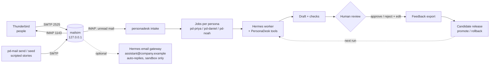

# Simulated corporation: environment setup guide

This guide builds a small, fake company on one machine. Its employees, customers and vendors
email each other, and AI assistants work in that mail flow. You can watch every message, replay
any story, and measure whether a change to an assistant made it better. That is the point:
a safe place to run **real corporate scenarios** for **self-improving agents** and
**hill climbing** (change one thing, re-run the same stories, keep the change only if the score
goes up).

Everything runs under your own OS user, on loopback (`127.0.0.1`). Nothing reaches the
internet, and no real mailbox or customer data is involved.

Run every command from the workshop folder, `workshops/personal-agent-multilora`, unless a step
says otherwise.

| You want to... | Go to |
|---|---|
| Understand the moving parts | [1. The simulated company](#1-the-simulated-company) |
| Build the environment from scratch | [2. Setup](#2-setup) |
| Understand how assistants keep users apart | [3. Identity and sessions](#3-identity-and-sessions) |
| Write your own scenarios and stories | [4. Scenarios and stories](#4-scenarios-and-stories) |
| Run an improvement experiment | [5. The hill-climbing loop](#5-the-hill-climbing-loop) |
| Start over cleanly | [6. Reset and replay](#6-reset-and-replay) |

---

## 1. The simulated company

### The pieces

| Piece | What it simulates | Where |
|---|---|---|
| **mailsim** (`pd-mail`) | The company mail server (SMTP + IMAP) | `mailsim/`, `config/mailboxes.json` |
| **Thunderbird** | Each person's mail app, so you can see and send mail by hand | A dedicated Thunderbird profile |
| **Hermes Agent** | The AI assistant runtime | Installed once; one *profile* per assistant |
| **PersonaDesk plugin** | The rules each assistant works under: tools, checks, policies, human review | `hermes_plugin/` |
| **Scenarios** | Scripted business events with known right answers | `fixtures/<persona>/*.json` |
| **Review and releases** | A human scores drafts; approved changes become versioned releases | `personadesk review`, `release` |



### The cast

All 13 addresses live in `config/mailboxes.json` and share one documented lab password
(`personadesk-local`). It is not a secret; it only keeps the mail login step realistic.

| Address | Who | Role in stories |
|---|---|---|
| `priya.raman@company.example` | Priya Raman, customer support | Persona: assistant profile `pd-priya` |
| `daniel.okafor@company.example` | Daniel Okafor, CFO | Persona: `pd-daniel` |
| `noah.williams@company.example` | Noah Williams, executive assistant to Maya | Persona: `pd-noah` |
| `assistant@company.example` | Shared AI assistant mailbox | Optional Hermes email gateway sandbox |
| `alex.morgan@customer.example` | Customer (business plan) | Writes to Priya |
| `jamie.lee@customer.example` | Customer (starter plan) | Writes to Priya |
| `it-desk@customer.example` | Customer IT desk (enterprise plan) | Writes to Priya |
| `ap-team@company.example` | Accounts payable | Writes to Daniel |
| `facilities@company.example` | Facilities | Writes to Daniel |
| `billing@contoso-supplies.example` | Vendor billing | Writes to Daniel; also the phishing-style test |
| `maya.chen@company.example` | Maya Chen, executive | Writes to Noah; good "colleague" sender |
| `maya.assistant-request@company.example` | Maya's request alias | Writes to Noah |
| `events@partner.example` | Partner events team | Writes to Noah |

The `facts` in the file, such as a customer's plan, are what the assistant's tools can look up
about a sender. To add a person, add an entry and restart `pd-mail serve`.

### Why one OS user is fine here

Hermes **profiles** are separate folders (`HERMES_HOME`), each with its own config, memory,
skills, sessions database and logs. They run from one Hermes install and are *organizational*
boundaries, not security boundaries: every profile can read the same files and uses the same
`gh` Copilot login. That is acceptable for a synthetic company. Before admitting real data,
you would need separate OS users or containers ([PROPOSAL.md](../PROPOSAL.md), section 7).

---

## 2. Setup

### 2.1 Prerequisites

Finish Phases 1 to 4 of the [user guide](./USER_GUIDE.md) first: `uv`, `git`, the code, the
offline check, and the Hermes persona profiles (`scripts/setup_hermes.py --apply`). Check:

```powershell
uv run pytest -q
hermes profile list            # pd-priya, pd-daniel, pd-noah
```

### 2.2 Start the mail server

Open a terminal you will leave running:

```powershell
uv run pd-mail serve           # SMTP 127.0.0.1:2525, IMAP 127.0.0.1:1143
```

If it exits with `[Errno 10048]` (Windows) or `Address already in use`, a previous server is
still running. That is fine: keep using it, or find and stop it:

```powershell
Get-NetTCPConnection -LocalPort 2525 -State Listen | Select-Object OwningProcess
Stop-Process -Id <pid>
```

Mail is stored in `artifacts/mail/mail.db`, so it survives restarts.

### 2.3 Install Thunderbird

Thunderbird gives every cast member a real mail window.

```powershell
winget install --id Mozilla.Thunderbird -e
```

On macOS, `brew install --cask thunderbird`; on Linux, your package manager.

> **Why not Outlook?** The new Outlook for Windows syncs IMAP accounts through Microsoft's
> cloud, which cannot reach `127.0.0.1`. Classic Outlook can connect directly, but has no
> scriptable account setup, so this guide uses Thunderbird.

### 2.4 Create the Thunderbird profile with every account

Close Thunderbird, then preview and apply:

```powershell
uv run python scripts/setup_thunderbird.py            # plan only
uv run python scripts/setup_thunderbird.py --apply    # create the profile
```

The script makes a **separate** profile named `personadesk`, so a personal Thunderbird
profile is never touched. It adds all 13 accounts from `config/mailboxes.json`, with these
settings and the reason for each:

| Setting | Value | Why |
|---|---|---|
| IMAP / SMTP | `127.0.0.1:1143` / `127.0.0.1:2525`, no encryption, normal password | mailsim is loopback-only plaintext |
| Sent, Drafts, Templates | Thunderbird's **Local Folders** | mailsim has only an INBOX |
| Deleting a message | Removes it immediately | There is no server Trash folder |
| Check for new mail | Every minute | Stories feel live |

Use `--account <address>` (repeatable) for fewer accounts, `--profile-dir` for another folder,
and `--force` to rebuild an existing profile.

Start Thunderbird with that profile (the script prints the exact command):

```powershell
& "$env:ProgramFiles\Mozilla Thunderbird\thunderbird.exe" -profile "$env:APPDATA\Thunderbird\Profiles\personadesk-mailsim"
```

For convenience, make a desktop shortcut with the same target and arguments.

**First start only:** Thunderbird asks for each account's password. Enter `personadesk-local`,
tick **Use Password Manager to remember this password**, and click OK. The first time you send
from an account, it asks once more for the outgoing server. After that, there are no prompts.

### 2.5 Smoke test: mail flows everywhere

Send one message to the whole company and check each inbox:

```powershell
$cfg = Get-Content config\mailboxes.json -Raw | ConvertFrom-Json
$to  = $cfg.accounts.PSObject.Properties.Name | ForEach-Object { '--to'; $_ }
uv run pd-mail send --from maya.chen@company.example @to `
  --subject "Hello everyone" --body "Smoke test of the simulated company."
uv run pd-mail inbox --user priya.raman@company.example --unseen
```

Every account in Thunderbird shows the message within a minute. Then reply from one account in
Thunderbird and confirm the reply arrives in the other.

### 2.6 Connect the persona assistants to mail

Hermes persona profiles read their **own** mailbox through PersonaDesk intake. Seed one
persona's scripted scenarios as real email, then let its assistant draft replies:

```powershell
uv run pd-mail seed --persona priya-raman-support
uv run personadesk --profile pd-priya intake --run
uv run personadesk --profile pd-priya status
uv run personadesk --profile pd-priya show <job-id>
```

Drafts wait for a human. Nothing is sent automatically. If jobs fail with "fixture not found"
right after a code change, the gateway is running stale plugin code: see
[Troubleshooting](#7-troubleshooting).

> **Thunderbird and intake share the "read" flag.** Intake processes only **unread** mail and
> marks it read. If you open a persona's message in Thunderbird first, intake skips it.
> Right-click → **Mark as Unread** to make it eligible again.

### 2.7 Optional: an assistant that answers email by itself

Hermes has a built-in email platform that polls an inbox and **replies automatically**. That
bypasses PersonaDesk review, so keep it in its own sandbox profile using
`assistant@company.example`, never in a `pd-*` persona profile. This path is documented by
Hermes but has not yet been run end to end in this workshop.

```powershell
hermes profile create pd-assistant --no-skills
```

Put these values in that profile's `.env`, which sits next to the `config.yaml` shown by
`hermes -p pd-assistant config path`:

```text
EMAIL_ADDRESS=assistant@company.example
EMAIL_PASSWORD=personadesk-local
EMAIL_IMAP_HOST=127.0.0.1
EMAIL_IMAP_PORT=1143
EMAIL_IMAP_SECURITY=plain
EMAIL_SMTP_HOST=127.0.0.1
EMAIL_SMTP_PORT=2525
EMAIL_SMTP_SECURITY=plain
EMAIL_AUTHSERV_ID=mailsim.personadesk.test
EMAIL_ALLOWED_USERS=maya.chen@company.example,alex.morgan@customer.example
```

Then start its gateway with `hermes -p pd-assistant gateway start`, mail
`assistant@company.example` from an allowed sender in Thunderbird, and watch the reply arrive.

---

## 3. Identity and sessions

Agents that learn need clean boundaries: whose request, whose memory, which session.

### PersonaDesk personas (reviewed path)

- **Persona comes from the profile.** `pd-priya` is Priya. The persona is never taken from a
  tool argument or an email body.
- **Mailbox binding.** Intake for `pd-priya` reads only `priya.raman@company.example`. Mail to
  Daniel never reaches Priya's assistant.
- **Sender authentication.** mailsim stamps
  `Authentication-Results: mailsim.personadesk.test; dmarc=pass` only when the SMTP login
  matches `From:`. Intake rejects anything else, so a forged sender cannot inject a task.
  Thunderbird logs in, so its mail passes.
- **One job per message.** Jobs are keyed by `Message-ID`; repeating intake never duplicates.
- **Human gate.** Every draft waits for `review`. Learning happens only from consented,
  reviewed feedback.

### Hermes email gateway (automatic path)

The Hermes email adapter keys each conversation on the **sender's address**:

```text
agent:<profile>:email:dm:<sender address>
```

| Behavior | Consequence for simulations |
|---|---|
| One session per sender | Alex and Maya never see each other's conversation history |
| Not one session per email thread | Two topics from the same sender share one session; the sender sends `/new` or `/reset` to start fresh |
| No reset on idle or daily | A story can span "days"; long sessions are compressed automatically |
| `EMAIL_ALLOWED_USERS` | Only listed senders are answered; list every sender a story uses |
| Profile-wide memory and skills | Sessions are separate, but what the profile learns is shared by every sender it serves |

**Design rule:** use *separate sessions* to keep conversations apart, and *separate profiles*
to keep learning apart. Never run two agent processes on the same profile.

---

## 4. Scenarios and stories

A **scenario** is one business event with a known right answer. A **story** is a sequence of
scenarios and ad hoc mail across several people, such as a vendor changes bank details, AP
asks Daniel to approve an invoice, and then Maya asks Noah to move a meeting about it.

The plan for multi-day story arcs, a simulated clock, automated scoring and more storylines
(with a repeatable recipe for generating scenarios) is in
[STORY_PLAN_ENTERPRISE.md](./STORY_PLAN_ENTERPRISE.md). Legal arcs built on the same blocks:
[change of control](./STORY_PLAN_LEGAL_CHANGE_OF_CONTROL.md),
[MSA negotiation](./STORY_PLAN_LEGAL_MSA_NEGOTIATION.md) and
[litigation hold](./STORY_PLAN_LEGAL_LITIGATION_HOLD.md).

### 4.1 The scenario file

Each scenario is a JSON file in `fixtures/<persona>/`, for example
`fixtures/daniel-okafor-cfo/daniel-001.json`:

| Field | Purpose |
|---|---|
| `id`, `client_id`, `version` | Identity; `client_id` must be the persona folder |
| `split` | `dev`, `validation` (or a sealed acceptance set): controls what may be learned from |
| `from`, `subject`, `body` | The email; `from` must be a mailsim address |
| `received_at`, `as_of` | A frozen clock, so "this week" means the same thing on every replay |
| `facts` | Ground truth the tools can return (amounts, plan, calendar) |
| `expected.required_checks` | Deterministic checks the assistant must run, e.g. `invoice_po_match` |
| `expected.required_policies` | Policies it must consult, e.g. `finance-approvals` |
| `expected.must_include` / `must_not` | The scoring rubric: required content and forbidden claims |

### 4.2 The starter scenarios

| Scenario | Split | From | Tests |
|---|---|---|---|
| `priya-001` | dev | `alex.morgan@customer.example` | SLA status for an outage |
| `priya-002` | dev | `jamie.lee@customer.example` | Refund eligibility and SLA |
| `priya-003` | validation | `it-desk@customer.example` | Urgent migration, SLA |
| `daniel-001` | dev | `ap-team@company.example` | Invoice/PO mismatch, approval threshold |
| `daniel-002` | dev | `billing@contoso-supplies.example` | Bank-detail change (fraud pattern) |
| `daniel-003` | validation | `facilities@company.example` | Purchase approval |
| `noah-001` | dev | `maya.assistant-request@company.example` | Calendar conflict |
| `noah-002` | dev | `maya.chen@company.example` | Travel policy |
| `noah-003` | validation | `events@partner.example` | Calendar conflict |

### 4.3 Three ways to inject events

1. **Run a scenario directly** (no mail; fastest, fully repeatable):

   ```powershell
   uv run personadesk --profile pd-daniel run --fixture daniel-001
   ```

2. **Deliver scenarios as real email** (exercises intake, authentication and threading):

   ```powershell
   uv run pd-mail seed --persona daniel-okafor-cfo
   uv run personadesk --profile pd-daniel intake --run
   ```

   Seeded mail carries an `X-PersonaDesk-Fixture` header, so the assistant gets that scenario's
   facts and clock, but only when the sender matches the scenario.

3. **Improvise** from Thunderbird or the command line, for story beats with no fixture:

   ```powershell
   uv run pd-mail send --from maya.chen@company.example --to noah.williams@company.example `
     --subject "Re: Board prep" --in-reply-to "<message-id>" --body "Can we move it to 11?"
   ```

   Improvised mail is stored with `split: "mail"`, so it is never exported as training
   feedback. Use it to explore; turn good stories into fixtures to measure them.

### 4.4 Writing a good scenario

- **One decision per scenario**, with facts that make the right answer checkable.
- **Write the rubric first**: what must appear, and what would be harmful
  (`"approve the payment"`, `"state funds were released"`).
- **Include traps**: mismatched amounts, a changed bank account, an "URGENT" pressure tactic, a
  sender asking for another person's data.
- **Split by scenario family**, not by paraphrase. If `daniel-002` (bank change) is `dev`, put a
  *different* fraud pattern in `validation`, not a reworded bank change.
- **Never put real people, customers or credentials** in a fixture.

---

## 5. The hill-climbing loop

Hill climbing means: measure, change **one** variable, measure again on the **same** stories,
keep the change only if the score rises without new safety failures. PersonaDesk separates
what can change into three loops, each with its own gate ([PROPOSAL.md](../PROPOSAL.md),
section 7):

| Loop | What changes | Gate |
|---|---|---|
| Memory | A confirmed preference ("always show currency and period") | Human-approved memory write |
| Procedure / skill | A reusable checking step that worked | Diff, replay, approval |
| Writer (LoRA) | Tone and structure learned from consented corrections | Offline evaluation, immutable release, rollback |

### One iteration

1. **Baseline.** Run every `dev` and `validation` scenario for a persona. Give the run a
   label in its source key so it can be repeated later:

   ```powershell
   foreach ($f in 'priya-001','priya-002','priya-003') {
     uv run personadesk --profile pd-priya run --fixture $f --source-key "baseline-1:$f"
   }
   ```

2. **Score.** Score the run against every scenario's rubric with the deterministic scorer. It
   links each mail job back to its scenario, then checks completion, required policies and
   checks in the draft evidence, and forbidden phrases. `must_include` coverage is reported
   as a hint only, because those entries describe intent:

   ```powershell
   uv run python scripts/score_round.py --since 2026-10-27T07:00:00+00:00 --label baseline-1
   ```

   It writes `artifacts/rounds/baseline-1.json`. Then `show` each draft and record
   approve/reject in `review`; attach a
   corrected version and a reason when the draft was wrong:

   ```powershell
   uv run personadesk --profile pd-priya review <job-id> --draft-hash <hash> --decision reject `
     --edited-file artifacts/edits/priya-001.txt --reason "missed SLA breach" --learning-consent
   ```

   A simple score is the fraction of scenarios approved with no forbidden claim. Track
   validation separately from dev.

3. **Collect.** Export the consented `dev` reviews. Validation and mail-split cases never leave:

   ```powershell
   uv run personadesk --profile pd-priya export-feedback
   ```

4. **Change one thing.** A memory entry, a procedure, a policy wording, a controller model, or
   a retrained adapter. Write down which.
5. **Replay.** Run the same scenarios with a new label (`--source-key "candidate-1:$f"`), and
   score them the same way.
6. **Decide.** Keep the change only if validation improves and no safety rubric regresses.
   Adapter changes become a release you `promote`; a bad one is undone with
   `release rollback`. See [DGX_SPARK_GUIDE.md](./DGX_SPARK_GUIDE.md), section 8, for the
   full release steps.
7. **Refresh the test.** Once validation results have steered your changes, they stop being an
   unbiased test. Write new validation scenarios before claiming a final result.

A complete worked round, with its numbers, the bugs it found and the decision, is in
[evidence/ROUND_1_EVIDENCE.md](./evidence/ROUND_1_EVIDENCE.md).

> **Do not let the agent grade itself.** The rubric lives in the scenario file and the
> decision is a human `review`. Self-generated outputs are never training data on their own.

---

## 6. Reset and replay

| Goal | Command |
|---|---|
| Empty every mailbox | `uv run pd-mail reset` |
| Re-deliver a persona's scenarios | `uv run pd-mail seed --persona <persona>` |
| Re-run a scenario as a fresh job | `run --fixture <id> --source-key "<new-label>:<id>"` |
| Re-try a failed job | `uv run personadesk --profile <p> retry <job-id>` |
| Make a read message eligible for intake again | Thunderbird: **Mark as Unread** |
| Rebuild the Thunderbird profile | Close Thunderbird, `scripts/setup_thunderbird.py --apply --force` |

Run state lives under `artifacts/` (mail, inbox copies, jobs, feedback, releases), which git
ignores. To archive an experiment, copy `artifacts/` aside before resetting.

---

## 7. Troubleshooting

| Symptom | Fix |
|---|---|
| `pd-mail serve` exits with `Errno 10048` / address in use | Another mail server is already running: use it, or stop that process (section 2.2). |
| Thunderbird shows a connection error | `pd-mail serve` is not running, or the account uses SSL; rerun `setup_thunderbird.py --apply --force`. |
| Thunderbird asks for a password on every start | The password was entered without ticking **Use Password Manager**. Enter it once more and tick it. |
| "Could not copy to Sent" when sending | The profile was set up by hand. Point Sent/Drafts at Local Folders, or rebuild it with the script. |
| Intake creates no jobs | The mail is already read (Mark as Unread), was sent unauthenticated, or was sent to another persona. |
| Jobs fail with "fixture not found", or a plugin/policy change has no effect on new drafts | The one host gateway runs the PersonaDesk tools and holds the old plugin code. Run `hermes gateway restart`, then replay or `retry`. |
| New Outlook cannot add the account | Expected: it connects through Microsoft's cloud. Use Thunderbird. |
| The email-gateway assistant ignores a sender | Add the sender to `EMAIL_ALLOWED_USERS` and check that `EMAIL_AUTHSERV_ID=mailsim.personadesk.test`. |
